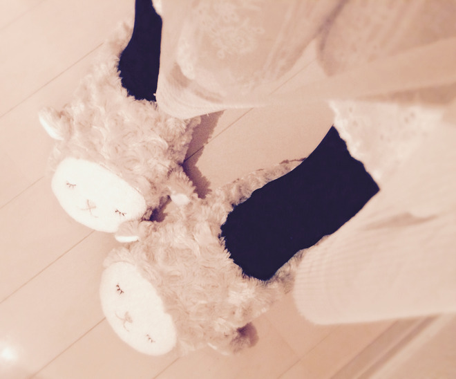
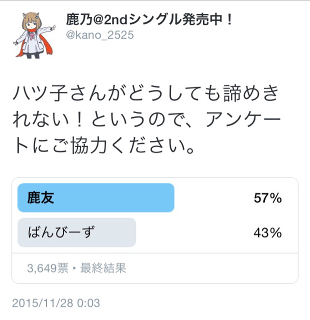

# ブログのタイトルつけるの難しくないですか？

- Published: 2015-11-29T03:52:27+0900
- Original URL: http://lineblog.me/kano/archives/1809135.html
- Wayback snapshot: 20170323081109
- Source HTML: ../data/pages/20170323081109_ETNK5JBJEV6GGSSS4XIDOUAJE6RSOHYG_lineblog.me_80_kano_archives_2015-11.html.html

こんばんは、鹿乃です

[Image source](https://parts.lineblog.me/img/emoji/3/ic_biccuri02.png)

今日の夜もとても寒いのでお出掛けする人もそうでない人もあたたかい格好をしましょう。靴下はくだけでもだいぶ違うよ〜足元ぽかぽかぬくぬく幸せ☃

[Image source](http://line.blogimg.jp/kano/imgs/9/6/968aedac.jpg)

羊さんのルームシューズ〜あったかい〜♪

むかーし、ツイッターでも呟いたのですが差し入れでいただいたチワワのリボンつきiphoneケースがありまして、大事に大事にずっと使っていたのですがリボンのところが壊れちゃって…涙涙涙

せっかくくれたのにごめんなさい！て謝りたかったのですが、先日のイベントに遊びにきてくれて！！謝ることもできたし、またこんな可愛い羊さんもいただいちゃって（恐縮です💦）鹿乃はとても嬉しいです。

昔から応援してくれてる人にも、最近はじめましてをしてくださった人にもまたいつかどこかでお会いしたいですね。ネットが発達している時代なので直接じゃなくても、放送とかツイッターとか！ブログのコメントとかね！

昨日投稿したブログに反応して、好きなもの、ハマっているもの、趣味をたくさんみんなが教えてくれて嬉しかったです。なにそれ！初耳！というやつはググッてみたり…笑

知らないものってまだまだいっぱいあって、意図せずこうしてみんなから教えてもらって出会ったものって記憶に残りますよね〜なんだか素敵で鹿乃は好きだなと思いました。

[Image source](http://line.blogimg.jp/kano/imgs/c/4/c4b4e89f.jpg)

＼ どおおおおん ／

あ、ああああ、アンケートの結果が意外といい勝負だったから内心焦ってたなんて、そんなことないよ…！笑

先日の放送を観てない方はなんのこっちゃな感じだと思うのですが、ざっくり言うと鹿乃好きな友達を見つけやすいように作った名称？ハッシュタグ的なものです。

#鹿友  ← をつけてツイッターで呟いたり、呟いている人を見つけて「お！この人なかなか気が合いそうかも。友達になりたいかも」な人がいたらはじめましてのご挨拶をして徐々に仲良く…！

なんて目的のものですね。別にグループ？を作ろう的なものではないです笑

知らぬ間に、予想外に広がりを見せている鹿友ですがみんなが楽しそうにしてて鹿乃は羨ましいぞ〜！

てなわけで、ここからは少し堅苦しい鹿乃からのお願いごとですっ

！親しき仲にも礼儀あり！

を、絶対に絶対に忘れないで活用する人は活用してください。反対に活用して楽しんでる人を活用しない人が揶揄するような発言をして嫌な気持ちにさせたりもしないで欲しいな〜〜と（´-\`）

きっと、大丈夫だろう！とみんなを信じてのプチイベント？なので、えーっと信じてますよ？！？！？！

色々無理して、疲れて、楽しくなくなって…じゃ、あまりにも悲しいですし、なにより鹿乃は心配性なので物凄くみんなのことを心配しちゃいます！

口うるさくいっぱい言っちゃってごめんなさい

[Image source](https://parts.lineblog.me/img/emoji/3/ic_asease.png)

そんなこんなで使う人は使う、使わない人は使わない！な「#鹿友」をよろしく？ね^o^♪

鹿乃
