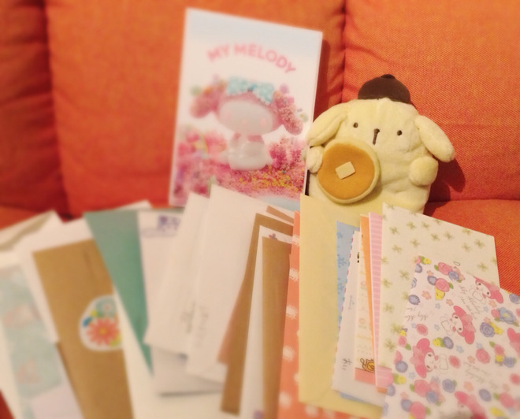

# さよなら2015年。よろしく2016年！

- Published: 2016-01-15T19:07:06+0900
- Original URL: http://lineblog.me/kano/archives/3067350.html
- Wayback snapshot: 20170323074050
- Source HTML: ../data/pages/20170323074050_GOWUS54EMVAJD7OGTZMTN4SXIHUM6Z5U_lineblog.me_80_kano_archives_2016-01.html.html

あけましておめでとうございます。

お久しぶりです、鹿乃です

[Image source](https://parts.lineblog.me/img/emoji/3/ic_biccuri02.png)

2015年の最終日に骨を折り、新年早々お財布を落とし…鹿乃はわりと踏んだり蹴ったりな日々でしたが、みなさんは最近いかがお過ごしですか？

また一段と寒くなってきたので風邪に注意でお過ごしください☃

鹿乃は冬コミでいただいたお手紙で心を、紅茶で体内を、ぽかぽか靴下で足元を、マフラーで首もとを温めて完璧です。

[Image source](http://line.blogimg.jp/kano/imgs/d/c/dcc96617.jpg)

お礼が遅くなってしまいましたが冬コミ遊びにきてくれた方、おうちから応援してくださった方、本当にありがとうございました！

2016年も不束な鹿乃ですが、どうぞよろしくお願いいたしますm(\_ \_)m

新譜「メリー」の通販はアニメイトさんと虎の穴さんでそろそろはじまると思います。各店舗、通販サイトをご利用してゲットしてください…！

トートバッグについてはツイッターでも言いましたが、前向きに再販を検討して準備をしています。今度は通販ぶんもちゃんと考えて諸々してます。もう少々お待ちください汗

そんなこんなで2016年もよろしくお願いします。どんな年になるかな〜〜みんなといっぱい一緒に何かを楽しめる年にしたいな(*^◯^*)

みんなはどんな年にしたいですか？よかったら教えてください。

[Image source](http://line.blogimg.jp/kano/imgs/7/e/7ee4fdda.jpg)

鹿乃
