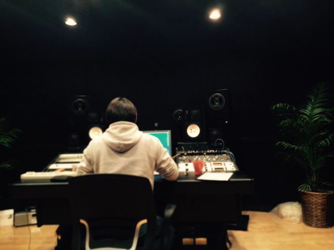

# 1stアルバム発売と……ライブ！

- Published: 2016-03-12T16:56:06+0900
- Original URL: http://lineblog.me/kano/archives/4568562.html
- Wayback snapshot: 20170323080417
- Source HTML: ../data/pages/20170323080417_RYCJNPWLC5RS72KENI3BHZFWJXBE6KCH_lineblog.me_80_kano_archives_2016-03.html.html

こんばんは、鹿乃です

[Image source](https://parts.lineblog.me/img/emoji/3/ic_pikapika.png)

5/11 鹿乃1stアルバム「nowhere」発売決定！

[Image source](http://www.amazon.co.jp/%E3%80%8Cnowhere%E3%80%8D-lt-%E7%B5%B5%E6%9C%AC%E4%BB%98%E7%94%9F%E7%94%A3%E9%99%90%E5%AE%9A%E7%9B%A4-gt-%E9%B9%BF%E4%B9%83/dp/B01CSANBYQ%3FSubscriptionId%3DAKIAIM37F4M6SCT5W23Q%26tag%3Dlvdrfree-22%26linkCode%3Dxm2%26camp%3D2025%26creative%3D165953%26creativeASIN%3DB01CSANBYQ)

[「nowhere」 [CD]](http://www.amazon.co.jp/%E3%80%8Cnowhere%E3%80%8D-lt-%E7%B5%B5%E6%9C%AC%E4%BB%98%E7%94%9F%E7%94%A3%E9%99%90%E5%AE%9A%E7%9B%A4-gt-%E9%B9%BF%E4%B9%83/dp/B01CSANBYQ%3FSubscriptionId%3DAKIAIM37F4M6SCT5W23Q%26tag%3Dlvdrfree-22%26linkCode%3Dxm2%26camp%3D2025%26creative%3D165953%26creativeASIN%3DB01CSANBYQ)

鹿乃

2016-05-11

[Image source](http://www.amazon.co.jp/%E3%80%8Cnowhere%E3%80%8D-lt-%E9%80%9A%E5%B8%B8%E7%9B%A4-gt/dp/B01CSANBWS%3FSubscriptionId%3DAKIAIM37F4M6SCT5W23Q%26tag%3Dlvdrfree-22%26linkCode%3Dxm2%26camp%3D2025%26creative%3D165953%26creativeASIN%3DB01CSANBWS)

[「nowhere」 [CD]](http://www.amazon.co.jp/%E3%80%8Cnowhere%E3%80%8D-lt-%E9%80%9A%E5%B8%B8%E7%9B%A4-gt/dp/B01CSANBWS%3FSubscriptionId%3DAKIAIM37F4M6SCT5W23Q%26tag%3Dlvdrfree-22%26linkCode%3Dxm2%26camp%3D2025%26creative%3D165953%26creativeASIN%3DB01CSANBWS)

鹿乃

2016-05-11

7/2 鹿乃1stライブ

「ばんび〜の」開催決定！

上記のことが先日の公式放送で発表されました。

骨折したり財布落としたり物を壊したり、コミカル不幸ネタばかりを今年になってから提供してきましたが、ちゃんとしたご報告ができてよかったです。

FM-FUJIさんのレギュラーラジオ「ばんび〜のラジオ！」を聞いてくださっている方には散々におわせていたので裏で何かをしてるってことはバレバレだったかもしれませんね笑

アルバムとライブの詳細は鹿乃公式HPをご覧ください。私が説明するより確実です。

http://whv-amusic.com/kano/

[Image source](http://line.blogimg.jp/kano/imgs/7/2/72032409.jpg)

今日も今日とてアルバム制作！2ndシングルからお世話になっているエンジニアのMさんの背中に向けて両手を合わせております。

毎回毎回、録音中に歌詞間違いを誤魔化すために奇声をだしてすみません（土下座）

ちなみに今日はゆうゆさんが書き下ろしてくださった曲のレコーディングをしてます

[Image source](https://parts.lineblog.me/img/emoji/3/ic_pikapika.png)

ラスサビ前の間奏がね、すごく好き。すごくすごく最高！綺麗な異国に旅立ちたくなります。探さないでください。

サビも歌っててとても気持ちいいのでみんなにも歌って味わって欲しいです。

まったく歌とは関係ないお話なのですが、ハードスケジュールがしばらく続くため安らぎのゲーム時間を削っている鹿乃氏、ゆうゆさんに面白いゲーム話をしていただいたので欲望がほんのり満たされたもようです。

みんなもおすすめのゲームあったら是非教えてください！いやでも、教えられたらやりたくなって悶々としちゃうのかな…？！

というわけで、2016年も他の人から比べるとのろのろに見えてしまうかもしれませんが地味に活動していくので引き続きよろしくお願いしますーーー！

鹿乃
