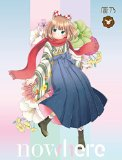
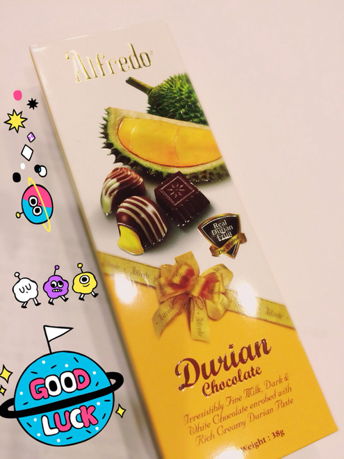

# もももも、も！！

- Published: 2016-05-03T14:38:20+0900
- Original URL: http://lineblog.me/kano/archives/6010161.html
- Wayback snapshot: 20160505175415
- Source HTML: ../data/pages/20160505175415_AARNMRFNDDNAAQGSCZQNCMWIHYXJTBMJ_lineblog.me_80_kano.html

申し訳ございませんでした！

機械音痴炸裂してカウントダウン開始2日にしてブログ記事更新されず…笑

予約投稿なんて慣れないことはするもんじゃありませんね。鹿乃はまたひとつ賢く？なりました。

というわけで、アルバム発売まであと……8日！今日も収録曲についてはもちろん、最後に深みのまったくない鹿乃のプライベートなお話をしていこうと思います。

<iframe width="480" height="360" src="https://www.youtube.com/embed/GNkPJvVEm0s?rel=0" title="嵌入视频" frameborder="0" allow="accelerometer; autoplay; clipboard-write; encrypted-media; gyroscope; picture-in-picture; web-share" allowfullscreen loading="lazy"></iframe>

<video controls preload="metadata" src="../media/5deac0f60979.mp4"></video>

> [!video] YouTube
> 
>
> [播放原视频](https://www.youtube.com/watch?v=GNkPJvVEm0s) · [查看网页存档](https://web.archive.org/web/20160505175415/https://www.youtube.com/watch?v=GNkPJvVEm0s)
>
> [封面来源](https://i.ytimg.com/vi/GNkPJvVEm0s/hqdefault.jpg)

アルバム収録曲2曲目は、鹿乃にとってはじめての連続だったこの曲「Stella-rium」ですφ(｡\_｡\*)

実は実は「Stell-rium」というタイトルも鹿乃がつけさせていただいたものだったんです。

プラネタリウムやアクアリウムのような感覚で「星のための場所、星をみるための場所」的な名付けになっております。なってると、いいな…φ(｡\_｡\*)

![放課後のプレアデス 第一巻〈初回限定生産版〉 [Blu-ray]](../media/7127b72a8789.jpg)

[Image source](http://ecx.images-amazon.com/images/I/51QWD808nHL._SL160_.jpg)

[放課後のプレアデス 第一巻〈初回限定生産版〉 [Blu-ray] [Blu-ray]](http://www.amazon.co.jp/%E6%94%BE%E8%AA%B2%E5%BE%8C%E3%81%AE%E3%83%97%E3%83%AC%E3%82%A2%E3%83%87%E3%82%B9-%E7%AC%AC%E4%B8%80%E5%B7%BB%E3%80%88%E5%88%9D%E5%9B%9E%E9%99%90%E5%AE%9A%E7%94%9F%E7%94%A3%E7%89%88%E3%80%89-Blu-ray-%E9%AB%98%E6%A3%AE%E5%A5%88%E6%B4%A5%E7%BE%8E/dp/B00W1HF5DM%3FSubscriptionId%3DAKIAIM37F4M6SCT5W23Q%26tag%3Dlvdrfree-22%26linkCode%3Dxm2%26camp%3D2025%26creative%3D165953%26creativeASIN%3DB00W1HF5DM)

2015-06-24

アニメ「放課後のプレアデス」の主題歌になっているこちらの楽曲！ぜひ、アニメともどもよろしくお願いします。アニメを全部観終わってから聴くと、うわあああんってなります。うわあああん！

個人的な欲望なのですが、プレアデス星人のぬいぐるみ再販しないかな〜〜ってずっと淡い期待を捨てきれずにもっております。大きいの買いたい。

[Image source](http://ecx.images-amazon.com/images/I/51eVw0AhK-L._SL160_.jpg)

[【早期購入特典あり】nowhere(メーカー特典:オリジナルポストカード(汎用ver.)) [CD]](http://www.amazon.co.jp/%E3%80%90%E6%97%A9%E6%9C%9F%E8%B3%BC%E5%85%A5%E7%89%B9%E5%85%B8%E3%81%82%E3%82%8A%E3%80%91nowhere-%E7%B5%B5%E6%9C%AC%E4%BB%98%E7%94%9F%E7%94%A3%E9%99%90%E5%AE%9A%E7%9B%A4-%E3%83%A1%E3%83%BC%E3%82%AB%E3%83%BC%E7%89%B9%E5%85%B8-%E3%82%AA%E3%83%AA%E3%82%B8%E3%83%8A%E3%83%AB%E3%83%9D%E3%82%B9%E3%83%88%E3%82%AB%E3%83%BC%E3%83%89-%E6%B1%8E%E7%94%A8ver/dp/B01DSN3MU0%3FSubscriptionId%3DAKIAIM37F4M6SCT5W23Q%26tag%3Dlvdrfree-22%26linkCode%3Dxm2%26camp%3D2025%26creative%3D165953%26creativeASIN%3DB01DSN3MU0)

鹿乃

2016-05-11

昨日は文化放送さんの「THE CATCH」にお邪魔させていただきましたー！

生ichigoさん、分島さんは美人で優しくてほっこりしておりました。人に気を遣わせずに優しくナチュラルにできる感じ憧れちゃいますね。

またご一緒する機会がありましたらよろしくお願いしますm(\_ \_)m

[Image source](http://line.blogimg.jp/kano/imgs/f/c/fc91a319.jpg)

お写真はだーーーーーいぶ、前に遡りますがお土産にいただいたドリアンチョコ。

私のレギュラーラジオを聞いてくださってる方は「ああ！」てなるかもしれません。そうです、これです。

人生初ドリアン…やばいですね。レッドブルで流し込んではみたものの、やばかったです。なにがってにおい！

においが強烈すぎて、肝心の味が美味しかった気がするのですが記憶に残らない笑

いつか機会があって、好奇心もあったらチャレンジしてみるといいかもしれません。

それでは、鹿乃でした〜〜またね⸜(๑⃙⃘'ᵕ'๑⃙⃘)⸝⋆︎*

鹿乃
