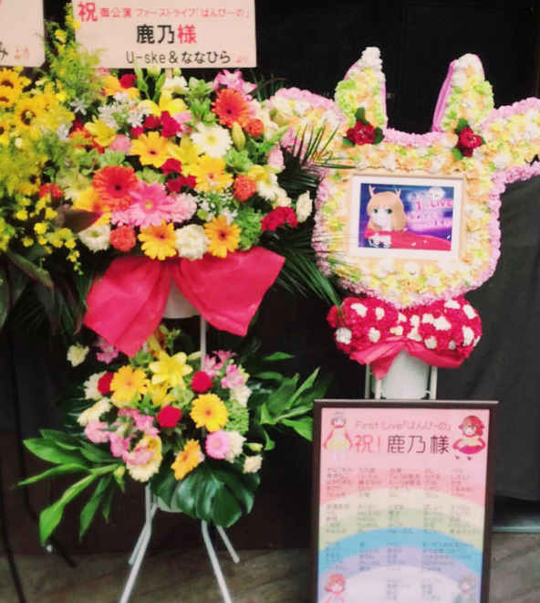

# 72

- Published: 2016-07-21T22:40:14+0900
- Original URL: http://lineblog.me/kano/archives/8573724.html
- Wayback snapshot: 20160808093825
- Source HTML: ../data/pages/20160808093825_VRIDYAHWKGOFCY74GLWAJVWWIDIH5ZII_lineblog.me_80_kano.html

ブログを書いては消し、書いては消し、どうまとめたらひとに読みやすいのかな〜〜と悩んでいましたがそうこうしているうちに8月になってしまう！ということで、勢いに任せポチッと投稿しちゃおうと思います。読みにくいところ多々ありますが許してください( ˊᵕˋ )

[Image source](http://line.blogimg.jp/kano/imgs/d/2/d28f5aff.jpg)

まずは、ライブ本当にお疲れ様でした。かけつけてくださった皆々様、御尽力くださった全ての演者さん、スタッフの皆々様本当にありがとうございました。ライブお留守番になってしまった皆々様には寂しい思いをさせてしまって本当にごめんなさい。

お花やバルーンをくださった皆々様も本当にありがとうございました。とてもきれいで、なによりもお気持ちが嬉しかったです。

株式会社KADOKAWA 電撃文庫編集部 さま

株式会社アニメイト さま

niconico（株式会社ドワンゴ） さま

niconico, animelomix さま

株式会社エフエム富士 さま

ワーナー・ブラザーズ さま

くまのきよみ さま

U-ske & ななひら さま

るな さま

ファン一同 さま

この場をお借りして改めてお礼を言わせてください。ありがとうございました。

さて！ライブ当日の鹿乃はというと「必死」の一言につきまして、あまり記憶がはっきりとはありません。ライブが終わってから一週間はもう誰にも会いたくない〜〜なにもしたくない〜〜というくらい、自分の中のなにかを全て外に押し出しました。

ゴールを決めてそこに走っていくまでというか、体力や精神力がゴールと同時にきれるようなペース配分で色々しているので終わった途端にガクッときます。

テスト勉強とか部活とか、まさにそんな感じでした。大人になっても考え方が変わってきても人間の根っこ？は変わらないもんだなとつくづく思いました。

皆さんはどうでしょうか？所謂「燃え尽きる」ような感じになったりすることはありますか？人によるのかな〜〜

ただ、ほとんど何もはっきり覚えていないとは言いつつ、ライブ会場で光っていたペンライトや空気、目があったときに笑いかけてもらえたこととか、みんなの声とか、お借りしたsamさんのギターの感触とか、そういうのは不思議なもので生々しいくらい覚えています。

たぶん、これからも忘れられないし、ふとした瞬間に思い出すんだろうなあ。

人の笑顔は勇気になるとつくづくみんなの笑顔に救われて思ったので、元気でいてほしいな〜〜と思う人の前では恥ずかしがらずに笑顔でいようと思います。

ではでは、こんな夜遅くに更新ごめんなさいでした🙇🙇🙇

おやすみなさい。

鹿乃
