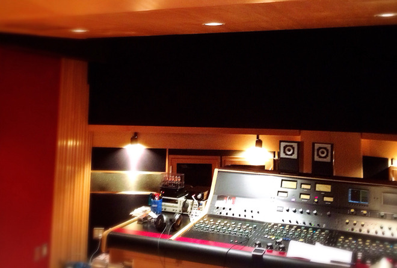
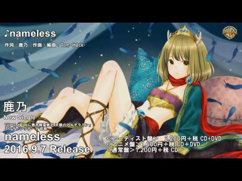

# 近況報告！

- Published: 2016-07-21T18:00:53+0900
- Original URL: http://lineblog.me/kano/archives/8559585.html
- Wayback snapshot: 20160723070425
- Source HTML: ../data/pages/20160723070425_M3CHAXIPK5HMCVDYDPKOGYF5J3TAOVZU_lineblog.me_80_kano_archives_cat_96603.html.html

お久しぶりです、鹿乃です。

[Image source](http://line.blogimg.jp/kano/imgs/2/0/20442a3a.jpg)

現在進行形で9/7発売の3rdシングル「nameless」のマスタリング現場にきています。

<iframe width="480" height="360" src="https://www.youtube.com/embed/XgyuRnAZll0?rel=0" title="嵌入视频" frameborder="0" allow="accelerometer; autoplay; clipboard-write; encrypted-media; gyroscope; picture-in-picture; web-share" allowfullscreen loading="lazy"></iframe>

<video controls preload="metadata" src="../media/bd5e4e693c64.mp4"></video>

> [!video] YouTube
> 
>
> [播放原视频](https://www.youtube.com/watch?v=XgyuRnAZll0) · [查看网页存档](https://web.archive.org/web/20160723070425/https://www.youtube.com/watch?v=XgyuRnAZll0)
>
> [封面来源](https://i.ytimg.com/vi/XgyuRnAZll0/hqdefault.jpg)

[Image source](http://ecx.images-amazon.com/images/I/51LtNSpoYsL._SL160_.jpg)

[nameless [CD]](http://www.amazon.co.jp/nameless-lt-%E3%82%A2%E3%83%BC%E3%83%86%E3%82%A3%E3%82%B9%E3%83%88%E7%9B%A4-gt-%E9%B9%BF%E4%B9%83/dp/B01GU2OOP8%3FSubscriptionId%3DAKIAIM37F4M6SCT5W23Q%26tag%3Dlvdrfree-22%26linkCode%3Dxm2%26camp%3D2025%26creative%3D165953%26creativeASIN%3DB01GU2OOP8)

鹿乃

2016-09-07

視聴動画投稿 & 予約はじまっているのでまだの方は要チェックしてください。

またこちらの楽曲がED主題歌になっているTVアニメ「ねじ巻き精霊戦記 天鏡のアルデラミン」も放送中です。

[http://alderamin.net](http://alderamin.net)

アニメのED主題歌の映像とても素敵なので、ぜひアニメ本編ともども観てください。観よう？！？！

ハッシュタグは「 #alderamin 」ですっ

7月はライブからはじまり、アニメ放送開始、3rdシングルのレコーディングや色々でふと気がつくともう8月の背中が見えてきました。

8月は少し落ち着けそうな予感がしているので、個人的にしたかったあれやこれやをしようかなと思っています。

ライブが終わったあとに書いたもののいつまで経っても投稿されずじまいだったブログを改めて…とか🙇🙇🙇

ちなみにそんなライブの音源が今回のシングルのアーティスト盤についてきます。

Stella-riumのときのみんなのテンションMAXな感じ半端ないっす。嬉しかったな〜〜どんな感じなのかわくわくしていてください( ˊᵕˋ )

アニメ盤には、ヒゲドライバーさんがremixしてくださった「nameless」がついてきます。雰囲気がガラッと変わったremix ver.もぜひ聴いて欲しいです。後半が特にお気に入りですっ

アーティスト盤と通常盤についてくるカップリングのREREは、自分で何回も聴いてしまうくらいには楽曲自体がとても気にいっていて今から聴いて感想いただけるのを心待ちにしています。

そんなこんなで鹿乃でした。またすぐ近いうちにブログでお会いしましょ〜〜〜〜( ˊᵕˋ )

あ、近況報告らしい近況報告ができてな…笑

鹿乃
