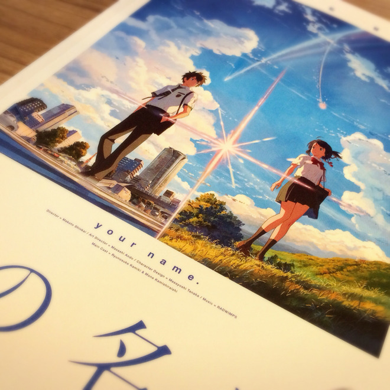

# 映画館って特別な場所ですよねってお話と特典情報！

- Published: 2016-08-30T15:36:49+0900
- Original URL: http://lineblog.me/kano/archives/10049577.html
- Wayback snapshot: 20160908232342
- Source HTML: ../data/pages/20160908232342_ZY7JZX7PNMK2C4QAKMY7DKIHJ2L4AYHJ_lineblog.me_80_kano.html

[Image source](http://line.blogimg.jp/kano/imgs/4/0/4074ef9f.jpg)

こんにちは、鹿乃です！

新海誠監督の新作「君の名は。」を観てきました。写真はパンフレットになります。鹿乃は映画館で観た作品のパンフレットは記念買う派なのですが、みんなはどうですか( ˊᵕˋ* )？

君の名は。はまだまだ公開されたばかりで、感想を書くとそんなつもりじゃなくてもネタバレ！になってしまう可能性があるので今日は控えておきます。

感想はまたいずれどこかで！

来月は「聲の形」も観に行く予定があるので今から楽しみです。

映画館って、なんか特別な空間？というか、ワクワクとかドキドキとか色々つまっているというか、素敵ですよね。

一作品ごとに映画館でみると＋αで思い出になっていく感じ！

みんなは映画館は好きですか？どんな映画が好きですか？おすすめ作品や映画にまつわる思い出話があったらぜひ鹿乃に教えてくださいφ(｡\_｡\*)

✂︎ ------------------------------

ここからは、9月7日発売の鹿乃3rdシングル「nameless」の特典情報についてです！

[Image source](http://line.blogimg.jp/kano/imgs/2/2/2257ebef.jpg)

◆メーカー特典
アーティスト盤を予約、ご購入していただいた方にはランダムで缶バッジが特典でついてきます！種類は全部で3種類です。絵柄は上記の画像を参照ください！

ちなみに鹿乃は居眠りばんびちゃんの絵柄がとてもすきです。みんなはどの缶バッチがすきですか？

対象店舗：アニメイト、とらのあな、TSUTAYA、タワーレコード

アニメ盤・通常盤を予約、ご購入していただいた方にB2両面告知ポスターが特典でついてきます。

対象店舗:アニメイト、ゲーマーズ、とらのあな、ソフマップ、TSUTAYA、タワーレコード、HMV

いよいよシングルも3枚目…慣れる日はくるのかな〜〜くるわけないなって確信するほど今からすでにリリース日が近づいてドキドキしています。感想、リリイベ、色々楽しいことを妄想してこのド緊張を乗り越えていこうと思います( ˊᵕˋ* )

ではでは、鹿乃でしたっ

鹿乃
