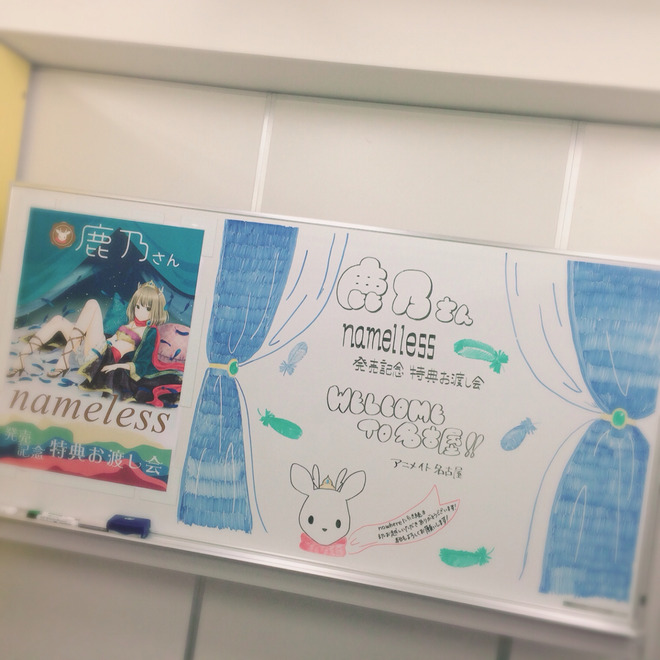
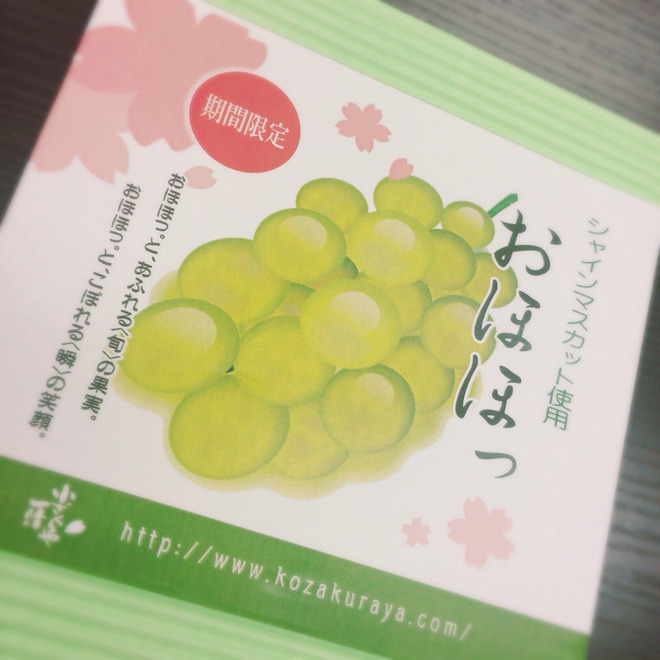
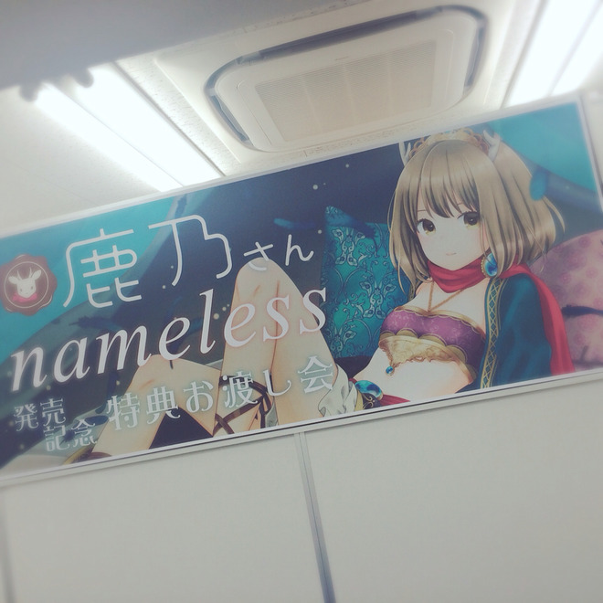
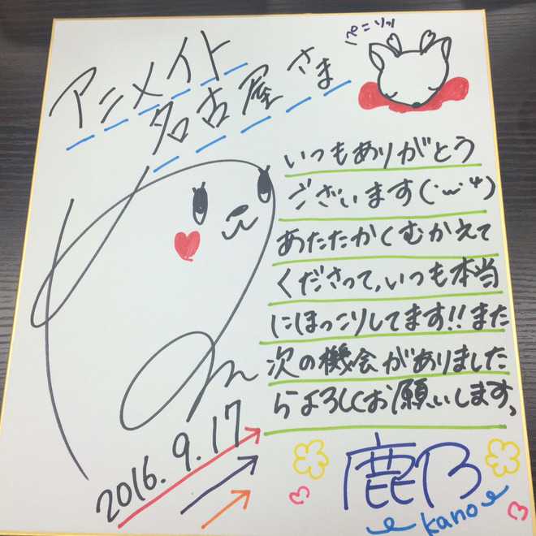

# また会える日まで

- Published: 2016-09-17T19:18:21+0900
- Original URL: http://lineblog.me/kano/archives/10798083.html
- Wayback snapshot: 20160921012139
- Source HTML: ../data/pages/20160921012139_W2PP5KK57EJ3HMAIOMVLUIGAG45SWTT6_lineblog.me_80_kano.html

[Image source](http://line.blogimg.jp/kano/imgs/d/2/d20cc70a.jpg)

名古屋でのリリイベ無事に終了しました！来て下さった皆さま、対応してくださったスタッフさま本当に本当にありがとうございました。

ウェルカムボードのカーテンの塗りの細かさに感嘆しました。楽しみに妄想していた以上のクオリティ〜〜さすがの名古屋魂( ˙◊︎˙◞︎)◞︎

[Image source](http://line.blogimg.jp/kano/imgs/6/8/685963c2.jpg)

楽屋にご用意いただいた

名古屋名物のおほほっ

私の2ndシングル「ディアブレイブ」がEDテーマになっている、アニメ「へヴィーオブジェクト」におほほって名前のキャラがでてくるのでにやっとなりました笑

[Image source](http://line.blogimg.jp/kano/imgs/f/5/f54d0291.jpg)

[Image source](http://line.blogimg.jp/kano/imgs/4/c/4c3d10a5.jpg)

アニメイト名古屋さんでもサイン色紙にサインをさせていただきました。感謝の気持ちを伝えたくて頑張ってたら、なんだかただただ自己主張激しい感じに…笑

名古屋もはじめましての方が多くて、かなりの緊張感が！うまく和ませたり、会話をふれていたらよかったのですが…だ、大丈夫でした？できてなかったらごめんね。

次までにもうちっと話術磨いておくので、また遊びに来てね( ˙◊︎˙◞︎)◞︎

二度目、三度目ましての皆さんもありがとうございます。鹿友ができて一緒に来ました〜て方もちらほらいて楽しんでいただけているようで私は幸せです。幸せな気持ちをおすそ分けしてくれてありがとうね。

鹿乃にいつか飽きて忘れてしまったとしても、私の歌をみんなの何かのキッカケにしてもらえたこと、もらえることが嬉しいです。

たくさんの人の、たくさんのキッカケにずっとなりたいから飽きられないように努力するけどね！笑

namelessはわりとパッと聴いただけだと暗い歌詞で、わりと救いはないぜな内容になってますが「希望」の歌です。色々考えながら聴いてみても楽しいかもφ(｡\_｡\*)

<iframe width="480" height="360" src="https://www.youtube.com/embed/im2tTHtR5YU?rel=0" title="嵌入视频" frameborder="0" allow="accelerometer; autoplay; clipboard-write; encrypted-media; gyroscope; picture-in-picture; web-share" allowfullscreen loading="lazy"></iframe>

<video controls preload="metadata" src="../media/ecc3e9bbd6b0.mp4"></video>

> [!video] YouTube
> 
>
> [播放原视频](https://www.youtube.com/watch?v=im2tTHtR5YU) · [查看网页存档](https://web.archive.org/web/20160921012139/https://www.youtube.com/watch?v=im2tTHtR5YU)
>
> [封面来源](https://i.ytimg.com/vi/im2tTHtR5YU/hqdefault.jpg)

カップリングのREREは毒毒毒毒毒で毒しかないです。でもどうしようもない自分の中の毒を吐き出しきったらそのあとは…ね！笑

<iframe width="480" height="360" src="https://www.youtube.com/embed/l4Rp9GNXhU4?rel=0" title="嵌入视频" frameborder="0" allow="accelerometer; autoplay; clipboard-write; encrypted-media; gyroscope; picture-in-picture; web-share" allowfullscreen loading="lazy"></iframe>

<video controls preload="metadata" src="../media/e3783139dd11.mp4"></video>

> [!video] YouTube
> 
>
> [播放原视频](https://www.youtube.com/watch?v=l4Rp9GNXhU4) · [查看网页存档](https://web.archive.org/web/20160921012139/https://www.youtube.com/watch?v=l4Rp9GNXhU4)
>
> [封面来源](https://i.ytimg.com/vi/l4Rp9GNXhU4/hqdefault.jpg)

色々、自分に当てはめながら聴いて楽しんでデトックスしてください。

さて、ここからは質問にちょろっとお答えしますなコーナー！iphoneの充電がないからサクサクいくぞ〜〜笑

▷ さとくまさんからの質問

どんな秋にしたいですか？

(◉△◉)＜ 大きな声じゃ言えないけど、ゆっくりする秋…笑

▷ タカピさんからの質問

上半期を振り返ってみてどうですか？

(◉△◉)＜ できるかぎりは超頑張ったつもりだけど、まだまだ頑張らなきゃいけないし頑張れたなと反省した上半期でした。年始から8月くらいまで体調度々笑えないレベルで崩してたので健康管理をもっとします。申し訳ない。

▷ 匿名希望さんからの質問

メジャーデビューしてからの嬉しかったこと、悲しかったことは？

(◉△◉)＜ アルバムがオリコンウィークリー11位だったことが嬉しかったなあ。たくさんの人に歌をとどけたいぜえ！アルバムは特に、寂しい気持ちになってる人にとどけたいね。悲しいことは内緒〜暗い気持ちは全部歌にぶちまけます！笑

それではまた会える日まで。

健康にはくれぐれも気をつけてね〜〜じゃあの( ˙◊︎˙◞︎)◞︎

鹿乃
