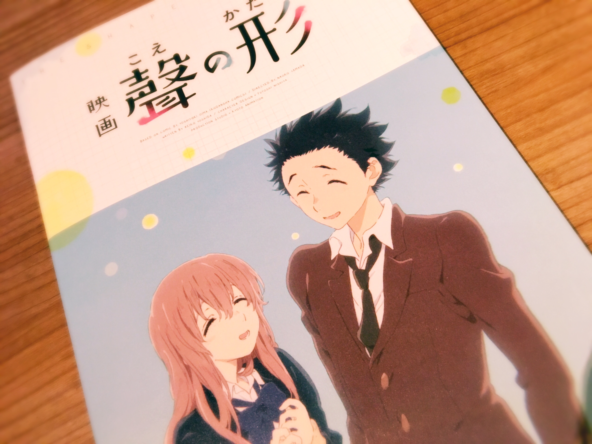

# ただいま！

- Published: 2016-12-14T19:12:13+0900
- Original URL: http://lineblog.me/kano/archives/13099932.html
- Wayback snapshot: 20161215123939
- Source HTML: ../data/pages/20161215123939_TKPOYYN75EMCFELKNVSOBELC7ITSRZEV_lineblog.me_kano_archives_13099932.html.html

お久しぶりです、鹿乃です！

機械音痴を大炸裂させてログイン出来なくなっていた鹿乃なのですが、本日LINEブログにようやく帰ってくることができました(T ^ T)

自分自身よくどんな効果があるかわかっていないのですが、このブログを「フォローする！」みたいな項目が新しくLINEブログに増えていたので是非フォローしてください！！！！！なんかきっといいことがある、はず（＾Ｏ＾）

[Image source](https://obs.line-scdn.net/0m0e0d49afe84d280e363e604c2d7b6b3e6406146b4e10574770026c4569595c610a4041637e417f0c6c5b6c65496a28612922432c76196d003e3b33666d777b1376623c727d1d2f45626f67221c676e38)

9月に観にいくよ〜なんて言いつつ、のびのびになっていた「聲の形」を先日観にいってきました。

ネタバレしたくない、されたくない派なのでどこまで書いていいのかと毎回迷うのですが「観てよかった！」と観終わったあとに私は思いました。

人間の弱くて汚くてズルい部分って観ていてあまり気持ちのいいものじゃなくて、映画だから観れたもののもっと内容がっつり掘り下げられているであろう原作はもしかしたら読めないかもな…なんて思いながら実は観てました(T ^ T)

それくらいいい意味で生々しいえぐさがありました。

感想書くのって照れくさいというか、感情的になりがちなので難しいですね笑

感想に正解もなにもないのはわかりつつ書くの緊張しちゃいますヽ(´o｀；

というわけで、鹿乃でした！

明日か明後日に冬コミのことについてブログ書きます。寒いので風邪に注意だ〜〜

鹿乃
