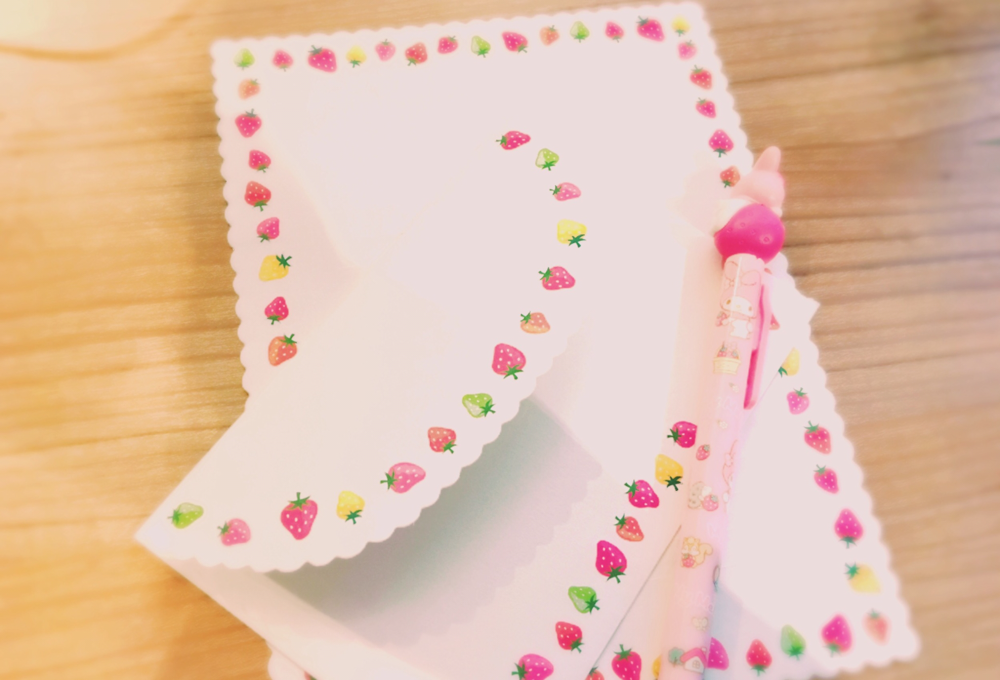

# lyric

- Published: 2017-01-20T11:55:14+0900
- Original URL: http://lineblog.me/kano/archives/13110796.html
- Wayback snapshot: 20170508171112
- Source HTML: ../data/pages/20170508171112_EOQHMMI4XWIAHZ3MEX5SPAQYCT4FL3QL_lineblog.me_kano_archives_13110796.html.html

こんにちは、鹿乃です(*⁰▿⁰*)

今日はお手紙を書いています。

[Image source](https://obs.line-scdn.net/0m0edd26d2e84d280e363e604c2d7b6b3e113a66322128691748326a4a732b64761b5b6e537f427a46405264675b416b672922432c73166a00333c36666d777b1423613d712c407c45626f3d2217333c6e)

手紙を書きつつ、便箋に今書いている歌詞を書きはじめたらいい感じに言葉がでてくるのかな？と思って、歌詞も書きはじめました。

結果は………いつかみんなが今書いている歌詞を聴いたときに心に響いたかどうかで判断してください\_(:3」z)\_

ここ数年は年賀状を書くことがなかったのですが、2017年は形からでもきちんとしよう！と思い今年はお世話になった方に送ってみてました。

照れくさいし、目上の方に失礼じゃない？マナー間違ってない？て年末にドギマギ（´-\`）

みんなも私宛にお手紙書いてるときはこんな気持ちなのかな。すごく緊張するね笑

いつもありがとう。

◆鹿乃2ndライブチケット一般発売中！

> [!link] http://whv-amusic.com/kano/sp/news/index00510000.html
>
> [打开原始链接](http://whv-amusic.com/kano/sp/news/index00510000.html) · [查看网页存档](https://web.archive.org/web/20170508171112/http://whv-amusic.com/kano/sp/news/index00510000.html)

◆ハッシュタグ

#鹿友 #鹿乃ライブ

さむいぞ！太陽さんがんばって！

☀️☀️☀️☀️☀️

鹿乃
