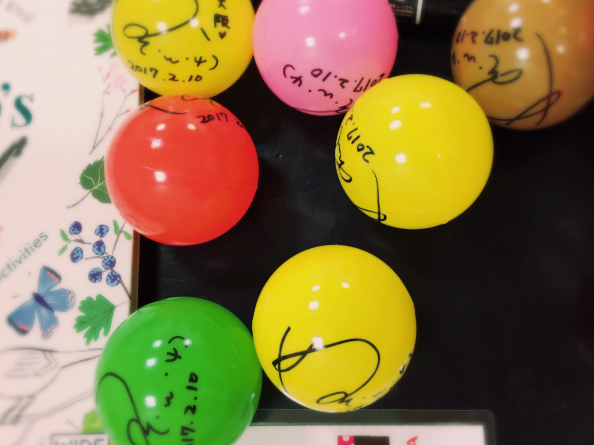

# ライブお疲れ様でした！

- Published: 2017-02-19T13:04:52+0900
- Original URL: http://lineblog.me/kano/archives/13117110.html
- Wayback snapshot: 20170322155730
- Source HTML: ../data/pages/20170322155730_J5ZCRLKPYNYKB5ZMVWTHG7D7KLPSB4AX_lineblog.me_80_kano_archives_13117110.html.html

鹿乃2ndライブ my little box

東京大阪 お疲れ様でした( ´ ▽ ` )

両日ともに前日のあたたかさが嘘のようなピンポイントに寒い日になってしまいましたが、風邪とかひいてませんか？

手洗いうがいばっちりしてくださいね！

[Image source](https://obs.line-scdn.net/0m0ef55253e84d280e363e604c2d7b6b3e1b176b2f56246c307239424f5b467a4a6e503d4046443b6f62274544614d223c2922432c701a6a00353d37666d777b14213168727d1d2c45626f3a731c6f6d6f)

ここからはちょっとしたライブの小話！

バレンタインデーに因んで、みんなに何かプレゼントを！と考えた結果…サインボールをライブ中に投げちゃおう💡

となったものの、みんなにぶつけないか不安で不安でたまらなかった本番当日。

案の定、大阪ライブ最前列どセンターにいた女の子のおでこにクリーンヒット！！！

本当にごめんねえ(´；ω；\`)

昨日の東京はたぶんうまくいったはず！たぶん…笑

問題があるとしたら最後だしなるべくたくさん〜〜って、サインボール用意したものの私の深刻な体力不足がry

きれいな衣装を着せていただきながら、ぜえぜえいってる自分が面白いやら恥ずかしいやら_:(´ཀ`」 ∠):

でも、ステージからみるみんなの顔が本当に楽しそうで幸せそうだったから息上がってボロボロになっちゃったけどいっかなって。

緊張するし、怖いし、体中あちこち痛いし、むおおおおって叫びたくなるときもあったけど、全部ひっくるめた最後にそんな感想がでてきました。

お父さんことギターのゆたかさん、お母さんことキーボードの金井さん、PAの米田さん、メイクの双木さん、よっしぃさん、素敵な楽曲を歌わせてくださった作曲編曲作詞を担当してくださった皆さま、ふたたびライブをする機会を設けてくださった大人の皆さま、ライブスタッフの皆さま、会場スタッフの皆さま、御尽力くださった全ての皆々さまにこの場をお借りしてお礼を言わせてください。本当にありがとうございました！

そして、私を応援してくださる全ての皆さまに大大大感謝をっ

みんなの一日が今日もいい一日でありますように！

鹿乃
