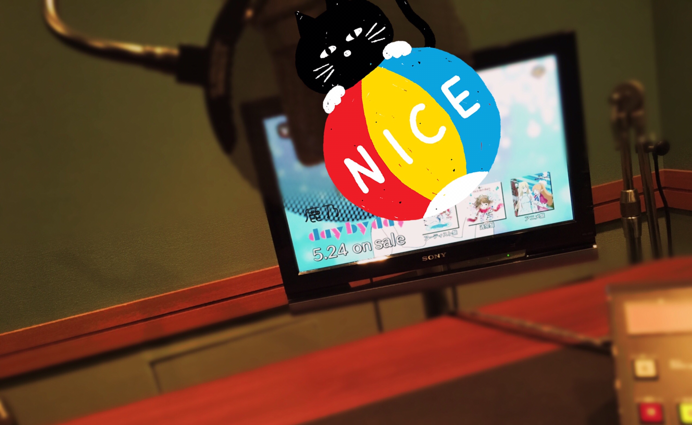

# ふふふ(*´◒`*)

- Published: 2017-04-10T15:35:38+0900
- Original URL: http://lineblog.me/kano/archives/13127137.html
- Wayback snapshot: 20170414054507
- Source HTML: ../data/pages/20170414054507_VQEYCKR55XHTYX4AADF2357LUJLGV7LF_lineblog.me_80_kano_archives_13127137.html.html

[Image source](https://obs.line-scdn.net/0hqOBLGwAJLmB_NQDsV1xRNz1oKA8GVjRoFU05WgpjJE4KWTlgF087VgVrbCoxXSFrCxgaYhJNdwQqfjV0GFYeeBpFCQIIZhdLJzsTGloweFBbBG0yQlBhDg81c1FUAiw3RFBnAwg2JA)

CMのナレーション録りに行ってきました！

自分の歌声にそろそろなれてきましたが喋る声にはまだまだ慣れません。うわああああああって頭を抱えたくなります。

骨伝導で普段きいている自分のマイボイスなんてただの幻想なんだぜ…

[Image source](https://parts.lineblog.me/img/emoji/line/1/00176.png)

私ごとですが、大手町で靴が壊れました。

お気に入りの靴の踵がパッカパカ！

まだ買って2ヶ月なのに〜〜

前も大手町で物を壊し…

くほおお悲しい

[Image source](https://parts.lineblog.me/img/emoji/line/1/00006.png)

[Image source](https://parts.lineblog.me/img/emoji/line/1/00006.png)

[Image source](https://parts.lineblog.me/img/emoji/line/1/00006.png)

[Image source](https://parts.lineblog.me/img/emoji/line/1/00006.png)

ただそれだけです。

CMみる機会ありましたら、あったかい目と耳でよろしくお願いします(｀・ω・´)

鹿乃
