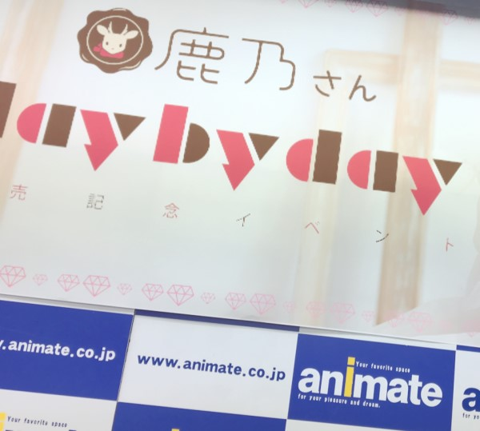
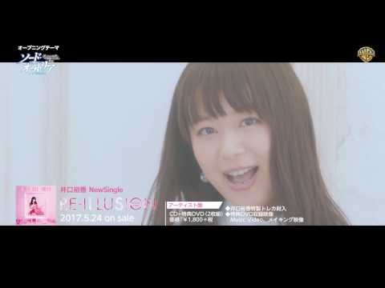

# 遂に出会えましたね(o^^o)

- Published: 2017-05-25T12:08:04+0900
- Original URL: http://lineblog.me/kano/archives/13135642.html
- Wayback snapshot: 20170525061320
- Source HTML: ../data/pages/20170525061320_NUE2ZZP25T7A2AAWKWKV7PANDYXU7CQO_lineblog.me_kano_archives_13135642.html.html

4thシングル「day by day/鹿乃」が遂に昨日リリースされました(\*ﾟ∀ﾟ\*)

昨日は店舗さんへのご挨拶まわり、リリースイベントと盛りだくさんでした！！

[Image source](https://obs.line-scdn.net/0hkS0--me6NHwNVBs9RHxLK08JMhN0Ny50ZywjRngCPlJ4OCN8ZS4hSncKdhV5D3YuTEV6H0gGDyhbDzNNeGQQWW83Fid3DDJXREokBihRYkgnbXIqMjR7EnoAakkobTYrNjV4HXtTPQ)

アニメイト横浜さんでのトークイベント終わり、やはり降りましたよ。雨！！笑

降水確率20%だったんだけどなあ…

昨日一緒に出演してくださったリスアニの澄川さんがトークイベント終わりにおそらくアメダス？をみて「横浜に雨雲がむかってきてる！笑」と笑っていたのはいい思い出です。

いつも優しく楽しくサポートしてくださり、澄川さん本当に本当にありがとうございます。今後ともこのポンコツをお助けください(_ _).｡o○

そして、そしてーーー！

> [!link] インターネットラジオステーション＜音泉＞
> 
>
> [预览图来源](http://www.onsen.ag/common/img/share/thumb.jpg)
>
> インターネットラジオステーション＜音泉＞はアニメ・ゲーム・声優系を中心としたラジオを配信するサイトです。すべての番組が無料で楽しむことができ、しかも登録などの煩わしい作業が一切不要です。誰でも手軽にご利用頂くことが可能です。スマートフォンにも対応！
>
> [打开原始链接](http://www.onsen.ag/program/sword_oratoria/) · [查看网页存档](https://web.archive.org/web/20170525061320/http://www.onsen.ag/program/sword_oratoria/)

2017/5/26 音泉（Webラジオ）「ソード・オラトリア」～魔導士とアマゾネス～に、ゲスト出演させていただきます(o^^o)！

昨日のリリイベでもちょっと触れていましたね笑

鹿乃のド！ポンコツトークを、木村さんが優しく高橋さんが楽しくお二人が包んで下さっています。アニメともどもこちらも合わせてよろしくお願いします

[Image source](https://parts.lineblog.me/img/emoji/line/1/00093.png)

[Image source](https://parts.lineblog.me/img/emoji/line/1/00111.png)

また！！！昨日リリースされたTVアニメ「ソード・オラトリア ダンジョンに出会いを求めるのは間違っているだろうか 外伝」井口裕香さんのOP、鹿乃のEDのCDにも猛烈出会ってください。

<iframe width="480" height="270" src="https://www.youtube.com/embed/611DTfoxAsQ?feature=oembed" title="嵌入视频" frameborder="0" allow="accelerometer; autoplay; clipboard-write; encrypted-media; gyroscope; picture-in-picture; web-share" allowfullscreen loading="lazy"></iframe>

<video controls preload="metadata" src="../media/701c590c16b7.mp4"></video>

> [!video] YouTube
> 
>
> [播放原视频](https://www.youtube.com/watch?v=611DTfoxAsQ) · [查看网页存档](https://web.archive.org/web/20170525061320/https://www.youtube.com/watch?v=611DTfoxAsQ)
>
> [封面来源](https://i.ytimg.com/vi/611DTfoxAsQ/hqdefault.jpg)

> [!link] RE-ILLUSION(TVアニメ「ソード・オラトリア ダンジョンに出会いを求めるのは間違っているだろうか外伝」オープニングテーマ)(アーティスト盤)
>
> [打开原始链接](https://www.amazon.co.jp/gp/aw/d/B06X3YXL5D/ref=pd_aw_sim_15_of_9?ie=UTF8&psc=1&refRID=XK9129BXBRF9ETCWRVRG) · [查看网页存档](https://web.archive.org/web/20170525061320/https://www.amazon.co.jp/gp/aw/d/B06X3YXL5D/ref=pd_aw_sim_15_of_9?ie=UTF8&psc=1&refRID=XK9129BXBRF9ETCWRVRG)

<iframe width="480" height="270" src="https://www.youtube.com/embed/A8jUgcSgcQg?feature=oembed" title="嵌入视频" frameborder="0" allow="accelerometer; autoplay; clipboard-write; encrypted-media; gyroscope; picture-in-picture; web-share" allowfullscreen loading="lazy"></iframe>

<video controls preload="metadata" src="../media/1c89458f6db3.mp4"></video>

> [!video] YouTube
> 
>
> [播放原视频](https://www.youtube.com/watch?v=A8jUgcSgcQg) · [查看网页存档](https://web.archive.org/web/20170525061320/https://www.youtube.com/watch?v=A8jUgcSgcQg)
>
> [封面来源](https://i.ytimg.com/vi/A8jUgcSgcQg/hqdefault.jpg)

> [!link] day by day(TVアニメ「ソード・オラトリア ダンジョンに出会いを求めるのは間違っているだろうか外伝」エンディングテーマ)(アーティスト盤)
>
> [打开原始链接](https://www.amazon.co.jp/gp/aw/d/B06WLPDW45/ref=pd_aw_sim_15_of_51?ie=UTF8&psc=1&refRID=QSS3M4CQ2XF9BKVXC7EP) · [查看网页存档](https://web.archive.org/web/20170525061320/https://www.amazon.co.jp/gp/aw/d/B06WLPDW45/ref=pd_aw_sim_15_of_51?ie=UTF8&psc=1&refRID=QSS3M4CQ2XF9BKVXC7EP)

鹿乃
