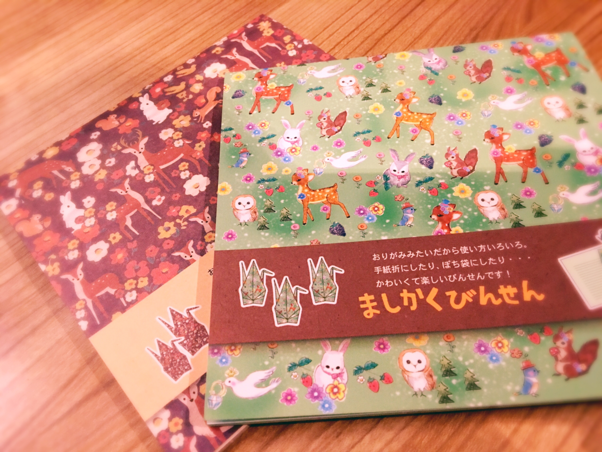

# letter

- Published: 2017-07-05T12:10:53+0900
- Original URL: https://lineblog.me/kano/archives/13142679.html
- Wayback snapshot: 20190519101735
- Source HTML: ../data/pages/20190519101735_6ANFCR3JGNIHAGZKRWG6QVYLJUYAJFRN_lineblog.me_kano_archives_2017-07.html.html

[Image source](https://obs.line-scdn.net/0h3T65IkJjbHsLTENH-GcTLEkRahRyL3ZzYTR7QX4aZlV-IHt7YzZ5TXESLhYlAHVfQV5zGkYKZiNED1JtYXVDem0FOwl0IlleZVhgAS5JOkMlfSstMiMjFXwbN0gufG4sMCIqHipLYA)

こんにちは、鹿乃です(\*'ω'\*)

世の中には可愛いものが溢れていますね。出歩くたびに部屋に雑貨やぬいぐるみが増えていきます。

まさに草むらを歩いているポケモントレーナーな感じ！！笑

季節は7月。7月といえば七夕。七夕といえば願いごと٩( ᐛ )و

ということで（？）みんなのお願いごとをひとつだけ叶えましょうならぬ、みんなの何気ない疑問に答えをだしましょう企画をはじめます。

このブログに何気ない疑問を書き込んでみてください。面白そうな疑問、興味をもった疑問の答えを鹿乃がゆる〜〜く探します。ゆる〜〜く、みんなに答え知らない？て聞きます。

思いついたからやってます感すごいですね…笑

みんなからの何気ない疑問をお待ちしております！！ブログコメントに書き込んでみてね✍️

ちなみに鹿乃の何気ない疑問は、カーテンレールとカーテンを繋ぐ？ものの名前なんていうんだあ？です。

カーテン新しく買ったんですけど、繋ぐものがなくて、買いたいのに名前もわからなくてぐぬぬぬ。

鹿乃🦌
