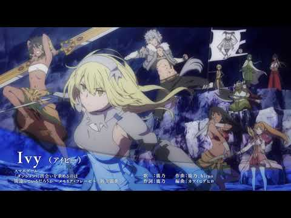

# Ivy

- Published: 2017-09-26T20:56:08+0900
- Original URL: https://lineblog.me/kano/archives/13155322.html
- Wayback snapshot: 20170928172006
- Source HTML: ../data/pages/20170928172006_NHL4EECI5ZLZKMPAN7AI6HU3B3UPA6UA_lineblog.me_kano_archives_13155322.html.html

<iframe width="480" height="270" src="https://www.youtube.com/embed/7B83qWE8We4?feature=oembed" title="嵌入视频" frameborder="0" allow="accelerometer; autoplay; clipboard-write; encrypted-media; gyroscope; picture-in-picture; web-share" allowfullscreen loading="lazy"></iframe>

<video controls preload="metadata" src="../media/ce61f1d51404.mp4"></video>

> [!video] YouTube
> 
>
> [播放原视频](https://www.youtube.com/watch?v=7B83qWE8We4) · [查看网页存档](https://web.archive.org/web/20170928172006/https://www.youtube.com/watch?v=7B83qWE8We4)
>
> [封面来源](https://i.ytimg.com/vi/7B83qWE8We4/hqdefault.jpg)

> [!link] ダンまち〜メモリア・フレーゼ〜（ダンメモ）
> 
>
> [预览图来源](http://danmemo.com/img/ogimage.jpg)
>
> シリーズ累計800万部を突破したダンまちのゲーム最新作『ダンジョンに出会いを求めるのは間違っているだろうか～メモリア・フレーゼ～』。原作のストーリーに加えてここだけで楽しめる大森藤ノ先生完全監修のオリジナルストーリーを、豪華声優陣のフルボイスで彩る本格RPG！遂にリリース！
>
> [打开原始链接](http://danmemo.com/) · [查看网页存档](https://web.archive.org/web/20170928172006/http://danmemo.com/)

ダンまち〜メモリア・フレーゼ〜の新主題歌を担当させていただくことになりました。そしてそして、今日その楽曲「Ivy」の視聴動画が投稿されました(● ˃̶͈̀ロ˂̶͈́)

作詞だけではなく、今回は作曲にも挑戦させていただきました。色んな意味で心臓ばくばくです。

ゲームともども好きになっていただけたら嬉しいです！

ちなみに、Ivyですがアイビーと読みます。どんな意味なんだろうって調べてくださった方の呟きをみて嬉しくなってました。曲に興味をもってもらえるのって幸せですね。

私をみつけて出会ってくださったみんな、楽曲に感謝を！！！

まだまだ2017年色々あります。一緒に最後まで楽しみましょう٩( ᐛ )و

鹿乃
