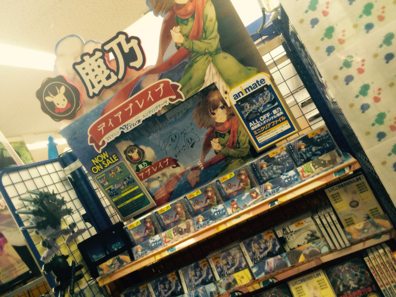
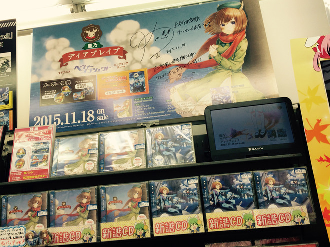
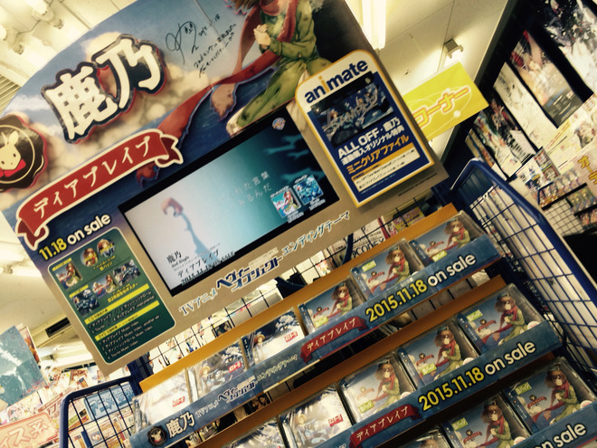

# やっほー！二回目のブログ更新だよ。
# 呀吼！第二次更新博客啦！

- Published: 2015-11-20T12:41:44+0900
- Original URL: https://lineblog.me/kano/archives/1561768.html
- Wayback snapshot: 20170907060145
- Source HTML: ../data/pages/20170907060145_UELW6BBIK7SG4OI4POMIOOZGMBZX5XE5_lineblog.me_kano_archives_2015-11.html_p_2.html

[Image source](http://line.blogimg.jp/kano/imgs/2/5/2580ed6b.jpg)

こんにちは、鹿乃です

大家好，我是鹿乃。

[Image source](https://parts.lineblog.me/img/emoji/3/ic_biccuri02.png)

先日、SHIBUYA TSUTAYAさんであったリリース記念イベントの前に都内のお店にご挨拶にいってきました。

前几天，在涩谷 TSUTAYA 举办发售纪念活动之前，我先去东京都内的各家店铺打了招呼。

CDを手にとってくださった瞬間を目撃したり、鹿乃か？鹿乃なのか？て気付いて声をかけてくれた人にコミュ障っぷりをお披露目したり…うぐぐぐ。

我亲眼看到有人拿起 CD 的瞬间，也有人认出“是鹿乃吗？真的是鹿乃？”而主动跟我搭话，让我当场暴露了不擅交际的一面……呜呜呜。

[Image source](http://line.blogimg.jp/kano/imgs/c/d/cd06defe.jpg)

[Image source](http://line.blogimg.jp/kano/imgs/a/f/afbc022d.jpg)

そんなこんなが色々がありつつ、

就这样，在发生了各种各样的事情之后，

AKIHABARAゲーマーズ本店さま

AKIHABARA GAMERS 本店

アニメイト秋葉原店さま

Animate 秋叶原店

とらのあな秋葉原店Ｂさま

虎之穴 秋叶原店Ｂ

アキバ☆ソフマップ1号店さま

秋叶原☆Sofmap 1号店

アニメイト池袋本店さま

Animate 池袋本店

タワーレコード新宿店さま

Tower Records 新宿店

アニメイト新宿店さま

Animate 新宿店

とらのあな新宿店Aさま

虎之穴 新宿店A

アニメイト渋谷店さま

Animate 涩谷店

タワーレコード渋谷店さま

Tower Records 涩谷店

SHIBUYA TSUTAYAさま

涩谷 TSUTAYA

にお邪魔させていただいてきたのですが、どの店舗さまも素敵にどかーんと「ディアブレイブ」をディスプレイしてくださっていて嬉しかったです。

我登门拜访了以上这些店铺，每家店都把《Dear Brave》漂亮又醒目地陈列出来，看到时特别开心。

お店にご挨拶している間にもツイッターでリプライや画像やRTやふぁぼや、色んな形でおめでとうや応援や元気をもらいました。

在去各家店铺打招呼期间，我也在 Twitter 上收到了大家的回复、图片、转发和点赞，以各种各样的形式收获了祝贺、应援和元气。

リリース記念イベントにも足元が悪い中、駆けつけてくださって「おめでとう」を言いにきてもらえて、なんて言葉にすると一番いいんですかね？

发售纪念活动当天，尽管路不好走，大家还是专程赶来对我说“恭喜”，这份心意该用什么话来表达才最合适呢？

鹿乃はめちゃめちゃ幸せものですね。

鹿乃真是个幸福得不得了的人呢。

ですかね？

是吧？

たくさんの人に支えてもらってるな〜と、特に肌で感じた一日でした。

那一天，我格外真切地感受到“原来有这么多人在支持着我呀”。

本当にありがとうございました。

真的非常感谢大家。

さて、最後にお知らせです！！！

好了，最后是通知！！！

今日、11/20の21時より

今天 11/20 晚上 9 点起，

鹿乃（カノ）生出演 2ndシングル発売をみんなでお祝いしようスペシャル http://nico.ms/lv241808897

鹿乃（Kano）现场出演“大家一起庆祝第二张单曲发售”特别节目 http://nico.ms/lv241808897

が！！あります。わああ拍手ー！！ぜひ遊びにではなく助けに（←重要です）きてください。

这个节目有哦！！哇啊鼓掌——！！请大家务必前来，不是来玩，而是来帮我（←这一点很重要）。

1stシングルのときもね、緊張してね、というかいつでもどこでも緊張と不安でパーンしていてね。みんなのコメントで私に癒しと安らぎと落ち着きをプレゼントしてください。めっちゃお待ちしております！！！

出第一张单曲时也是这样，我很紧张——不如说，无论何时何地我都紧张不安得快炸掉了。请大家用评论给我送上治愈、安宁和平静吧。我超级期待！！！

そしてそして、明日の11月21日は名古屋、大阪日でリリース記念イベントがあります。

还有还有，明天11月21日，在名古屋和大阪也有发售纪念活动。

↓ 参加券頒布店舗さま一覧 ↓

↓ 发放参加券的店铺一览 ↓

・アニメイト名古屋、栄店さん

・Animate 名古屋、荣店

・アニメイト大阪日本橋店、天王寺、三宮、京都、梅田店さん

・Animate 大阪日本桥店、天王寺、三宫、京都、梅田店

まだ参加券が若干あるようなので是非、このブログをみた名古屋、大阪近辺在住、もしくは遠出して行っちゃうぞー！と思ってくださった皆様！！！ぜひ遊びにきてください。

听说参加券还剩一些，所以——住在名古屋、大阪附近，或是看到这篇博客后心想“那就干脆出趟远门过去吧！”的各位！！！请一定要来玩哦。

詳細はオフィシャルページのイベント情報を参照してくださいっ

详情请参考官网的活动信息页面。

http://whv-amusic.com/kano/sp/

ではでは、鹿乃でしたー！

那么那么，以上就是鹿乃啦——！
