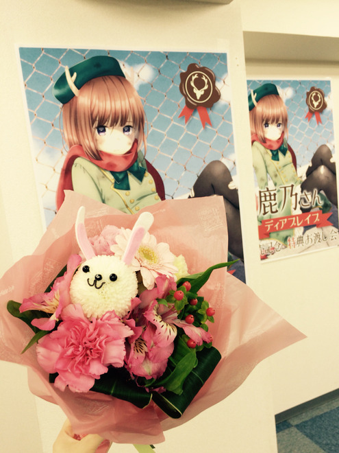
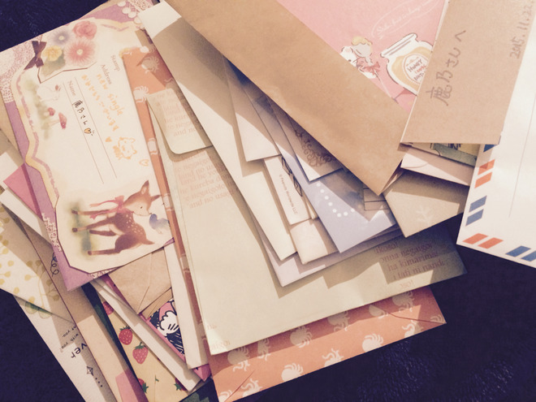

# ディアブレイブ
# 亲爱的勇者

- Published: 2015-11-23T20:51:34+0900
- Original URL: https://lineblog.me/kano/archives/1641185.html
- Wayback snapshot: 20170907060145
- Source HTML: ../data/pages/20170907060145_UELW6BBIK7SG4OI4POMIOOZGMBZX5XE5_lineblog.me_kano_archives_2015-11.html_p_2.html

[Image source](http://line.blogimg.jp/kano/imgs/b/d/bdcfe600.jpg)

こんばんは、鹿乃です

晚上好，我是鹿乃。

[Image source](https://parts.lineblog.me/img/emoji/3/ic_biccuri02.png)

お写真は名古屋のイベントでいただいたうさちゃんのお花と鹿乃！…の手。です笑

照片里是名古屋活动上收到的小兔子花束，还有鹿乃！……的手。笑

[Image source](http://line.blogimg.jp/kano/imgs/2/6/2629767e.jpg)

たくさんお手紙もいただきましたー。トランプを扇状に広げる感じでしたかったのですが、鹿乃にはまだ早かったようです。無念…！！

还收到了好多信——。本来想试着把信像扑克牌一样扇形展开来着，不过对鹿乃来说似乎还太早了。遗憾……！！

いただいた差し入れはまだお家に届いていないので載せられていないのですが、大事に感謝しながら使わせていただきますねっ

大家送的慰问品还没寄到家里，所以暂时没法晒出来，不过我会满怀感激、好好珍惜着用的！

本当にありがとうございました

真的非常感谢！

[Image source](https://parts.lineblog.me/img/emoji/3/ic_hearts.png)

今回のイベントは昔から応援してくださっている方、Stella-riumで好きになってくださった方、今回のディアブレイブをきっかに気になって来てくださった方、本当に色々な方がいました。

这次的活动现场，有从很早以前就一直支持我的人，也有因为《Stella-rium》而喜欢上我的人，还有因为这次的《Dear Brave》开始关注、特意赶来的朋友，真的来了各种各样的人。

いつもなんとなく心細くて、歯がゆくて、悔しくて、申し訳なくて…そんな気持ちを抱いていることの多い鹿乃なのですが、イベントに来てもらえたり、CDの感想をリプライでいただけたり、どこかでCDを手にとって今も誰かが自分の言葉に耳を傾けてくれているのかなって感じるたびにとても不思議で幸せな気持ちになりました。

我总是没来由地感到不安、焦急、不甘心、过意不去……带着这种心情的时候很多。可每当大家来参加活动、在回复里告诉我 CD 的感想，或是一想到也许此刻正有人在某个地方拿起 CD、倾听我的歌声，我都会觉得非常不可思议，又无比幸福。

私が1年前に勇気をだして踏み出した一歩がこれから先、どこに続いていくのかはわかりません。

一年前我鼓起勇气迈出的那一步，今后究竟会通向哪里，我自己也不知道。

傷つかないように傷つけないように、面倒くさくないように格好悪くないように…そうやって安全な道を選んできた私がどこまでやっていけるかは激しく不安ではありますが、未来なんて誰にもわからないし結局は自分の努力や周りの人や時の運や色んなことの積み重ねで、誰にも決められるものじゃないし！！

不让自己受伤、也不伤害别人，不给人添麻烦、也不显得难堪……一直这样选择安全道路的我究竟能走多远，虽然心里非常不安，但未来这种事谁都说不准，说到底，未来是靠自己的努力、身边的人、时运和种种事情累积起来的，不是任何人能够决定的！！

文章がまとまらなくなってきました。そろそろまとめなくちゃ…笑

写着写着又变得没有条理了。差不多该收个尾了……笑

ディアブレイブの二番からは特に今までと、これから応援してくれる「君」と、今までとこれからの自分の過去と未来を強く意識して歌っていました。

《Dear Brave》从第二段开始，我尤其强烈地意识到了一直以来支持我、今后也会继续支持我的“你”，还有自己过去与未来的种种，是带着这样的意识去唱的。

わたしもみんなにしてもらったように、頑張るひとの「君」になれるようこれからも頑張るね！！

我也想像大家对我那样，努力成为正在努力的人身边的那位“你”，今后也会继续加油哦！！

<iframe width="480" height="360" src="https://www.youtube.com/embed/UstE6yTlwcU?rel=0" title="嵌入视频" frameborder="0" allow="accelerometer; autoplay; clipboard-write; encrypted-media; gyroscope; picture-in-picture; web-share" allowfullscreen loading="lazy"></iframe>

<video controls preload="metadata" src="../media/b04cdeafa13e.mp4"></video>

> [!video] YouTube
> 
>
> [播放原视频](https://www.youtube.com/watch?v=UstE6yTlwcU) · [查看网页存档](https://web.archive.org/web/20170907060145/https://www.youtube.com/watch?v=UstE6yTlwcU)
>
> [封面来源](https://i.ytimg.com/vi/UstE6yTlwcU/hqdefault.jpg)

[http://youtu.be/UstE6yTlwcU](http://youtu.be/UstE6yTlwcU)

ディアブレイブを引き続きよろしくー

《Dear Brave》也请继续多多关照哦ー

[Image source](https://parts.lineblog.me/img/emoji/3/ic_biccuri02.png)

鹿乃
