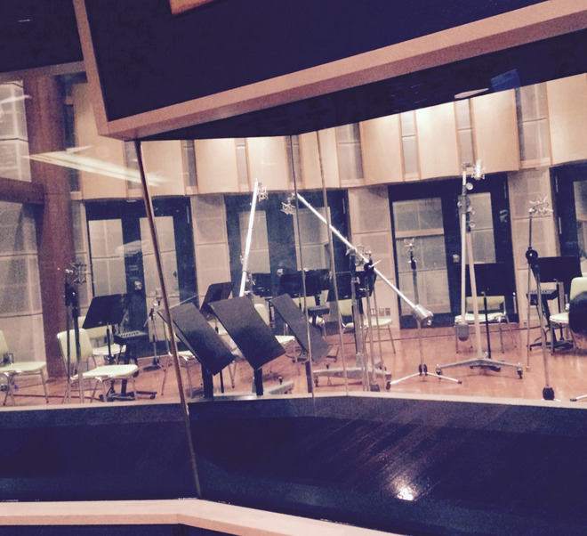
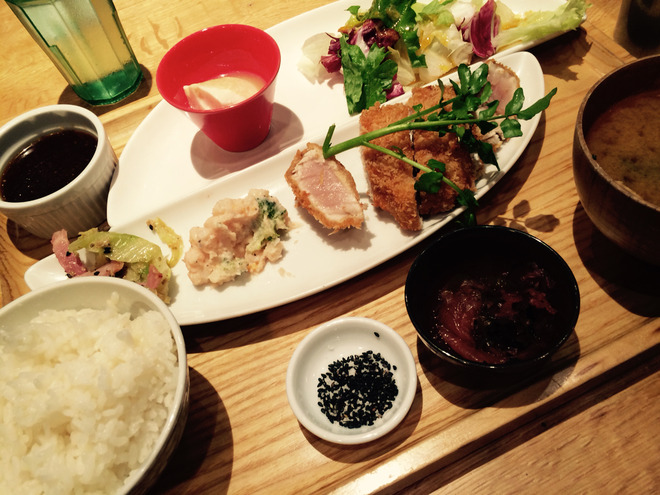
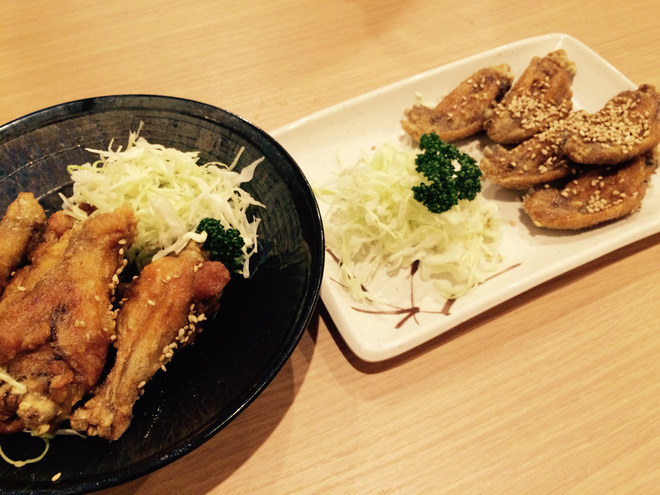
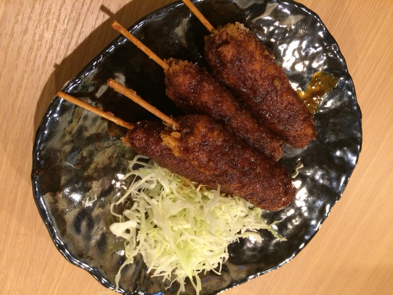

# お腹すいてる人は見ちゃダメ！絶対だよ！
# 肚子饿的人不许看！绝对哦！

- Published: 2015-11-25T03:14:16+0900
- Original URL: http://lineblog.me/kano/archives/1691470.html
- Wayback snapshot: 20170323081109
- Source HTML: ../data/pages/20170323081109_ETNK5JBJEV6GGSSS4XIDOUAJE6RSOHYG_lineblog.me_80_kano_archives_2015-11.html.html

こんにちは、鹿乃です

你好，我是鹿乃。

[Image source](https://parts.lineblog.me/img/emoji/3/ic_biccuri02.png)

先週に引き続いて今週からは冬コミに向けて大忙し…！のはずが、風邪でダウンしてしまいました。

这周也要接着上周，为冬Comi忙得不可开交……！本该如此，结果却因为感冒病倒了。

生放送します〜〜って公式LINEでみんなにメッセージ送ってたのにごめんなさい💦

明明已经在官方 LINE 上给大家发消息说“要开生放送啦〜〜”，结果却病倒了，对不起💦

お詫びにお蔵入りになった鹿乃のプチ失敗お写真を…。

作为赔礼，就放出几张被鹿乃雪藏起来的小失败照片吧……。

[Image source](http://line.blogimg.jp/kano/imgs/1/f/1f72e664.jpg)

なんのお写真でしょう！

猜猜这是什么照片！

正解は〜〜〜〜

正确答案是〜〜〜〜

ディアブレイブのストリングス収録後のお写真です。説明しないとなんの写真かわからないですよね。そうなんです。もう二度とないチャンスだったのに、ストリングスの収録があまりにも圧巻だし素敵すぎだしで聴くのに夢中で気付いたら終わっていて、片付けられはじめていたという……。

这是《Dear Brave》弦乐录音结束后的照片。不说明的话，根本看不出是什么照片吧。是啊，就是这样。明明是这样千载难逢的机会，可弦乐录制实在太震撼、太美妙了，我听得入了神，回过神来已经录完了，工作人员都开始收拾了……。

ううう。みんなにも観て欲しかった。

呜呜呜。真想让大家都亲眼看到。

いやでもほら！音源からどれくらい凄かったか伝わるし？！？！

哎呀不过你看！光从音源里也能感受到有多厉害吧？！？！

<iframe width="480" height="360" src="https://www.youtube.com/embed/UstE6yTlwcU?rel=0" title="嵌入视频" frameborder="0" allow="accelerometer; autoplay; clipboard-write; encrypted-media; gyroscope; picture-in-picture; web-share" allowfullscreen loading="lazy"></iframe>

<video controls preload="metadata" src="../media/b04cdeafa13e.mp4"></video>

> [!video] YouTube
> 
>
> [播放原视频](https://www.youtube.com/watch?v=UstE6yTlwcU) · [查看网页存档](https://web.archive.org/web/20170323081109/https://www.youtube.com/watch?v=UstE6yTlwcU)
>
> [封面来源](https://i.ytimg.com/vi/UstE6yTlwcU/hqdefault.jpg)

[Image source](http://ecx.images-amazon.com/images/I/517s3E3VFrL._SL160_.jpg)

[ディアブレイブ](http://www.amazon.co.jp/%E3%83%87%E3%82%A3%E3%82%A2%E3%83%96%E3%83%AC%E3%82%A4%E3%83%96-%E3%82%A2%E3%83%8B%E3%83%A1%E7%9B%A4-%E3%82%A2%E3%83%8B%E3%83%A1-%E3%80%8C%E3%81%B8%E3%83%B4%E3%82%A3%E3%83%BC%E3%82%AA%E3%83%96%E3%82%B8%E3%82%A7%E3%82%AF%E3%83%88%E3%80%8D-%E3%82%A8%E3%83%B3%E3%83%87%E3%82%A3%E3%83%B3%E3%82%B0%E3%83%86%E3%83%BC%E3%83%9E/dp/B01520YADK%3FSubscriptionId%3DAKIAIM37F4M6SCT5W23Q%26tag%3Dlvdrfree-22%26linkCode%3Dxm2%26camp%3D2025%26creative%3D165953%26creativeASIN%3DB01520YADK)

改めて写真フォルダの中を観ると、失敗したお写真多いな〜〜

重新翻了翻相册，发现失败的照片还真不少呢〜〜

[Image source](http://line.blogimg.jp/kano/imgs/8/c/8c599a48.jpg)

これは失敗じゃないよ

这张可不是失败哦

[Image source](http://line.blogimg.jp/kano/imgs/3/b/3b02a240.jpg)

これも失敗じゃないよ

这张也不是失败哦

[Image source](http://line.blogimg.jp/kano/imgs/6/a/6a1c339e.jpg)

＼これもまったく失敗じゃないよ／

＼这张也完全不失败哦／

ここ一ヶ月で食べた美味しいものの写真（主に名古屋飯）を自慢げに貼りつつ、今回は筆を置きたいと思います。

一边得意地贴出这一个月来吃到的美食照片（主要是名古屋美食），这次的博客就打算写到这儿啦。

みんなはもうお昼食べましたか？鹿乃はまだです。おなかすいた〜〜！！

大家已经吃过午饭了吗？鹿乃还没吃呢。肚子好饿〜〜！！

鹿乃
