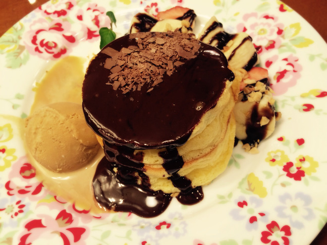
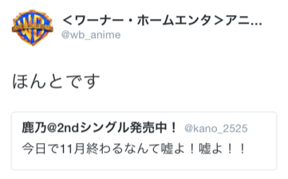

# コンコンッ。お邪魔しますー！
# 咚咚。打扰啦～！

- Published: 2015-12-06T11:00:59+0900
- Original URL: https://lineblog.me/kano/archives/1979102.html
- Wayback snapshot: 20170907052803
- Source HTML: ../data/pages/20170907052803_QVO5QGXAWJBIOQYMVOXZPILQFXVLHFHG_lineblog.me_kano_archives_2015-12.html_p_2.html

[Image source](http://line.blogimg.jp/kano/imgs/e/f/ef987cfe.jpg)

こんばんは、鹿乃です

晚上好，我是鹿乃。

[Image source](https://parts.lineblog.me/img/emoji/3/ic_biccuri02.png)

12月になりましたね。11月が終わるなんて嘘だ嘘だと思い込もうとしましたが、天より「現実をみなさい」とのお告げがあり戻ってまいりました。

已经进入12月了呢。我本来还想拼命说服自己“11月结束什么的，骗人的骗人的”，结果上天降下“面对现实吧”的谕示，我便回来了。

[Image source](http://line.blogimg.jp/kano/imgs/1/9/19813b67.jpg)

ちなみに、一番最初にペタリとしたお写真は最近食べたパンケーキです。ふわっとろっで最高に美味しかったのですが、うろちょろして辿り着いたお店なので二度と行ける気がしません。

顺带一提，最开头贴出来的那张照片，是我最近吃的松饼。松软绵密、好吃到不行，不过那家店是我东游西逛时偶然撞见的，感觉这辈子再也找不回去了。

紹介したくても！できない！渋谷のビルの8階にありましたよ！しか言えない！

就算想推荐给大家！也做不到！只能说一句“它开在涩谷某栋楼的8楼”！

な〜〜んで渋谷のそんなお洒落なお店に行っていたかと言いますと

要说我为什么会跑去涩谷那么时尚的店呢

NHK FM アニソンアカデミーさんに昨日、出演させていただいたからです

是因为我昨天出演了 NHK FM 的《动漫歌曲学院》节目

[Image source](https://parts.lineblog.me/img/emoji/3/ic_biccuri02.png)

その帰りにご褒美に、ね…笑

回来的时候，就当是给自己的奖励啦……笑

相変わらず、お喋りが下手でおどおどする私を優しくあべあきらさんとしょこたんさんのお二方がリードしてくださり、無事に？たぶん無事に？過ごすことが出来ました。

和往常一样不善言辞、怯怯生生的我，多亏了あべあきらさん和しょこたんさん两位温柔地带着聊，总算是？大概算是？平安顺利度过了。

改めましてあべさん、しょこたんさん、番組スタッフさん、そしてそして聞いてくださった方、本当に本当にありがとうございました！！

在此再次感谢あべさん、しょこたんさん、节目组的各位，还有还有收听的各位，真的真的非常感谢！！

そうそう、お話は少しだけ変わりまして…

对了对了，话题稍微转一下……

しょこたんさんと約束したとおりモンハン買いました。お店どこも売り切れで通販ですが買いましたーーー！

按照和しょこたんさん的约定，我买了《怪物猎人》。哪家店都卖光了，虽然是网购，但总之买到了———！

と、ブログでひっそりとご報告です。ちょっとだけ昔やって、怖くて挫折したのですが今度こそ。今度こそっっっ

就，在博客里悄悄跟大家汇报一下。以前稍微玩过一点，结果因为太吓人半途而废了，但这次一定行。这次一定行っっっ

やり方わからないので、みんなのお知恵をかなりお狩りさせていただくつもり満々なので先輩方なにとぞ初心者の鹿乃に優しくする準備をよろしくお願いします

因为完全不知道怎么玩，我已经打定主意要大肆请教大家的智慧了，所以各位前辈，拜托大家做好温柔对待新手鹿乃的准备，请多关照啦

[Image source](https://parts.lineblog.me/img/emoji/3/ic_cat02.png)

（お問い合わせちょこちょこいただいているのですが、コミケのことは後日こちらのブログに色々まとめますのでお待ちいただけますと幸いです。すみません）

（最近陆陆续续收到一些咨询，关于 Comiket 的事情，之后我会在这边的博客里好好整理出来，届时还请大家稍等。不好意思）

鹿乃
