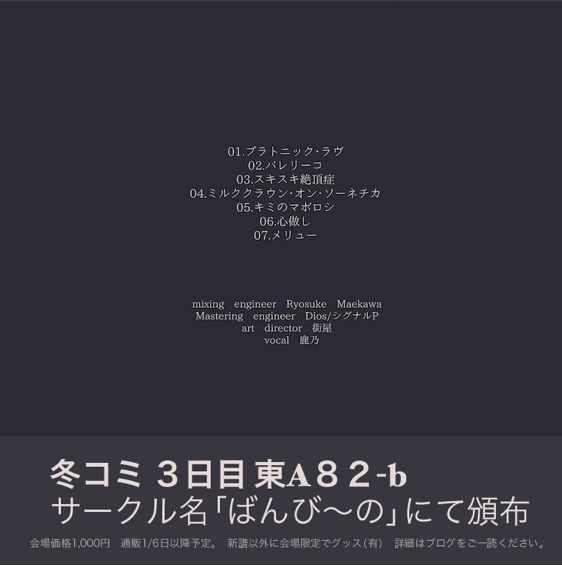
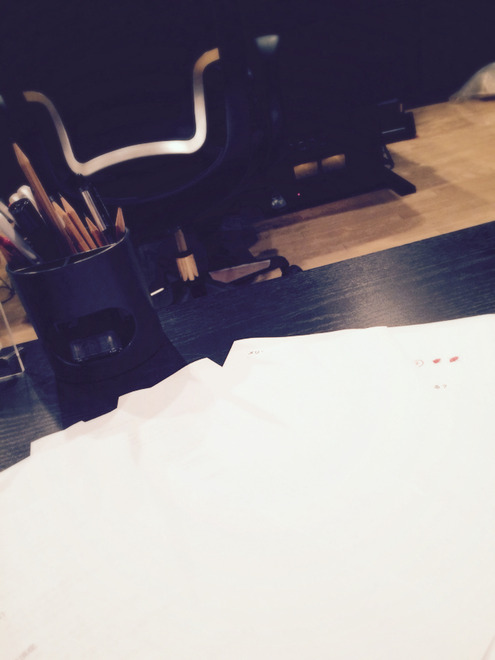

# 冬コミにで、で、でま…！
# 冬Comi要出、出、出摊…！

- Published: 2015-12-20T11:28:20+0900
- Original URL: http://lineblog.me/kano/archives/2413821.html
- Wayback snapshot: 20170323081734
- Source HTML: ../data/pages/20170323081734_RQTEJAXJHNMATQALH5CXEHCVSCOSVKVP_lineblog.me_80_kano_archives_2015-12.html.html

こんにちは、鹿乃です

你好，我是鹿乃。

[Image source](https://parts.lineblog.me/img/emoji/3/ic_biccuri02.png)

無事に冬コミの新譜入稿が終わりましたので帰還しました。ただいまー！

冬Comi的新专辑稿子顺利交完，我回到家了。我回来啦——！

みんな元気にしてましたか？それとも、諸々さまざまな事情で鹿乃と同じく闇のデュエルに負けた人みたいな顔になってしまってますか？ましたか？

大家这段时间都精神吗？还是说，因为这样那样的各种事情，也变得和鹿乃一样，一脸像输掉暗黑决斗的样子了呢？了呢？

なんで12月って毎年こんなに慌ただしくなるんでしょうね。私の場合は色々、後で〜後でやる〜の積み重ねなので完全に自業自得なんですけど。よい子は鹿乃のようにはなっちゃダメだヨ

为什么12月每年都会变得这么手忙脚乱呢。我的话，是因为各种事情都“待会儿～待会儿再做～”地不断堆积，完全是自作自受就是了。好孩子可不能学鹿乃这样哦

[Image source](https://parts.lineblog.me/img/emoji/3/ic_finger_ok.png)

[Image source](https://parts.lineblog.me/img/emoji/3/ic_pikapika.png)

さて、改めまして…

那么，重新正式地介绍一下……

冬コミ 3日目 東A 82b 「ばんび〜の」

冬Comi 第3天 东A 82b「ばんび〜の」

で、2年ぶりに歌ってみたアルバムがでます。ださせていただきます。

我们时隔两年又将推出新的翻唱专辑了，终于要推出啦！

[Image source](http://line.blogimg.jp/kano/imgs/9/f/9f3dca84.jpg)

＼じゃじゃあああああん／

収録曲と今回の新譜制作に関わってくださった皆様のご紹介です。

收录曲目，以及这次为新专辑制作出力了的各位的介绍来啦。

ジャケット、クロスフェード、通販、諸々は順次ご紹介＆投稿＆ご案内していきます。少々お待ちを…！

封面、试听串烧、通贩等各项内容，我会陆续介绍＆发布＆通知。请稍等片刻…！

また新譜だけではなく今年はグッズも作りました。水玉子さんがデザインしてくれたトートバッグ＆缶バッチセットです。画像用意中なのでこちらのご紹介もお待ちください。

另外今年除了新专辑，还做了周边。是水玉子桑帮忙设计的托特包＆徽章套装。图片正在准备中，这个的介绍也请稍等。

（トートバッグと缶バッチが二つで一つのセットになっております)

（托特包和两枚徽章组成一套）

ちなみにこちらのトートバッグ＆缶バッチセットは会場で売り切れてしまった場合は通販ありません。再販もおそらくしないです。ご了承くださいm(\_ \_)m

顺带一提，这套托特包＆徽章套装如果在会场售罄，就不会有网售了，大概也不会再贩。请多包涵m(\_ \_)m

それにしても、今年は冬コミの情報だしがいつも以上に遅くてすみませんでした。特に遠征迷っている方、当日の予定をはやく立てたかった方には申し訳なく…orz

话说回来，今年冬Comi的情报发布比往年还要晚，实在抱歉。尤其是让还在犹豫要不要远征的朋友、想早点安排好当天行程的朋友等了这么久，真的很对不起……orz

というわけで、2015年最後の最後までよろしくね！！

那么，直到2015年最后最后，也请多多关照！！

[Image source](http://line.blogimg.jp/kano/imgs/1/b/1b6d7f66.jpg)

来週はいよいよ鹿乃のお誕生日！なにをしてるかって？？？12月24日が何曜日なのかを調べてみるとわかります。

下周终于要到鹿乃的生日了！你问我那天在做什么？？？只要查一查12月24日是星期几就知道了。

(o^^o)ノシノシ

鹿乃
