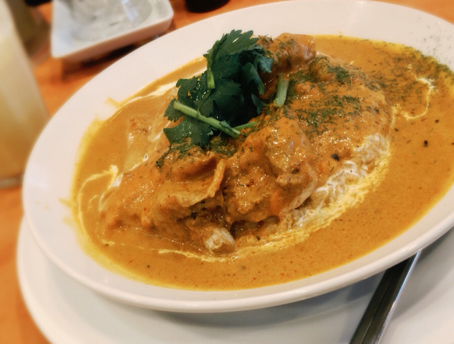
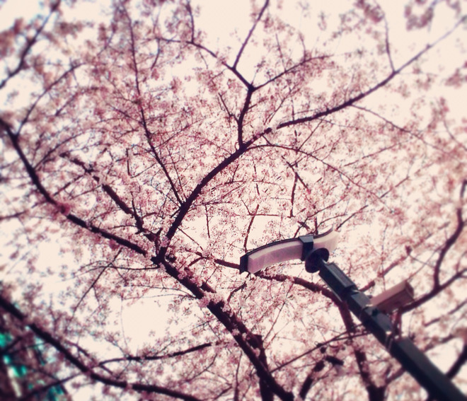

# もぐもぐもぐも…お答えしましょう！
# 嚼嚼嚼……来回答大家的问题吧！

- Published: 2016-04-07T12:12:43+0900
- Original URL: https://lineblog.me/kano/archives/5254013.html
- Wayback snapshot: 20170907045659
- Source HTML: ../data/pages/20170907045659_QJ3FFVPNPMYLPIWUOLG5Q64P4WGTS5XR_lineblog.me_kano_archives_2016-04.html_p_2.html

こんにちは、鹿乃です

你好，我是鹿乃。

[Image source](https://parts.lineblog.me/img/emoji/3/ic_cat02.png)

[Image source](http://line.blogimg.jp/kano/imgs/b/8/b890e730.jpg)

美味しいカレーを食べました。

我吃了超好吃的咖喱。

バターチキンカレーです

是黄油鸡肉咖喱哦。

[Image source](https://parts.lineblog.me/img/emoji/3/ic_pikapika.png)

人生初マンゴーラッシーも飲みました。両方とっても美味しかったです。

还喝了人生第一杯芒果拉西，两种都特别好喝。

レコーディング中は喉のことを考えて刺激的な食べ物を避けていたので、余計に美味しく感じてしまったのかもですね！笑

录音期间为了嗓子着想一直避开刺激性的食物，所以可能正因为如此才觉得格外美味吧！笑

さてさて、本題に……

好了好了，进入正题……

[Image source](https://parts.lineblog.me/img/emoji/3/ic_chick.png)

先日、特典やお渡し会イベントの詳細をお知らせしたところ質問をいただきましたのでブログにてお答えさせていただこうと思います。

前几天公布了特典和亲手递交会活动的详情后，收到了大家的提问，所以想在这里借博客来回答一下。

「イベント参加券は対象店舗以外で予約してももらえないの？」

“活动参加券不是在指定店铺以外的地方预订就拿不到吗？”

「答えは……YES!! もらえません」

“答案是……YES!! 就是拿不到。”

※絵本付生産限定盤のみイベント参加券がついてきます。ご注意ください。

※只有附带绘本的生产限定盘才会附送活动参加券，请注意。

東京のイベント

东京的活动

5月11日（水）

5月11日（周三）

★会場:SHIBUYA TSUTAYA

★会场：SHIBUYA TSUTAYA

参加券配布店舗：SHIBUYA TSUTAYA

参加券发放店铺：SHIBUYA TSUTAYA

大阪のイベント 5月14日（土）

大阪的活动 5月14日（周六）

★会場:アニメイト大阪日本橋

★会场：アニメイト大阪日本桥

参加券配布店舗：アニメイト天王寺店、三宮店、京都店、大阪日本橋店、梅田店

参加券发放店铺：アニメイト天王寺店、三宫店、京都店、大阪日本桥店、梅田店

★会場:TSUTAYA EBISUBASHI

★会场：TSUTAYA EBISUBASHI

参加券配布店舗：TSUTAYA EBISUBASHI

参加券发放店铺：TSUTAYA EBISUBASHI

名古屋のイベント 5月15日（日）
★会場：第3太閤ビル
参加券配布店舗：アニメイト名古屋店

名古屋的活动 5月15日（周日）
★会场：第3太阁大楼
参加券发放店铺：アニメイト名古屋店

東京のイベント2  5月22日（日）

东京的活动2  5月22日（周日）

★会場：アニメイト池袋本店
参加券配布店舗：アニメイト池袋本店、渋谷店、秋葉原店、横浜店、新宿店

★会场：アニメイト池袋总店
参加券发放店铺：アニメイト池袋总店、涩谷店、秋叶原店、横滨店、新宿店

★会場：とらのあな秋葉原店C
参加券配布店舗：とらのあな秋葉原店B、池袋店B、新宿店A

★会场：とらのあな秋叶原店C
参加券发放店铺：とらのあな秋叶原店B、池袋店B、新宿店A

★会場：タワーレコード新宿店
参加券配布店舗：タワーレコード新宿店、渋谷店

★会场：タワーレコード新宿店
参加券发放店铺：タワーレコード新宿店、涩谷店

詳しくは公式HPに書いてあるのでぜひ確認してみてください。それでもわからない場合は店舗様にお問い合わせをお願いします(o^^o)

详情都写在官方网站上了，请务必去看一看确认一下。如果看了还是不明白的话，就麻烦您向店铺咨询哦(o^^o)

[http://whv-amusic.com/kano/](http://whv-amusic.com/kano/sp/)

当日お会いできるのを楽しみにしてますね！ライブの前だとみんなとお会いできる機会はこれが最後かな〜？緊張だっ

很期待当天能和大家见面哦！演唱会前能和大家见面的机会，这大概是最后一次了吧～？好紧张啊

緊張しつつ予約の報告、参加券ゲットの報告、プリマステラの感想、応援などなどなどたくさんのリプライや拡散、らぶる？ブログコメントをにこにこしながら見てます。いつも元気をくれてありがとう(o^^o)

我一边紧张，一边笑眯眯地看着大家预约的报告、拿到参加券的报告、对《プリマステラ》的感想、应援等等等等数不清的回复和转发，还有（充满爱意的？）博客留言。谢谢你们总是带给我元气(o^^o)

今日はここまで。またねっ

今天就到这里。下次见啦

[Image source](http://line.blogimg.jp/kano/imgs/0/5/05b87e94.jpg)

ハラハラ     パラパラ

心怦怦跳　　哗啦哗啦
