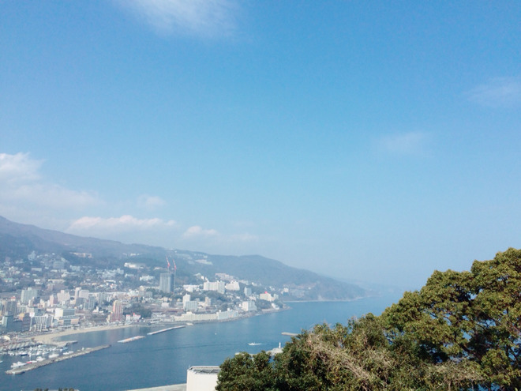
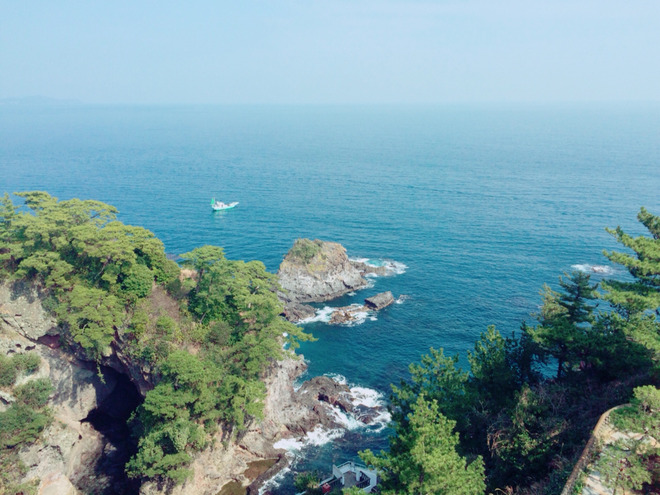
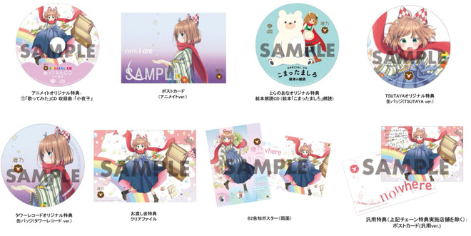

# 海は広いな大きかったな！
# 大海好宽好大呀！

- Published: 2016-04-25T18:15:52+0900
- Original URL: http://lineblog.me/kano/archives/5772153.html
- Wayback snapshot: 20160428002141
- Source HTML: ../data/pages/20160428002141_OK5N55AK645UKSSMBZAYNHNJPMK57I75_lineblog.me_80_kano_archives_5772153.html.html

こんばんは、鹿乃です ⸜(๑⃙⃘'ᵕ'๑⃙⃘)⸝⋆︎*

晚上好，我是鹿乃 ⸜(๑⃙⃘'ᵕ'๑⃙⃘)⸝⋆︎*

今日はラジオ収録とボイトレに行ってきました。寝不足と微妙な暑さでへろへろです。おすすめの疲労回復方法や癒し系グッズがあったらぜひ教えてください！

今天去录了广播节目，还去上了发声训练课。因为睡眠不足，加上这不凉不热的闷热天气，整个人都累瘫了。大家如果有推荐的恢复疲劳的方法或者治愈系小物，请一定要告诉我！

[Image source](http://line.blogimg.jp/kano/imgs/a/c/acd5bff4.jpg)

[Image source](http://line.blogimg.jp/kano/imgs/5/b/5bcd38a1.jpg)

ブログ書くなら写真か画像を…というこだわりのある鹿乃なのですが、ネタになりそうな写真を今日は撮ってない！ので、今年頭に立ち寄った熱海の写真をぺたりとしてみました。

我是那种写博客就一定要配上照片或图片、有点讲究的鹿乃，不过今天没拍到什么能当素材的照片！所以就把今年年初顺路去的热海的照片贴出来啦。

長いこと海辺の街で暮らしていたので、こうしてたまに海をみると妙に懐かしい気持ちになります。

因为曾经在海边的城市生活了很久，所以像这样偶尔看看海，心里就会涌起一种莫名的怀念。

東京にいるとなかなか海をみることないからね！なにより滅多に出歩かないからね笑

在东京的话平时很难看到海嘛！而且我也很少出门，哈哈。

いい感じにしんみり？したところで、先日公開された特典関係について質問がいくつかありましたので補足のお話をさせてください( ´⚰︎` )

正当气氛恰到好处地变得有些感伤？的时候——关于前几天公开的特典，我收到了几个提问，所以请让我在这里补充说明一下( ´⚰︎` )

[Image source](http://line.blogimg.jp/kano/imgs/3/a/3a4fba7a.jpg)

◆特典は通販で購入してもつくの？

◆通过通贩购买也能拿到特典吗？

先着順になりますがついてきます。詳しくは「nowhere/鹿乃」の各店舗さんの通販ページに特典について書いてくださっているのでご参照ください。どうしても不安な場合はお店にお問い合わせして確認していただくと確実ですっ

会有的，不过按先到先得。至于详情，各家店铺都在自己“nowhere／鹿乃”的通贩页面上写明了特典内容，请参考一下。如果实在不放心，直接向店家咨询确认一下最稳妥哦。

◆汎用特典はどこでもらえるの？

◆通用特典在哪里能拿到？

チェーン特典実地店さん以外です。

在连锁特典的指定店铺以外的地方都能拿到。

例えば、amazonさんとか！

比如 amazonさん 之类的！

[Image source](http://www.amazon.co.jp/%E3%80%90%E6%97%A9%E6%9C%9F%E8%B3%BC%E5%85%A5%E7%89%B9%E5%85%B8%E3%81%82%E3%82%8A%E3%80%91nowhere-%E7%B5%B5%E6%9C%AC%E4%BB%98%E7%94%9F%E7%94%A3%E9%99%90%E5%AE%9A%E7%9B%A4-%E3%83%A1%E3%83%BC%E3%82%AB%E3%83%BC%E7%89%B9%E5%85%B8-%E3%82%AA%E3%83%AA%E3%82%B8%E3%83%8A%E3%83%AB%E3%83%9D%E3%82%B9%E3%83%88%E3%82%AB%E3%83%BC%E3%83%89-%E6%B1%8E%E7%94%A8ver/dp/B01DSN3MU0%3FSubscriptionId%3DAKIAIM37F4M6SCT5W23Q%26tag%3Dlvdrfree-22%26linkCode%3Dxm2%26camp%3D2025%26creative%3D165953%26creativeASIN%3DB01DSN3MU0)

[【早期購入特典あり】nowhere(メーカー特典:オリジナルポストカード(汎用ver.)) [CD]](http://www.amazon.co.jp/%E3%80%90%E6%97%A9%E6%9C%9F%E8%B3%BC%E5%85%A5%E7%89%B9%E5%85%B8%E3%81%82%E3%82%8A%E3%80%91nowhere-%E7%B5%B5%E6%9C%AC%E4%BB%98%E7%94%9F%E7%94%A3%E9%99%90%E5%AE%9A%E7%9B%A4-%E3%83%A1%E3%83%BC%E3%82%AB%E3%83%BC%E7%89%B9%E5%85%B8-%E3%82%AA%E3%83%AA%E3%82%B8%E3%83%8A%E3%83%AB%E3%83%9D%E3%82%B9%E3%83%88%E3%82%AB%E3%83%BC%E3%83%89-%E6%B1%8E%E7%94%A8ver/dp/B01DSN3MU0%3FSubscriptionId%3DAKIAIM37F4M6SCT5W23Q%26tag%3Dlvdrfree-22%26linkCode%3Dxm2%26camp%3D2025%26creative%3D165953%26creativeASIN%3DB01DSN3MU0)

鹿乃

2016-05-11

◆B2告知ポスターの入手方法は？

◆B2宣传海报要怎么才能拿到？

B2告知ポスターは店舗さんに飾ってありますよ〜なもので特典ではありません。

B2宣传海报是装饰在店里的东西哦～，并不是特典。

◆アニメイト特典CDは何曲入ってるの？

◆アニメイト特典CD里收录了几首歌？

リマスタリング版の「小夜子」が一曲収録されています。

收录了重制版《小夜子》一首歌。

◆リリイベの参加券はまだある？

◆发售活动的参加券还有吗？

22日のとらのあなさんぶんは、秋葉原店Bさんと新宿店Aさんが終了して池袋店Bさんのみ若干まだあるようです！

22日とらのあな的份额，秋叶原店B和新宿店A已经没有了，好像只有池袋店B还剩一些！

なので今から予約する方で確実にリリイベ参加券をゲットしたいという方は、TSUTAYAさん、アニメイトさん、タワーレコードさんに行っていただくといいかもしれません！

所以如果是现在才想预约、又希望能稳稳拿到发售活动参加券的朋友，去TSUTAYA、アニメイト或タワーレコード看看或许会比较好！

各店舗さまごとの詳細は下記URLよりご確認ください(﹡ˆᴗˆ﹡)

各店铺的详细情况请通过下方的网址确认(﹡ˆᴗˆ﹡)

TSUTAYA

[http://s.ameblo.jp/shibuya-tsutaya/entry-12145918540.html](http://s.ameblo.jp/shibuya-tsutaya/entry-12145918540.html)

[http://store-tsutaya.tsite.jp/storelocator/detail/4900.html?fapp=1](http://store-tsutaya.tsite.jp/storelocator/detail/4900.html?fapp=1)

アニメイト

[https://www.animate.co.jp/event/23962/](https://www.animate.co.jp/event/23962/)

タワーレコード

[http://tower.jp/store/event/2016/05/055052216a](http://tower.jp/store/event/2016/05/055052216a)

とらのあな

[http://www.toranoana.jp/info/media/160522_kano/index.html?infotop_link=1](http://www.toranoana.jp/info/media/160522_kano/index.html?infotop_link=1)

文字数びっしりで見づらかったかもですね！ごめんなさい！

文字排得密密麻麻的，可能不太好读吧！对不起啦！

ではでは、鹿乃でした〜またね⸜(๑⃙⃘'ᵕ'๑⃙⃘)⸝⋆︎*

那么那么，我是鹿乃～下次见⸜(๑⃙⃘'ᵕ'๑⃙⃘)⸝⋆︎*

<iframe width="480" height="360" src="https://www.youtube.com/embed/6BXKh4f6Vhw?rel=0" title="嵌入视频" frameborder="0" allow="accelerometer; autoplay; clipboard-write; encrypted-media; gyroscope; picture-in-picture; web-share" allowfullscreen loading="lazy"></iframe>

<video controls preload="metadata" src="../media/91af2eb6035d.mp4"></video>

> [!video] YouTube
> 
>
> [播放原视频](https://www.youtube.com/watch?v=6BXKh4f6Vhw) · [查看网页存档](https://web.archive.org/web/20160428002141/https://www.youtube.com/watch?v=6BXKh4f6Vhw)
>
> [封面来源](https://i.ytimg.com/vi/6BXKh4f6Vhw/hqdefault.jpg)

鹿乃
