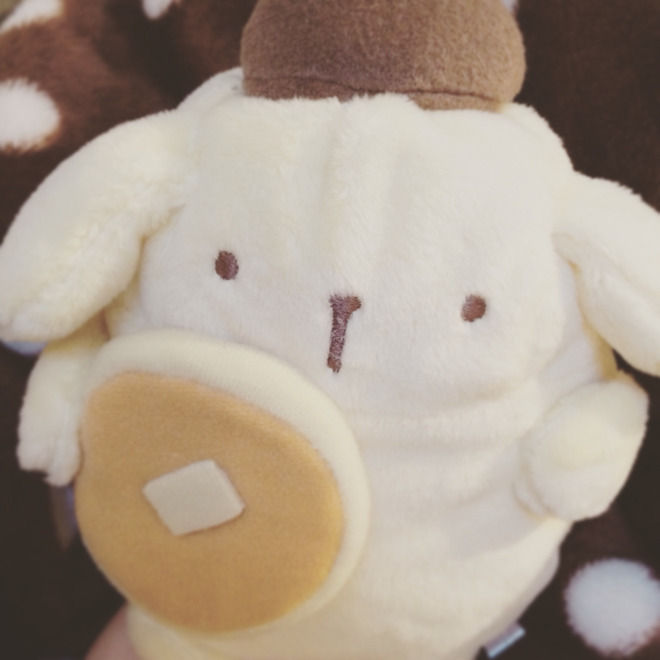

# 大変大変！カウントダウンのはじまりです！
# 不得了不得了！倒计时开始啦！

- Published: 2016-05-01T17:13:12+0900
- Original URL: http://lineblog.me/kano/archives/5941459.html
- Wayback snapshot: 20160504175607
- Source HTML: ../data/pages/20160504175607_4XQWJMJQ76F5G3R2OMSUY7YDINCRRQVP_lineblog.me_80_kano_archives_5941459.html.html

こんばんは、鹿乃です。

晚上好，我是鹿乃。

いよいよ、鹿乃メジャー1stアルバム「nowhere」のリリースまであと…10日とちょっとです。

终于，距离鹿乃主流出道首张专辑《nowhere》发售只剩……10天多一点了。

[Image source](http://ecx.images-amazon.com/images/I/51eVw0AhK-L._SL160_.jpg)

[【早期購入特典あり】nowhere(メーカー特典:オリジナルポストカード(汎用ver.)) [CD]](http://www.amazon.co.jp/%E3%80%90%E6%97%A9%E6%9C%9F%E8%B3%BC%E5%85%A5%E7%89%B9%E5%85%B8%E3%81%82%E3%82%8A%E3%80%91nowhere-%E7%B5%B5%E6%9C%AC%E4%BB%98%E7%94%9F%E7%94%A3%E9%99%90%E5%AE%9A%E7%9B%A4-%E3%83%A1%E3%83%BC%E3%82%AB%E3%83%BC%E7%89%B9%E5%85%B8-%E3%82%AA%E3%83%AA%E3%82%B8%E3%83%8A%E3%83%AB%E3%83%9D%E3%82%B9%E3%83%88%E3%82%AB%E3%83%BC%E3%83%89-%E6%B1%8E%E7%94%A8ver/dp/B01DSN3MU0%3FSubscriptionId%3DAKIAIM37F4M6SCT5W23Q%26tag%3Dlvdrfree-22%26linkCode%3Dxm2%26camp%3D2025%26creative%3D165953%26creativeASIN%3DB01DSN3MU0)

鹿乃

2016-05-11

今日からリリース日までアルバムの制作秘話や、アルバムとはまったく関係ない鹿乃のプライベートのお話とか書いていこうと思いますφ(｡\_｡\*)

从今天起直到发售日，我打算写写专辑的制作秘闻，以及和专辑完全无关的鹿乃私人话题之类的φ(｡\_｡\*)

<iframe width="480" height="360" src="https://www.youtube.com/embed/6BXKh4f6Vhw?rel=0" title="嵌入视频" frameborder="0" allow="accelerometer; autoplay; clipboard-write; encrypted-media; gyroscope; picture-in-picture; web-share" allowfullscreen loading="lazy"></iframe>

<video controls preload="metadata" src="../media/91af2eb6035d.mp4"></video>

> [!video] YouTube
> 
>
> [播放原视频](https://www.youtube.com/watch?v=6BXKh4f6Vhw) · [查看网页存档](https://web.archive.org/web/20160504175607/https://www.youtube.com/watch?v=6BXKh4f6Vhw)
>
> [封面来源](https://i.ytimg.com/vi/6BXKh4f6Vhw/hqdefault.jpg)

アルバムの1曲目【プリマステラ】

专辑的第一首歌《プリマステラ》

プリマステラはイタリア語で「一等星」という意味です。私が曲名をつけさせていただきました。

《プリマステラ》在意大利语里是“一等星”的意思。我有幸为这首歌起了名字。

将来の夢、目標、大事なもの、恋とか友情とかその他諸々！

将来的梦想、目标、珍视的东西、恋爱、友情，以及其他种种！

探そうと思って見つかったり探したくてもどこにあるかわからなくて見つからなかったり、ふとした瞬間に急に見つけたりなくなったり。

有时候想要寻找就找到了；有时候想找却不知道它在哪里、怎么也找不到；有时候又在不经意的一瞬间突然出现，或是悄然不见。

なんかそういう感じが星っぽいな〜と思って「プリマステラ」と曲名をつけさせていただきました。

总觉得这种状态很像星星呢～，所以我就把歌名取成了《プリマステラ》。

人それぞれ色んな「星」があると思います。私にもあります。きっと自分にはないと思っている人にもあります。見つからなくても探しにいくことはできます。与えられることもあります。よね？みたいな気持ちを込めたタイトルです。

我觉得每个人的心中都有各自不同的“星”。我也有。想必那些觉得自己一定没有的人，其实也拥有。就算暂时找不到，也还是可以去寻找。有时候它也会自己来到你身边。我把这种“对吧？”的心情寄托在了这个标题里。

曲を聴いた人は「星」にどんなものをあてはめて聴いてるのかな〜機会があったらいつか教えてください( ˊᵕˋ* )

听这首歌的大家，会把什么东西代入成自己的“星”来听呢～有机会的话，请一定要告诉我哦( ˊᵕˋ* )

さて、ここからは今日から謎にはじまった「教えて鹿乃さん！」のコーナーの時間です。

好了，接下来是今天神秘开张的“请教鹿乃さん！”栏目时间。

「教えて鹿乃さん！…………鹿乃は鹿乃なの？ばんび〜のなの？はっきりして？？？？？？？」

“请教鹿乃さん！…………鹿乃是鹿乃吗？还是ばんび〜の？给我说清楚？？？？？？？”

よくある質問？疑問ですね。正直、私はばんび〜のでっす❤︎❤︎❤︎なんて名乗ったことは一切ないのでなんでこんなに言われるのか長年の謎でしたが……ようやくわかりました！！！

这是经常被问到的问题？还是疑问呢。说实话，我从来没有自称过“我是ばんび〜の哦❤︎❤︎❤︎”，所以一直不明白为什么大家总是这么说，多年来这都是一道谜……现在我终于搞懂了！！！

個人サークル名が「ばんび〜の」なのですが、個人サークル名＝一人ユニット名だと思われてる説。違います。鹿乃は鹿乃です。ばんび〜のさんじゃありません！！！と、ここに宣言をさせていただきます。

我的个人社团名是“ばんび〜の”，不过似乎有一种说法认为个人社团名＝单人组合名。不是的。鹿乃是鹿乃。并不是ばんび〜のさん！！！在此我要郑重地声明。

「教えて鹿乃さん………好きなキャラクターは？！ハマってるものは？！」

“请教鹿乃さん………喜欢的角色是？！最近着迷的东西是？！”

好きなキャラクターはいっぱいありますが、最近はぽむぽむぷりんとピカチューが好きです。一番好きな色は青なのですが、なんか黄色が好きなのかなって感じのキャラクターにハマってますね笑

喜欢的角色有很多，最近最喜欢布丁狗和皮卡丘。我最喜欢的颜色明明是蓝色，却偏偏迷上了一些让人感觉“是不是其实喜欢黄色呀”的角色呢，笑

[Image source](http://line.blogimg.jp/kano/imgs/7/c/7c76f4ac.jpg)

と、いうわけで、ゆる〜〜いコーナーをやりきったところで今日はお別れです。鹿乃でした！また明日ね！

那么就这样，在把这个软绵绵～的栏目做完之后，今天就要和大家道别啦。我是鹿乃！明天见哦！

鹿乃
