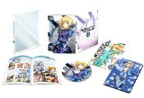
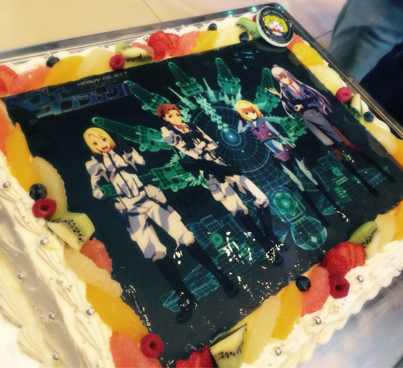

# ヘヴィーオブジェクトの打ち上げに…！
# 《重装武器》庆功宴之行…！

- Published: 2016-05-04T17:39:16+0900
- Original URL: http://lineblog.me/kano/archives/6039909.html
- Wayback snapshot: 20160505175415
- Source HTML: ../data/pages/20160505175415_AARNMRFNDDNAAQGSCZQNCMWIHYXJTBMJ_lineblog.me_80_kano.html

こんにちは、鹿乃ですφ(｡\_｡\*)

你好，我是鹿乃φ(｡\_｡\*)

みなさま、GWいかがお過ごしですか？

大家黄金周过得怎么样呀？

鹿乃1stメジャーアルバム「nowhere」リリースと発売日当日のリリイベ含めてあと一週間ですよ。はやい。

包括鹿乃首张主流专辑《nowhere》的发售，以及发售当天的发售纪念活动，都只剩一周了哦。真快呀。

☆2016年5月11日（水）
●会場：SHIBUYA TSUTAYA 2F
●時間：開場:19:15 開演:19:30
参加券配布店舗：SHIBUYA TSUTAYA

☆2016年5月11日（周三）
●会场：涩谷TSUTAYA 2F
●时间：开场 19:15，开演 19:30
参加券发放店铺：涩谷TSUTAYA
[http://ameblo.jp/shibuya-tsutaya/entry-12145918540.html](http://ameblo.jp/shibuya-tsutaya/entry-12145918540.html)

まだ参加券ありますので、その他の開催地のリリイベもご都合よろしければぜひ遊びにきてくださいね( ˊᵕˋ* )

参加券还有剩余，其他举办地的发售纪念活动如果时间合适，也欢迎大家来玩哦( ˊᵕˋ* )

お渡し会限定でクリアファイルとオリジナルサイン色紙をお渡しさせていただきますです。

在限定特典递交会上，会给大家送上透明文件夹和原创签名色纸。

<iframe width="480" height="360" src="https://www.youtube.com/embed/UstE6yTlwcU?rel=0" title="嵌入视频" frameborder="0" allow="accelerometer; autoplay; clipboard-write; encrypted-media; gyroscope; picture-in-picture; web-share" allowfullscreen loading="lazy"></iframe>

<video controls preload="metadata" src="../media/b04cdeafa13e.mp4"></video>

> [!video] YouTube
> 
>
> [播放原视频](https://www.youtube.com/watch?v=UstE6yTlwcU) · [查看网页存档](https://web.archive.org/web/20160505175415/https://www.youtube.com/watch?v=UstE6yTlwcU)
>
> [封面来源](https://i.ytimg.com/vi/UstE6yTlwcU/hqdefault.jpg)

さてさて、カウントダウンブログ第三弾は「ディアブレイブ」のご紹介です。

好了好了，倒计时博客的第三弹，要为大家介绍的是《Dear Brave》。

鹿乃の2ndシングル曲であり、テレビアニメ「ヘヴィーオブジェクト」のED主題歌になっております。

这是鹿乃的第二张单曲，也是电视动画《重装武器》的片尾主题曲。

[Image source](http://ecx.images-amazon.com/images/I/51UhYwIQebL._SL160_.jpg)

[「ヘヴィーオブジェクト」Vol.1【Blu-ray】 [Blu-ray]](http://www.amazon.co.jp/%E3%80%8C%E3%83%98%E3%83%B4%E3%82%A3%E3%83%BC%E3%82%AA%E3%83%96%E3%82%B8%E3%82%A7%E3%82%AF%E3%83%88%E3%80%8DVol-1-lt-%E5%88%9D%E5%9B%9E%E7%94%9F%E7%94%A3%E9%99%90%E5%AE%9A%E7%89%88-gt-%E3%80%90Blu-ray%E3%80%91/dp/B016Q3MES0%3FSubscriptionId%3DAKIAIM37F4M6SCT5W23Q%26tag%3Dlvdrfree-22%26linkCode%3Dxm2%26camp%3D2025%26creative%3D165953%26creativeASIN%3DB016Q3MES0)

[Image source](http://line.blogimg.jp/kano/imgs/0/a/0a97b99a.jpg)

タイトルでネタバレしちゃっているのですが、そうなんです！行ってきました「ヘヴィーオブジェクト」の打ち上げ。

标题已经剧透给大家了，没错！我去参加了《重装武器》的庆功宴。

お写真はヘヴィーオブジェクトのケーキです。すごくないですか？感激しちゃいました。

照片里是《重装武器》的蛋糕。是不是超厉害？我都感动坏了。

打ち上げにはたくさんの人がいらしていて、頭ではわかってはいたのですがたくさんの人の協力が色々あって、作品は出来上がってるんだなあと改めて実感しました。

庆功宴上来了很多人。虽然心里早就明白，但亲眼看到一部作品是靠这么多人的各方协作才得以完成，我还是重新深切地体会到了这一点。

わたしも音楽面で、そのたくさんの人の中に参加させていただくことができて本当に嬉しかったです。

我也能在音乐方面，成为这众多人中的一员，真的非常开心。

2ndシングルであり、アルバム3曲目の「ディアブレイブ」は一人じゃ見つけられなかった勇気や自分の気持ちと出会う物語性のある楽曲なんだよな〜なんか素敵だな〜と、打ち上げ会場でたくさんの関係者さんたちの横顔や背中を見つめながらぼんやり考えていました。

《Dear Brave》既是第二张单曲，也是专辑的第三首歌，是一首充满故事性的曲子——讲述与独自一人时无法找到的勇气、以及自己真正的心意相遇的故事。在庆功宴会场里，我望着众多工作人员们的侧脸和背影，出神地想着：这真是一首很棒的歌啊～

まとまりが…ない！笑

思绪真是……毫无条理！笑

[Image source](http://ecx.images-amazon.com/images/I/51eVw0AhK-L._SL160_.jpg)

[【早期購入特典あり】nowhere(メーカー特典:オリジナルポストカード(汎用ver.)) [CD]](http://www.amazon.co.jp/%E3%80%90%E6%97%A9%E6%9C%9F%E8%B3%BC%E5%85%A5%E7%89%B9%E5%85%B8%E3%81%82%E3%82%8A%E3%80%91nowhere-%E7%B5%B5%E6%9C%AC%E4%BB%98%E7%94%9F%E7%94%A3%E9%99%90%E5%AE%9A%E7%9B%A4-%E3%83%A1%E3%83%BC%E3%82%AB%E3%83%BC%E7%89%B9%E5%85%B8-%E3%82%AA%E3%83%AA%E3%82%B8%E3%83%8A%E3%83%AB%E3%83%9D%E3%82%B9%E3%83%88%E3%82%AB%E3%83%BC%E3%83%89-%E6%B1%8E%E7%94%A8ver/dp/B01DSN3MU0%3FSubscriptionId%3DAKIAIM37F4M6SCT5W23Q%26tag%3Dlvdrfree-22%26linkCode%3Dxm2%26camp%3D2025%26creative%3D165953%26creativeASIN%3DB01DSN3MU0)

鹿乃

2016-05-11

そんなこんなでアルバム含めて、わたしと出会ってくれた皆さん！！！これからもよろしくお願いします！

就这样，连同这张专辑在内，感谢所有与鹿乃相遇的大家！！！今后也请多多关照！

鹿乃
