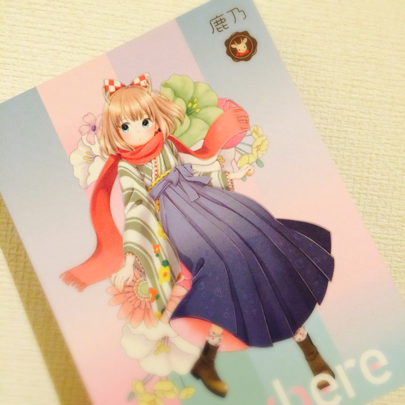

# アルバムフラゲ＆動画投稿な日！
# 专辑抢先到手＆投稿视频的一天！

- Published: 2016-05-10T20:55:47+0900
- Original URL: http://lineblog.me/kano/archives/6262383.html
- Wayback snapshot: 20160521004925
- Source HTML: ../data/pages/20160521004925_XTP34KW5LSUVEPCE4UAJXKPIH5PSX63P_lineblog.me_80_kano_archives_cat_96603.html.html

[Image source](http://line.blogimg.jp/kano/imgs/4/4/44f688ae.jpg)

＼フライングでゲット／

＼抢先一步到手／

明日、5月11日はとうとう鹿乃メジャー1stアルバム「nowhere」の発売日です。

明天5月11日，鹿乃的首张主流专辑《nowhere》终于迎来发售日了。

今日すでに色々な店舗さんで素敵に並べられているようで、Twitterから流れてくる情報をみて嬉しくなっていました。

今天各家店铺似乎已经把它陈列得很漂亮了，看着 Twitter 上不断传来的消息，我开心得不得了。

ようやくみんなに聴いてもらえる。聴いてもらうことをこんなに強く、楽しみに思う気持ちがあったのかと自分でも少し驚くほど本当に嬉しくて仕方ありませんでした。

终于能让大家听到我的歌了。原来我会如此强烈、如此期待有人来听吗——连自己都有点吃惊，真的高兴得不知如何是好。

みんなに届けたいです。届くといいな。ありがとう。みんなにありがとう。

想把这份心意传达给大家。希望能传达到呀。谢谢。谢谢大家。

なんか感動してて、これしか言葉がでてこない！どうしましょう笑

太感动了，脑子里只剩这一句话！怎么办呀。笑

滅多になれる気持ちじゃないので今は噛み締めちゃおうかな。

这种心情可不是常有的，现在我想好好把它细细品味一番。

今日、40mPさんに書き下ろしていただいた楽曲を同時に投稿しました。アルバム収録の「今をかける少女」です。

今天，我同时上传了由 40mP 老师为我特别创作的歌曲，也就是专辑里收录的《奔跑在当下的少女》。

初音ミクちゃん版

初音未来演唱版

[http://sp.nicovideo.jp/watch/sm28816494](http://sp.nicovideo.jp/watch/sm28816494)

鹿乃 版

鹿乃演唱版

[http://sp.nicovideo.jp/watch/sm28816550](http://sp.nicovideo.jp/watch/sm28816550)

ぜひ聴いて観て楽しんでください。

请大家一定要听一听、看一看，好好享受哦。

アルバムや動画に関する感想を呟く際には「#鹿乃」のハッシュタグをもしよろしければ！

发推聊专辑或视频感想的时候，方便的话也请带上“#鹿乃”的话题标签！

明日はアルバムリリース、そしてライブのチケットがいよいよ…

明天就是专辑发售日了，然后演唱会的门票也终于要……

一緒に今を精一杯楽しみましょうねっ

让我们一起尽情享受当下吧！

鹿乃
