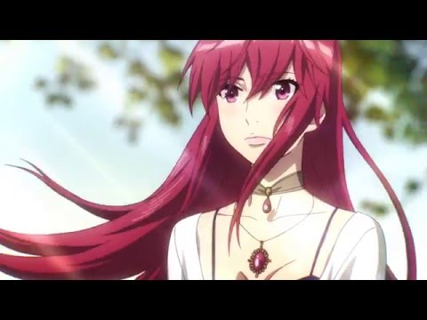
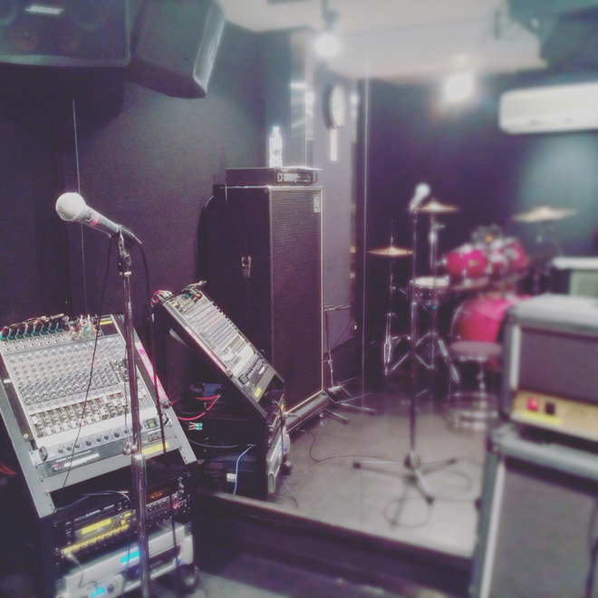

# ご報告。
# 向各位报告。

- Published: 2016-06-10T20:02:24+0900
- Original URL: http://lineblog.me/kano/archives/7195372.html
- Wayback snapshot: 20160611074456
- Source HTML: ../data/pages/20160611074456_VYH4OM2AGRPLVOVVHANX7PUTI7NVRCQS_lineblog.me_80_kano.html

7月8日から放送開始のTVアニメ「ねじ巻き精霊戦記  天鏡のアルデラミン」のED主題歌を私、鹿乃が担当させていただくことになりました。

我鹿乃确定要为7月8日起开播的电视动画《发条精灵战记 天镜的极北之星》演唱片尾主题曲了。

作曲編曲はTom-h@ckさん！歌詞は鹿乃が担当させていただいています。

作曲和编曲由 Tom-h@ck 老师负责！歌词则是由鹿乃来写的。

そんな楽曲のタイトルは「nameless」で……2016年９月7日にリリースが決まりました⸜(๑⃙⃘'ᵕ'๑⃙⃘)⸝⋆︎*

这首歌的歌名叫《nameless》……已经确定将于2016年9月7日发售啦⸜(๑⃙⃘'ᵕ'๑⃙⃘)⸝⋆︎*

<iframe width="480" height="360" src="https://www.youtube.com/embed/5kL47t4Mz-4?rel=0" title="嵌入视频" frameborder="0" allow="accelerometer; autoplay; clipboard-write; encrypted-media; gyroscope; picture-in-picture; web-share" allowfullscreen loading="lazy"></iframe>

<video controls preload="metadata" src="../media/7a460f9f936d.mp4"></video>

> [!video] YouTube
> 
>
> [播放原视频](https://www.youtube.com/watch?v=5kL47t4Mz-4) · [查看网页存档](https://web.archive.org/web/20160611074456/https://www.youtube.com/watch?v=5kL47t4Mz-4)
>
> [封面来源](https://i.ytimg.com/vi/5kL47t4Mz-4/hqdefault.jpg)

どんな楽曲になるのか、わくわくそわそわ、アニメの放送と一緒に楽しみに待っていてくださると嬉しいです。

这首歌会是什么样呢？我既兴奋又忐忑。希望大家能和动画开播一起期待它的到来，我会很开心的。

詳しい放送日などはこちらの公式HPをチェックしてください！[http://alderamin.net](http://alderamin.net)

具体的播出时间等信息，请查看这边的官方网站确认！[http://alderamin.net](http://alderamin.net)

よかったらこのブログを #アルデラミン のハッシュタグつきでTwitterなどでも拡散してください。いっぱいの人に知っていただきたいのです。図々しいお願いしてごめんなさい。なにとぞご協力を〜〜（＞人＜）汗

如果方便的话，请把这个博客配上“#アルデラミン”的标签，在 Twitter 等处帮忙扩散。我想让更多人都知道它。这么厚脸皮的请求真不好意思，恳请大家多多帮忙～～（＞人＜）汗

2016年前半戦も残り僅か…

2016年的上半场也没剩多少了……

まだまだ休ませませんよ〜一緒に目一杯楽しんでいきましょう！いっぱい心配をおかけしちゃうかもですが、コツコツと鹿乃のペースで必ず乗り越えて進んでいくのでついてきてください。

我可不会让大家歇着哦～让我们一起尽情享受吧！虽然可能会让大家担心不少，但我会按自己的节奏脚踏实地、一步一个脚印地克服困难继续前进，请你们跟紧我。

まずはライブですね！笑

首先要说的就是演唱会！笑

ひゃ〜〜緊張だようっ

呀～～好紧张啊！

[Image source](http://line.blogimg.jp/kano/imgs/0/4/04cd5d40.jpg)

鹿乃
