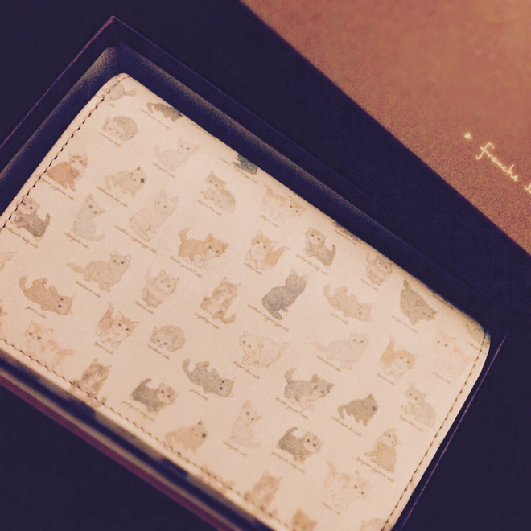
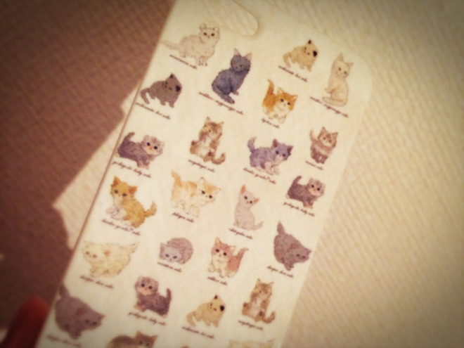
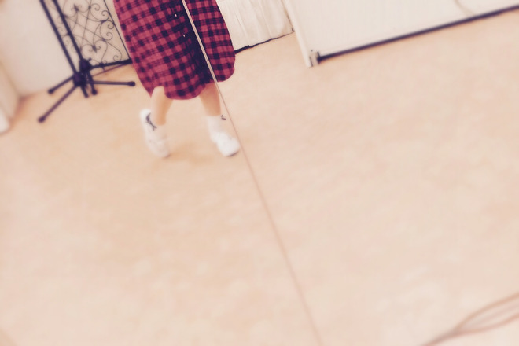

# にゃーーん！
# 喵呜——！

- Published: 2016-06-16T20:23:03+0900
- Original URL: http://lineblog.me/kano/archives/7397078.html
- Wayback snapshot: 20160620144537
- Source HTML: ../data/pages/20160620144537_XYGUXNT7KENJCTG7VKZNVWARFMH4XHZO_lineblog.me_80_kano_archives_7397078.html.html

[Image source](http://line.blogimg.jp/kano/imgs/6/7/67f93b4d.jpg)

＼にゃ〜〜〜〜〜〜ん／

＼喵～～～～～～／

去年のお誕生日プレゼントとアルバム発売記念とライブ頑張れよ〜〜な気持ちを兼ねて、前から欲しかったお財布を家族からプレゼントしてもらいました。

这个钱包我早就想要了，这次家人把它作为生日礼物（去年的）、专辑发售纪念，以及“演唱会加油哦～”的心意一起送给了我。

応援してもらえるって嬉しいですね。すごくうれしい。

能被大家这样支持，真的很开心。超级开心。

ところで……この柄にピンッときた方、さすがです！

话说……一眼就认出这个花纹的朋友，真有眼光！

[Image source](http://line.blogimg.jp/kano/imgs/5/a/5a38b19d.jpg)

以前Twitterで紹介したiphoneケースと同じ柄ですっ

和之前在 Twitter 上介绍过的 iphone 手机壳是同一个花纹哦！

うまく言えないのですが、思い入れって小さくても大きくても思い出と一緒にできるものなんだろうなって思いました。大事にしよう。

虽然说不清道不明，但我觉得，那些承载着心意的物件，无论大小，都会和回忆一起留存下来吧。要好好珍惜它。

ライブまであと半月…！

距离演唱会还有半个月……！

ねこちゃんパワーでがんばるぞっ

我要靠猫咪力量加油！

[Image source](http://line.blogimg.jp/kano/imgs/a/d/adf1dc61.jpg)

鹿乃
