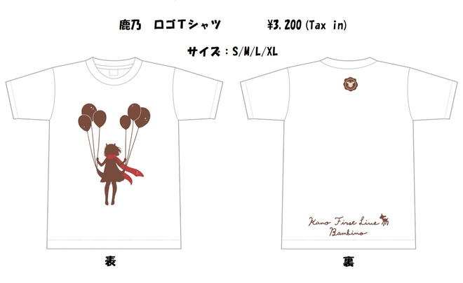
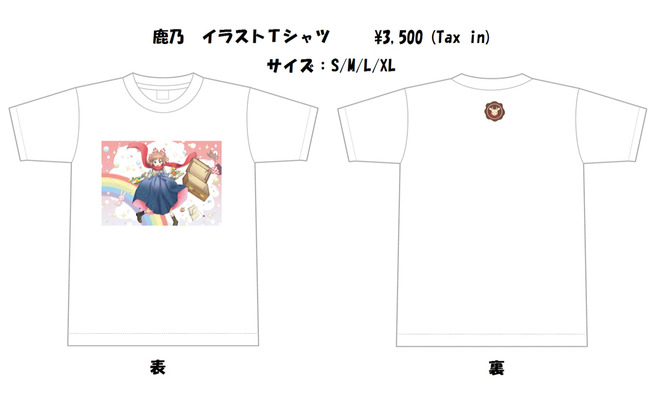
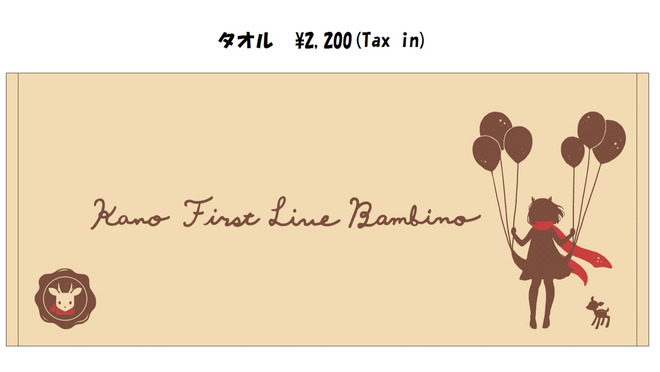
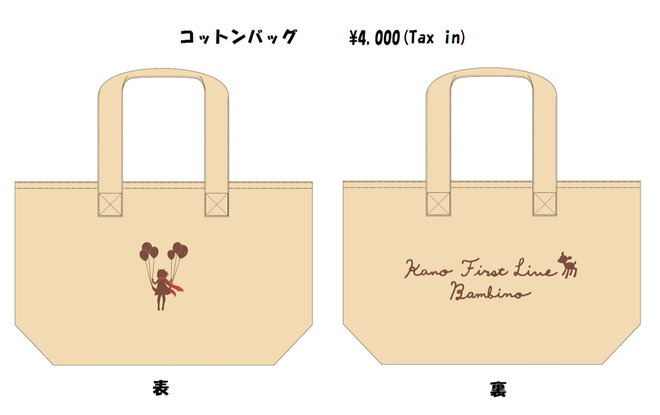
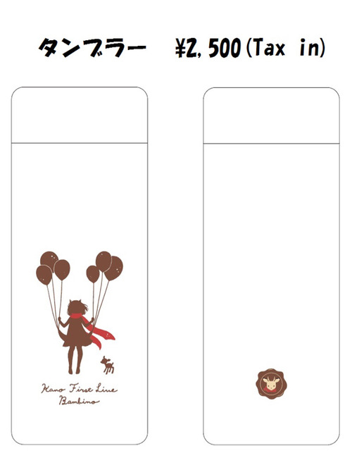
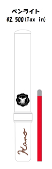
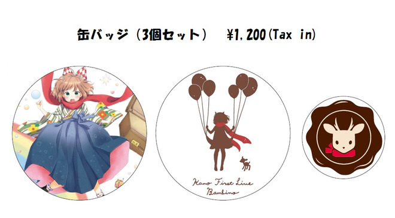
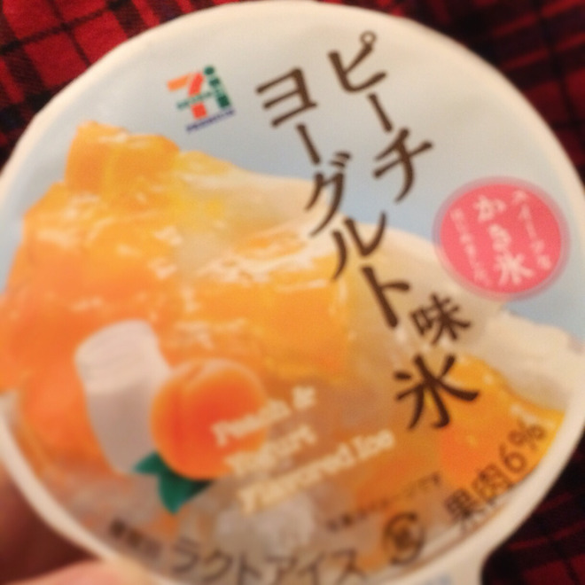

# ライブグッズ！と、マイブームなお話
# 演唱会周边！以及最近让我着迷的事

- Published: 2016-06-28T17:30:39+0900
- Original URL: http://lineblog.me/kano/archives/7754064.html
- Wayback snapshot: 20160701111923
- Source HTML: ../data/pages/20160701111923_NMUPLZF5CHXOIYH7NJVG5AUAOXGBKLKQ_lineblog.me_80_kano_archives_7754064.html.html

こんばんは、鹿乃です。昨日はブログ書きつつまさかの寝落ちで気がついたら0時過ぎ…ｶﾞ--(꒪⌓︎꒪)-- ﾝｯ

晚上好，我是鹿乃。昨天我一边写博客一边居然睡着了，等回过神来已经过了零点……唔哇—(꒪⌓︎꒪)—嗯

なので予約投稿なる文明の利器を使っちゃいます。これでばっちりだ！

所以今天就用上“定时发布”这个文明利器啦。这样就万无一失啦！

さてさて、いよいよ発表になったライブグッズ〜〜皆さんもうチェックはできていますか？

好了好了，演唱会周边终于公布了～大家都已经看过了吗？

[Image source](http://line.blogimg.jp/kano/imgs/6/9/6944a28a.jpg)

[Image source](http://line.blogimg.jp/kano/imgs/7/d/7d42c150.jpg)

[Image source](http://line.blogimg.jp/kano/imgs/0/d/0d77c219.jpg)

[Image source](http://line.blogimg.jp/kano/imgs/4/2/428a63c1.jpg)

[Image source](http://line.blogimg.jp/kano/imgs/b/9/b9b1ea07.jpg)

[Image source](http://line.blogimg.jp/kano/imgs/7/2/7280189d.jpg)

[Image source](http://line.blogimg.jp/kano/imgs/7/4/743d66d7.jpg)

こうやって画像がずら〜〜っと並ぶと、圧巻ですね。実物ほんっとめちゃかわなので早くみんなに見て、お手にとっていただきたい( ･ᴗ･̥̥̥  )

像这样把图片一张张排开，真是壮观呀。实物真的超级可爱，好想快点让大家亲眼看看、亲手拿到手上( ･ᴗ･̥̥̥  )

特にペンライト！当日はこちらのペンライトを使って、みんな一緒に楽しんでもらえたらいいなって思ってます。

尤其是应援棒！真希望当天大家能挥着这款应援棒，一起尽情享受。

わたしにとってのはじめてのライブが、はじめて行くライブになるよ〜〜という方をちらほらお見かけしたので、ペンライトがあったらわかりやすい？みんなと一緒に楽しみやすいかなと思ってお願いして作っていただきました！

我零零散散看到有人说：“这是她的第一场演唱会，也会是我第一次去看的现场！”之类的话，所以我想，如果有应援棒，是不是更容易明白、更能和大家一起投入其中？于是特地拜托制作了这款应援棒。

（ペンライトを興奮しすぎて周りの人にぶつけない、ぶつけられないように注意してね。ぶつかったことないからわからないけど痛い気がするっ）

（太兴奋的话，小心别让应援棒打到周围的人，也别被别人的应援棒打到哦。我没被砸过所以不清楚，但感觉一定很疼！）

いよいよ今週末に迫った1stライブ！

首场演唱会就迫在眉睫，就在这周末了！

気分はリレーのバトンを渡されるのを待つ走者です笑

心情就像接力赛里等着接力棒递到自己手中的跑者。笑

バトンを受けとって走りだしたら、転んでも1位でもビリでも、最後まで走りきるしかないので、格好悪いところいっぱい見せちゃうかもしれないけど一生懸命みんなに向かって歌うね。

一旦接过接力棒跑起来，不管是摔倒、跑第一还是垫底，都只能坚持跑到最后。所以也许会让你们看到很多狼狈的样子，但我一定会拼命朝着大家歌唱。

どんな歌を歌う人になりたいの？て、質問に1年前ははっきりと答えられなかったけど、今は答えられるようになりました。

“你想成为一个唱怎样的歌的人呢？”——这个问题，一年前我还答不上来，但现在我能回答了。

わたしは誰かに寄り添う歌を歌いたい！

我想唱能陪伴在某人身边的歌！

今、私の歌を聴いてちょっとでも寂しい気持ちが和らいでくれる人がいるなら、その人のために歌いたい。

如果现在有人听到我的歌，哪怕只是让寂寞的心情缓和一点点，我都想为那个人而唱。

自分のためだけに歌ってたころより、少しだけ成長できた気がします。たぶん。ヘタレなりにまだまだ成長する気もあります。

比起只为自己唱歌的那段时光，我感觉自己多少成长了一点。大概吧。虽然是个没出息的家伙，但我还想继续一点点成长下去。

まだまだダメダメな鹿乃ですが、これからもよろしくお願いしますっ

鹿乃还有很多不足、还很不成熟，但今后也请多多关照！

さて、話は変わって…

好了，换个话题……

最近の鹿乃のマイブーム！

最近让鹿乃着迷的东西！

[Image source](http://line.blogimg.jp/kano/imgs/a/5/a5cd3ace.jpg)

何回やってもピントが合わない！笑

不管拍多少次都对不上焦！笑

あんまり写真撮ってるとその間にアイスが溶けちゃう〜〜てことで、細かい粗はご容赦ください。

要是拍得太久，冰淇淋都要在这期间化掉了～所以这些小瑕疵还请大家多多包涵。

このセブンイレブン限定？のアイスすごく美味しいんです。めちゃめちゃハマってます。

这款好像是 7-Eleven 限定？的冰淇淋真的超好吃。我彻底迷上它了。

気になった方はぜひ食べてみてください♪

感兴趣的朋友一定要尝尝看哦♪

鹿乃
