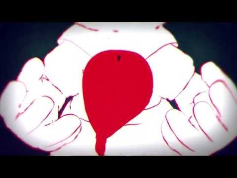

# あのね
# 跟你说哦

- Published: 2016-09-04T18:11:12+0900
- Original URL: http://lineblog.me/kano/archives/10292177.html
- Wayback snapshot: 20160907191353
- Source HTML: ../data/pages/20160907191353_P3EA3OEPWQ7VCAJCFZNOY4M27JKO3QYC_lineblog.me_80_kano_archives_10292177.html.html

[Image source](http://line.blogimg.jp/kano/imgs/e/7/e7a496b5.jpg)

そろそろ夏から秋！ということで、ベッド周りから今日は模様替えをはじめてみました。夏の間は青系多めのお部屋だったのですが、今日からは赤系多めに生まれ変わりました。

差不多该从夏天进入秋天了！所以今天先从床铺周围开始试着重新布置了一下。整个夏天房间都以蓝色系为主，但从今天起它焕然一新，变成以红色系为主了。

みんなはそろそろ秋だし、◯◯をチェンジするか〜〜みたいなのありますか？

大家呢，秋天快到了，有没有“要不要把某某换一换〜〜”之类的想法呀？

よかったらみんなのことを鹿乃に教えてくださいφ(｡\_｡\*)

方便的话，把大家的事也讲给鹿乃听听吧φ(｡\_｡\*)

ちなみになのですが、ブログを書くときは何かしら写真を載せたいなと思っている鹿乃なのですが、特にこれといって写真がなかったのでベッドの中から撮れる身近なものを撮ってみました笑

顺带一提，鹿乃我写博客的时候总想放点照片上去，不过这次没什么特别想拍的照片，就从被窝里伸手拍了些手边的小物件，哈哈。

さて来週はいよいよ鹿乃3rdシングル「nameless」のリリース週！

那么下周终于就是鹿乃第三张单曲《nameless》发售的那一周了！

[Image source](http://ecx.images-amazon.com/images/I/51c%2B7U1ICBL._SL160_.jpg)

[nameless [CD]](http://www.amazon.co.jp/nameless-lt-%E3%82%A2%E3%83%BC%E3%83%86%E3%82%A3%E3%82%B9%E3%83%88%E7%9B%A4-gt-%E9%B9%BF%E4%B9%83/dp/B01GU2OOP8%3FSubscriptionId%3DAKIAIM37F4M6SCT5W23Q%26tag%3Dlvdrfree-22%26linkCode%3Dxm2%26camp%3D2025%26creative%3D165953%26creativeASIN%3DB01GU2OOP8)

鹿乃

2016-09-07

先ほど、それを記念して？Twitterにピアノアレンジver.の動画を投稿しました。もしよかったらRTやお気に入り、感想いただけると励みになるのでよろしくお願いします( ˊᵕˋ* )

刚才，为了纪念这件事？我在Twitter上投稿了钢琴改编版的视频。如果大家方便的话，能转发、点收藏，或是告诉我感想，都会成为我的动力，拜托大家啦( ˊᵕˋ* )

[https://twitter.com/kano_2525](https://twitter.com/kano_2525)

↓ 原曲動画 ↓

↓ 原曲视频 ↓

<iframe width="480" height="360" src="https://www.youtube.com/embed/im2tTHtR5YU?rel=0" title="嵌入视频" frameborder="0" allow="accelerometer; autoplay; clipboard-write; encrypted-media; gyroscope; picture-in-picture; web-share" allowfullscreen loading="lazy"></iframe>

<video controls preload="metadata" src="../media/ecc3e9bbd6b0.mp4"></video>

> [!video] YouTube
> 
>
> [播放原视频](https://www.youtube.com/watch?v=im2tTHtR5YU) · [查看网页存档](https://web.archive.org/web/20160907191353/https://www.youtube.com/watch?v=im2tTHtR5YU)
>
> [封面来源](https://i.ytimg.com/vi/im2tTHtR5YU/hqdefault.jpg)

カップリングの「RERE」も投稿しました。いっぱい聴いてください！

搭配曲《RERE》也上传了！请大家多多聆听！

<iframe width="480" height="360" src="https://www.youtube.com/embed/l4Rp9GNXhU4?rel=0" title="嵌入视频" frameborder="0" allow="accelerometer; autoplay; clipboard-write; encrypted-media; gyroscope; picture-in-picture; web-share" allowfullscreen loading="lazy"></iframe>

<video controls preload="metadata" src="../media/e3783139dd11.mp4"></video>

> [!video] YouTube
> 
>
> [播放原视频](https://www.youtube.com/watch?v=l4Rp9GNXhU4) · [查看网页存档](https://web.archive.org/web/20160907191353/https://www.youtube.com/watch?v=l4Rp9GNXhU4)
>
> [封面来源](https://i.ytimg.com/vi/l4Rp9GNXhU4/hqdefault.jpg)

そしてそして、まだまだ続く告知…！

然后然后，公告还在一波接一波……！

Newシングル「nameless」発売を記念してツイキャス特番を
9
月8日21
時に放送することになりました！！

为了纪念新单曲《nameless》发售，我们决定在9月8日21点播出TwitCasting特别节目！！

[http://twitcasting.tv/kano_2525](http://twitcasting.tv/kano_2525)

今回はうふふなうふふがありまして…うふふなうふふの内容はまた後日に！みんなと一緒に楽しめたらいいなあ。ぜひ遊びにきてくださいねっ

这次准备了一些“嘿嘿嘿的嘿嘿嘿”……至于“嘿嘿嘿的嘿嘿嘿”的内容，就等改天再公布！要是能和大家一起开开心心地度过就好了，请一定要来玩哦！

リリイベもお待ちしてます！！まだ参加券あるのでご都合よろしかったらなにとぞぞぞφ(｡\_｡\*)

发售活动也恭候大家光临！！参加券还有剩余，如果时间方便的话，拜托拜托拜托啦φ(｡\_｡\*)

リリイベにそなえて美容院いったり、お洋服を色々手にとって睨めっこしたりしてて思ったんですが、行動がデート前の子みたいですね笑

为了发售活动去做了头发，又把各种衣服拿起来左挑右选，做着做着突然发现，这行为简直就像约会前的小姑娘嘛，笑

準備も含めて楽しい時間をいつも私にプレゼントしてくれてありがとう。

连做准备的日子在内，你们总是把快乐的时光当作礼物送给我，谢谢你们。

おやすみなさい〜〜またね⸜( ´ ꒳ ` )⸝♡︎

晚安〜〜下次见⸜( ´ ꒳ ` )⸝♡︎

鹿乃
