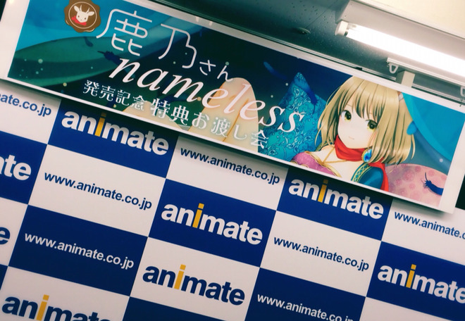
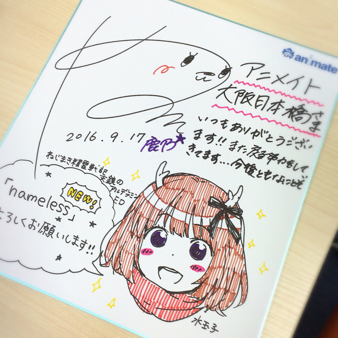
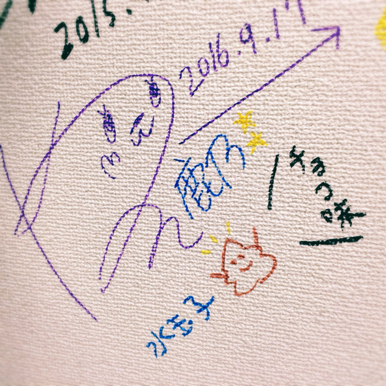
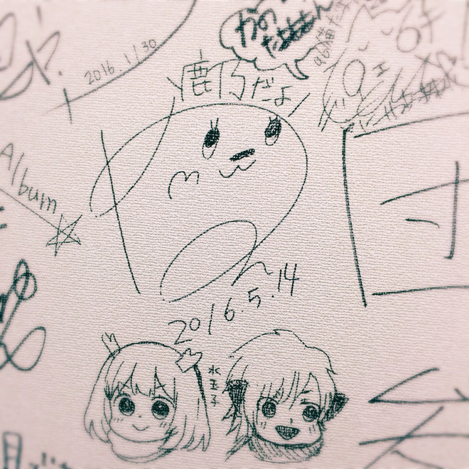
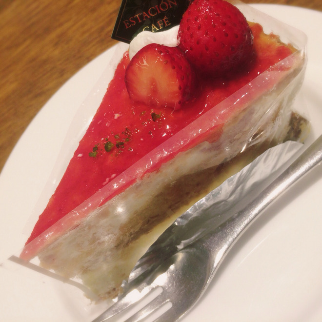

# またね大阪！いざ名古屋！
# 再见了大阪！出发去名古屋！

- Published: 2016-09-17T16:00:57+0900
- Original URL: http://lineblog.me/kano/archives/10791320.html
- Wayback snapshot: 20160921012139
- Source HTML: ../data/pages/20160921012139_W2PP5KK57EJ3HMAIOMVLUIGAG45SWTT6_lineblog.me_80_kano.html

[Image source](http://line.blogimg.jp/kano/imgs/1/6/16686519.jpg)

アニメイト大阪日本橋さんでのリリイベありがとうございました！デビューシングルからお世話になっているので、勝手に実家に戻ってきたようなホッとした気持ちになります( ˊᵕˋ* )

感谢大家在Animate大阪日本桥店参加发售活动！从出道单曲起就一直受这家店照顾，所以每次都会有种擅自回到老家的安心感( ˊᵕˋ* )

大阪でのリリイベは関東とは違い、はじめましての方が多いリリイベでした！まだまだ私のことを知らない、知ったら好きになってくださる方がいるんだな〜〜と嬉しくなりました。

大阪的发售活动和关东不太一样，初次见面的朋友特别多！一想到“原来还有这么多还不认识我、但一旦认识就会喜欢上我的人呀〜〜”就特别开心。

また、リリイベでお馴染みの方々とも今日も楽しくおしゃべりできたので、かなりテンションも上がりました！いつもありがとう〜

而且今天也和发售活动上常见面的老朋友们聊得很开心，情绪一下子高涨了起来！一直以来谢谢大家〜

また関西にお邪魔させていただけるように頑張るぞ( ¯•ω•¯ )‼︎

为了能再到关西来叨扰大家，我会加油的( ¯•ω•¯ )‼︎

[Image source](http://line.blogimg.jp/kano/imgs/8/a/8a2e5314.jpg)

[Image source](http://line.blogimg.jp/kano/imgs/2/0/20ffce32.jpg)

水玉さんも遊びに来て下さっていたので、恒例？のコラボサインも書いてきました！笑 ＜ チョコ味

水玉也来玩了，所以还写了那个惯例？的合作签名！笑 ＜ 巧克力味

[Image source](http://line.blogimg.jp/kano/imgs/4/6/46004e53.jpg)

このコラボサインの写真もパシャパシャしてきました📸✨

合作签名的照片也咔嚓咔嚓拍了不少📸✨

中腰になって書き書きしてるねこさん想像しちゃいますね。足ぷるぷるさせてるねこさん可愛いφ(｡\_｡\*) ※妄想

能想象出那只半蹲着写写画画的猫猫呢。腿在哆哆嗦嗦发抖的猫猫好可爱φ(｡\_｡\*) ※纯属妄想

[Image source](http://line.blogimg.jp/kano/imgs/1/9/19d50c4a.jpg)

ラストに水玉さんたちと午後のティータイム！お店に向かうまでに窓から見えた「ゴリラクリニック」が気になる。ネーミングセンスが強い！笑

最后和水玉他们一起享用了下午茶！去店里的路上，透过车窗看到的“大猩猩诊所”很让人在意。这命名功力也太强了！笑

というわけで、水玉さんにバイバイして今から名古屋へGOです。名古屋のリリイベに参加される皆さま、よろしくお願いしますよん( ˙◊︎˙◞︎)◞︎

就这样，和水玉他们说了拜拜，现在向名古屋出发GO！要参加名古屋发售活动的各位，请多多关照哦( ˙◊︎˙◞︎)◞︎

ブログネタ、質問まだまだ募集してます。このブログにコメントか、Twitterにリプライしてみてください！

博客话题和提问还在继续征集中！可以在这篇博客下留言，或者到Twitter上回复我！

名古屋のリリイベが終わって、東京に帰る電車の中で書き書きする予定のブログでまたいくつかお答えさせていただきますっ

我打算在名古屋的发售活动结束后、坐电车回东京的路上写一篇博客，到时候再回答大家几个问题哦

じゃあの( ˙◊︎˙◞︎)◞︎

那，回见啦( ˙◊︎˙◞︎)◞︎

鹿乃
