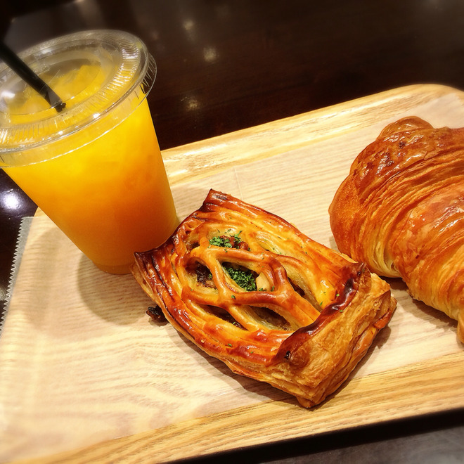

# おはよう〜みんなからの質問にムフッ( ˊᵕˋ* )
# 早上好～看到大家的问题，嘿嘿( ˊᵕˋ* )

- Published: 2016-09-17T08:25:03+0900
- Original URL: http://lineblog.me/kano/archives/10781022.html
- Wayback snapshot: 20160921012139
- Source HTML: ../data/pages/20160921012139_W2PP5KK57EJ3HMAIOMVLUIGAG45SWTT6_lineblog.me_80_kano.html

[Image source](http://line.blogimg.jp/kano/imgs/6/e/6eb2d896.jpg)

おはようございます、鹿乃です( ˊᵕˋ* )

早上好，我是鹿乃( ˊᵕˋ* )

最近、パン屋さんのパンにハマっています。一番好きなのは恵比寿駅の改札をでてすぐ目の前にある「モワザン」さんのクロワッサンです。おいしい〜♪

最近迷上了面包店的面包。最喜欢的是从惠比寿站检票口出来正对面那家“モワザン”家的可颂，超好吃～♪

お写真は東京駅の中にあるパン屋さんのパン！オレンジジュースは少し酸っぱいイメージがあったのですが、こちらのお店のはすごく甘くてびっくりしました。

照片里是东京站里一家面包店的面包！本以为橙汁会有点酸，结果这家店的特别甜，让我吃了一惊。

以前、青森の方が差し入れでくださったりんごジュースも今まで飲んできたりんごジュースと違ってめちゃめちゃ甘くてびっくりした記憶があるなあ〜〜。

记得以前有位青森的朋友送了我苹果汁，那味道也和以前喝过的苹果汁完全不一样，甜得惊人啊～～。

そんなこんなで今日はアニメイト大阪日本橋店さんと、第三太閤ビル（名古屋）さんで先週リリースされた「nameless」のリリイベがあります。

于是乎，今天在 Animate 大阪日本桥店和第三太阁大楼（名古屋）有上周发售的《nameless》的发售活动。

まだリリイベの参加券ちょびっとあるので、ぜひ遊びにきてくださいね⸜( ´ ꒳ ` )⸝♡︎

发售活动的参加券还剩一点点，欢迎大家一定要来玩哦⸜( ´ ꒳ ` )⸝♡︎

≫詳細はコチラ

≫详情请看这里

[http://whv-amusic.com/kano/sp/news/index00440000.html](http://whv-amusic.com/kano/sp/news/index00440000.html)

[Image source](http://www.amazon.co.jp/nameless-lt-%E3%82%A2%E3%83%BC%E3%83%86%E3%82%A3%E3%82%B9%E3%83%88%E7%9B%A4-gt-%E9%B9%BF%E4%B9%83/dp/B01GU2OOP8%3FSubscriptionId%3DAKIAIM37F4M6SCT5W23Q%26tag%3Dlvdrfree-22%26linkCode%3Dxm2%26camp%3D2025%26creative%3D165953%26creativeASIN%3DB01GU2OOP8)

[nameless [CD]](http://www.amazon.co.jp/nameless-lt-%E3%82%A2%E3%83%BC%E3%83%86%E3%82%A3%E3%82%B9%E3%83%88%E7%9B%A4-gt-%E9%B9%BF%E4%B9%83/dp/B01GU2OOP8%3FSubscriptionId%3DAKIAIM37F4M6SCT5W23Q%26tag%3Dlvdrfree-22%26linkCode%3Dxm2%26camp%3D2025%26creative%3D165953%26creativeASIN%3DB01GU2OOP8)

鹿乃

2016-09-07

ここからは昨晩Twitterで募集したブログネタ＆質問の中からいくつかひろってお答えしていこうと思います。リプライくれた皆さんありがとう〜〜( ˊᵕˋ* )

接下来，我会从昨晚在 Twitter 上征集的博客素材和问题中挑一些来回答。回复了我的大家，谢谢你们～～( ˊᵕˋ* )

▷六ノ桐 さんからの質問

▷来自六ノ桐 さん 的提问

やりたいことは？行ってみたい場所は？

想做的事是什么？想去的地方是哪里？

(◉▷◉)＜ 別名義でまったく「鹿乃」とは違う感じの活動してみたいねふふふ。行ってみたい場所は北海道〜〜ウニ！

(◉▷◉)＜ 想试试用别的名义，做点与“鹿乃”完全不同的活动呢，呵呵呵。想去的地方是北海道～～海胆！

▷りゅ〜さん からの質問

▷来自りゅ〜さん 的提问

今やっている、やってみたいゲームは？

现在在玩的游戏、想玩的游戏是什么？

(◉△◉)＜「キャサリン」ていうタイトルのゲームをやりたいです。ポケモンの新作も楽しみ〜〜new任天堂3DS LLにとうとう買い替える日がゴクリ( ˊᵕˋ )

(◉△◉)＜ 想玩一款叫《凯瑟琳》的游戏。也很期待宝可梦的新作～～终于到了要换 new任天堂3DS LL 的日子，咕咚( ˊᵕˋ )

▷しぐまさん からの質問

▷来自しぐまさん 的提问

好きな色は？花は？

喜欢的颜色是？花呢？

(◉△◉)＜ 青色が一番好きですが、生々しい話をすると部屋の家具や服との兼ね合いの関係で赤、白、ピンクなものが部屋に溢れてます。お花はだいたい全部好きですが特に桜と青いバラ、マーガレットが好きです。

(◉△◉)＜ 最喜欢的颜色是蓝色。不过说得实在点，为了搭配房间里的家具和衣服，红、白、粉色的东西堆得满屋子都是。花的话基本全都喜欢，尤其喜欢樱花、蓝玫瑰和玛格丽特。

▷ リリイベでされた質問

▷ 发售活动上被问到的问题

好きな服のブランドは？

喜欢的服装品牌是？

(◉▷◉) ＜ dazzlin、mysty woman、earth music&ecology、LOWRYS FARM、MAJESTIC LEGON、MERCURYDU などなどなどなど。わりときれいめ？可愛い系な服が好きです。誰にも会わねえぞ私は完全に自由だあああああウおらああああああな完全オフ日は古着屋さんで買ったプルオーバーのパーカーに長めのスカート（ズボンはかない）ハイカットスニーカーな感じが多いです。aikoさんみたいな服装も大好き！

(◉▷◉)＜ dazzlin、mysty woman、earth music&ecology、LOWRYS FARM、MAJESTIC LEGON、MERCURYDU 等等等等等等。喜欢的衣服偏干净利落？可爱系。完全休息日谁也见不着我，我就是彻底的自由啊啊啊啊啊呜噢噢噢噢。这种日子我多半穿古着店淘来的套头卫衣，配长裙（不穿裤子）和高帮帆布鞋。像 aiko 那样的穿搭我也超喜欢！

とりあえず今はここまで！今日また余裕があったらブログ更新するよ〜〜ブログネタや質問などまだまだありましたらブログコメントやリプライください。全部はお答えできませんがいくつかひろってくぜいφ(｡\_｡\*)

总之今天先到这里！今天要是有空的话我还会再更新博客的～～要是还有博客素材和问题，请尽管写在博客评论或回复里。虽然没办法全部回答，但我会挑一些来答的φ(｡\_｡\*)

またねっ

下次见啦

<iframe width="480" height="360" src="https://www.youtube.com/embed/l4Rp9GNXhU4?rel=0" title="嵌入视频" frameborder="0" allow="accelerometer; autoplay; clipboard-write; encrypted-media; gyroscope; picture-in-picture; web-share" allowfullscreen loading="lazy"></iframe>

<video controls preload="metadata" src="../media/e3783139dd11.mp4"></video>

> [!video] YouTube
> 
>
> [播放原视频](https://www.youtube.com/watch?v=l4Rp9GNXhU4) · [查看网页存档](https://web.archive.org/web/20160921012139/https://www.youtube.com/watch?v=l4Rp9GNXhU4)
>
> [封面来源](https://i.ytimg.com/vi/l4Rp9GNXhU4/hqdefault.jpg)

鹿乃
