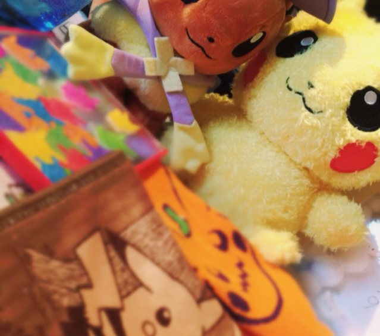
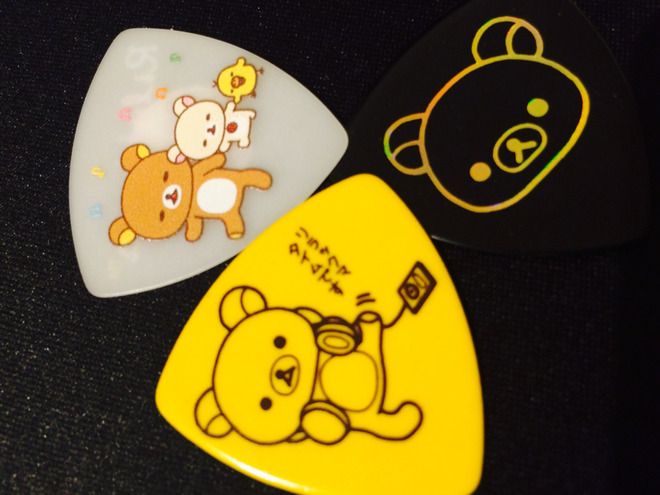

# Zeeeeeeeee!!!!!!

- Published: 2016-10-10T15:35:30+0900
- Original URL: http://lineblog.me/kano/archives/11700683.html
- Wayback snapshot: 20161010171556
- Source HTML: ../data/pages/20161010171556_UL3PJL4IZU3UOYFAXO5YG4WIDOWDOQUY_lineblog.me_80_kano.html

＼ポケモン(グッズ)ゲットだZeeee／

＼抓到宝可梦（周边）啦 Zeeee／

[Image source](http://line.blogimg.jp/kano/imgs/d/1/d18c3bdc.jpg)

Zeeee ⬅︎ アヒルの親子に見えません？

Zeeee ⬅︎ 不觉得看起来像鸭妈妈带小鸭吗？

＼見える／＼見える／＼見える／

＼像！／＼像！／＼像！／

こんにちは、鹿乃です。今日はポケモングッズをみて気持ち悪くニヤニヤ爽やかな笑顔になるDAYでした( ⸝⸝◦︎ω◦︎⸝⸝ )！

你好，我是鹿乃！今天是看着宝可梦周边，就会露出恶心兮兮的傻笑、却又透着清爽笑容的一天( ⸝⸝◦︎ω◦︎⸝⸝ )！

鹿乃は好きなキャラクターグッズをなんでもかんでも自重しなきゃとわかりつつ吸い寄せられるように買っちゃう収集癖があるのですが、みんなはついつい買っちゃうものってありますか？よかったらブログコメントでまた教えてね。

鹿乃有收集癖——明明知道喜欢的角色周边不能什么都买，却还是像被吸过去一样忍不住买下来。大家有没有那种一不小心就会买下来的东西呢？方便的话也请再到博客评论里告诉我哦。

昨日はたくさんみんなからコメントもらえて嬉しかった〜〜けど、おやつどれにしよう！一種類に絞れないぞって幸せな悩みでむむむっとしてました笑

昨天收到了大家好多评论，好开心～～不过“零食选哪个好呢！没法只挑一种啦”，我正为这种幸福的烦恼发愁呢 笑

このあとお買い物にいっておやつを物色してきます( ˙◊︎˙◞︎)◞︎[おやつ]

接下来我要去买东西，物色一下零食( ˙◊︎˙◞︎)◞︎[零食]

体調気遣ってくださった方もありがとうございます。今日は朝から寒かったなあ。みんなのところはどうでした？特に受験や大事なご予定が今後控えているみんなは風邪ひかないように注意でっ

也谢谢关心我身体的朋友们。今天从早上开始就好冷呀。大家那边怎么样？特别是接下来要考试、或是有重要安排的朋友们，要小心别感冒哦

[Image source](http://line.blogimg.jp/kano/imgs/1/2/12a5d5ba.jpg)

おやつを食べたあとはこれを使って…ふ、ふふふふガンバル負ケナイ( ⸝⸝◦︎ω◦︎⸝⸝ )

吃完零食之后就要用这个来……嘿、嘿嘿嘿嘿，加油，不能输( ⸝⸝◦︎ω◦︎⸝⸝ )

鹿乃
