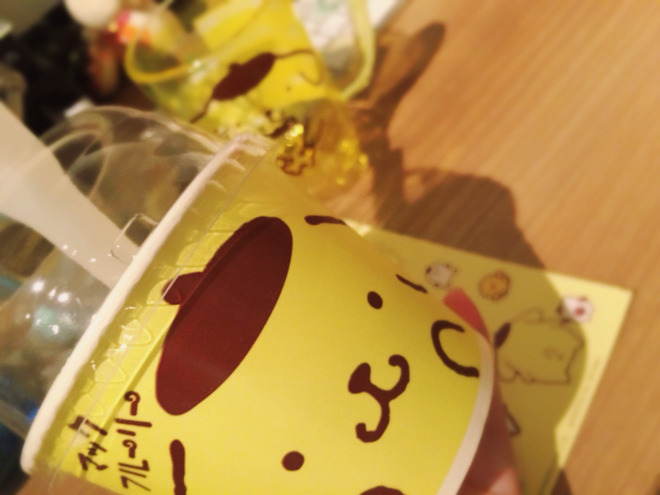
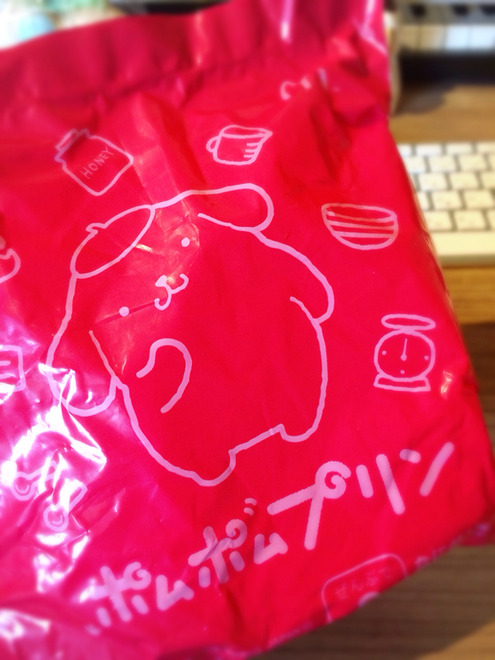
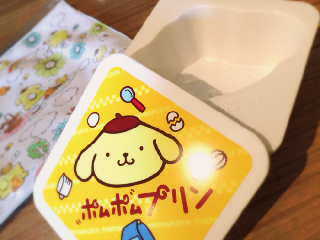

# ＼ハッピーセット／
# ＼开心乐园餐／

- Published: 2016-10-16T11:30:07+0900
- Original URL: http://lineblog.me/kano/archives/11914103.html
- Wayback snapshot: 20161025162833
- Source HTML: ../data/pages/20161025162833_NWPVHWRMVWSYUEU3IVWD42N4HDEPVBY5_lineblog.me_80_kano.html

＼ かわいいしおいしい ／

＼ 又可爱又好吃 ／

[Image source](http://line.blogimg.jp/kano/imgs/6/9/694db8f8.jpg)

ぽむぽむぷりんとマックがコラボだと〜〜行くしかない！と、さっそく買ってきました( ⸝⸝◦︎ω◦︎⸝⸝ )

布丁狗和麦当劳联动了～～那必须得去！于是马上买回来了( ⸝⸝◦︎ω◦︎⸝⸝ )

マックフルーリー、実は今回はじめて食べました。中に入ってたマシュマロとカラメルソースはコラボに因んでなのかな？くどくない程度の甘さで美味しかったあ。

麦旋风其实这次是我第一次吃。里面的棉花糖和焦糖酱，是因为联动的缘故吗？甜度恰到好处不腻，很好吃呀。

そして、いよいよ最大のお目当ての

然后，终于到了最期待的主角——

[Image source](http://line.blogimg.jp/kano/imgs/1/4/144435bb.jpg)

何年ぶりましてかのハッピーセット…のおもちゃ！けっこう大きい笑

久违多年的开心乐园餐……里的玩具！还挺大个的 笑

なにが当たるかわからない、期待しちゃダメだと思いつつ期待しちゃうこの感じ。

不知道会抽中哪一个，明知道不该期待却还是忍不住期待的这种感觉。

パズドラでさんざん泣かされた物欲センサーが！物欲センサーが反応しちゃううううなんて思いつつ、いざ開封の儀式へ〜〜( ˙◊︎˙◞︎)◞︎[ワクワク]

那个在《智龙迷城》里把我虐哭无数次的欲望感应器要来了！一边想着“欲望感应器要发动了啊啊啊”，一边进入开箱仪式～～( ˙◊︎˙◞︎)◞︎[兴奋期待]

[Image source](http://line.blogimg.jp/kano/imgs/d/d/dd100162.jpg)

＼ポムポムプリンのプリンの型／

＼布丁狗的布丁模具／

かわいいいいい〜〜これは来週末くらいにさっそく使って作るしかないと思いつつ、汚すのもったいないオバケがでてきてしまいこんでしまいそう…笑

好可爱啊啊啊～～一边想着“这必须得赶紧在下周末就拿来用”，一边又冒出个“弄脏了多可惜”的小妖怪，感觉它会就这么被我收起来……笑

最近は趣味全開のブログばかりで大丈夫かなと思いつつ、楽しいからいっか〜と開きなおりしてきました。

最近净发些兴趣全开的博客，虽然也会想“这样真的没问题吗”，不过因为开心，就干脆想开了——“算了，就这样吧”。

そうそう！前回のブログでみんな質問した「おみやげ」へのコメント、すごく面白かったなあ。みんながもらったものにほっこりしたり、驚かされたり、思わずクスッと笑ったり。

对了对了！上一篇博客里问大家的“特产礼物”，收到的评论超有趣的。看到大家收到的礼物，有的让我心头一暖，有的让我惊讶，有的让我忍不住扑哧一笑。

世の中にはたくさんの人がいて、そのぶんたくさんの趣味趣向や気持ちや意図があって、うまく言えないけど身近にも感じれたし、まだまだ出会えてないタイプの人はたくさんいるんだろうなあって考えてみたり！

这世上有很多很多人，也因此有着各种各样的爱好、心情和想法。虽然说不清，但我既觉得这种事离自己很近，也会想：还没遇到过的类型的人，肯定还有很多很多吧！

色々考えさせてくれる時間やキッカケをくれて、いつも本当にありがとうっ

总是带给我各种值得思考的时间和契机，真的非常感谢你们

鹿乃
