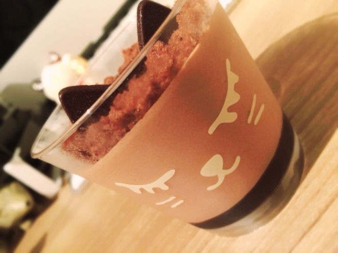
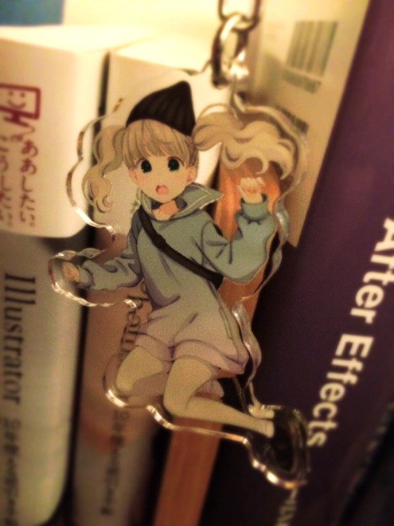

# ○○○○○っぽいこと
# 像○○○○○那样的事

- Published: 2016-10-22T19:36:15+0900
- Original URL: http://lineblog.me/kano/archives/12225898.html
- Wayback snapshot: 20161025162833
- Source HTML: ../data/pages/20161025162833_NWPVHWRMVWSYUEU3IVWD42N4HDEPVBY5_lineblog.me_80_kano.html

＼○○○○○の中に入る言葉はにゃんだ／

＼○○○○○里该填什么词喵～／

[Image source](http://line.blogimg.jp/kano/imgs/4/9/497cdcbd.jpg)

＼正解はハロウィンだああ／

＼正确答案是万圣节啊啊／

○○○○○の中に入る言葉わかりましたか？正解したみんなもわからなかったみんなもこんばんは、鹿乃です( ˙◊︎˙◞︎)◞︎

○○○○○里该填的词，大家猜到了吗？猜对的大家、没猜到的大家，晚上好，我是鹿乃( ˙◊︎˙◞︎)◞︎

昨日は水玉さんがコミティアにでるため上京をするとの情報を嗅ぎつけて、うっきうきしながら水玉さんをナンパしました。結果は大成功！

昨天我嗅到消息说，水玉さん为了参加 COMITIA 要上京，于是兴冲冲地去“搭讪”了水玉さん。结果大获成功！

少しの間ですが癒しオーラと生命力を吸引してきましたスーハースーハー

虽然时间不长，但我好好地吸取了她的治愈光环和生命力，嘶哈嘶哈

[Image source](http://line.blogimg.jp/kano/imgs/1/6/16fd10f1.jpg)

そして、一足先にこのかわいこちゃんをお迎えしてきました。どこにつけよっかなあ！笑

然后，我提前一步把这位小可爱迎回了家。该把它挂在哪里好呢！笑

ハロウィンっぽい猫ちゃんケーキを食べながら考えよう〜〜っと。

那就一边吃着充满万圣节气氛的猫咪蛋糕，一边慢慢想吧～～

ところでこのブログ…昨日書いてたのになあ。朝起きてみてみたら投稿思いきりミスッてました。勘弁してえ(T_T)

话说这篇博客……明明是昨天写好的。早上起来一看，发布的时候彻底搞砸了。饶了我吧(T_T)

鹿乃
