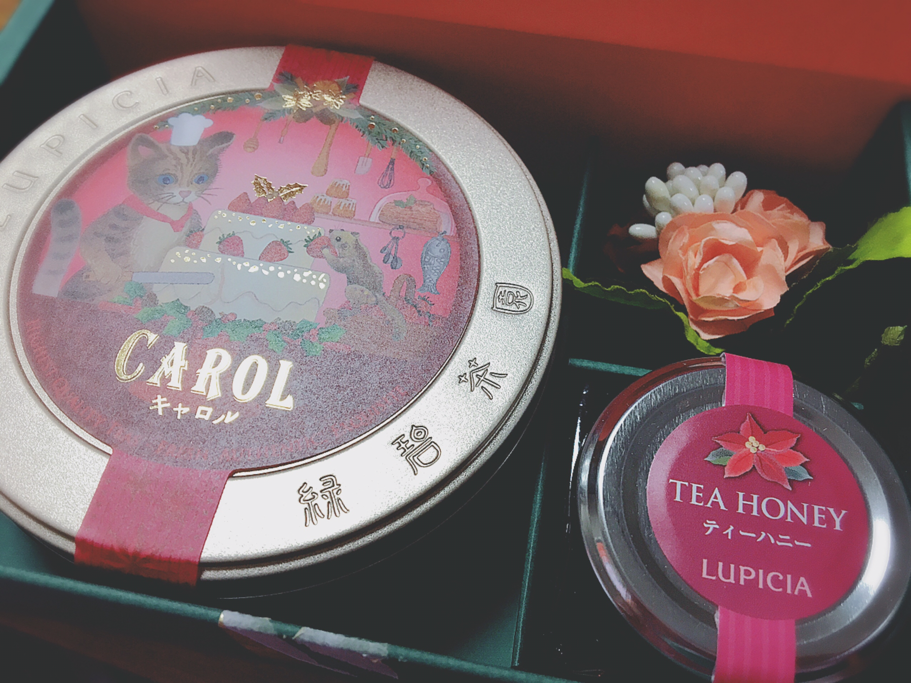

# 2017年1月6日で…！
# 到 2017 年 1 月 6 日，就……！

- Published: 2017-01-06T12:30:16+0900
- Original URL: http://lineblog.me/kano/archives/13104762.html
- Wayback snapshot: 20170107160117
- Source HTML: ../data/pages/20170107160117_FQOW3MNW7KP7E22M6HZ4AUOFDQJM63Z7_lineblog.me_kano_archives_13104762.html.html

あけましておめでとうございます！

新年快乐！

昨年は大変お世話になりました。

去年承蒙大家诸多关照。

今年もどうぞよろしくお願いします(*´-`)

今年也请大家多多关照(*´-`)

そしてそして、本日1月6日は鹿乃として歌いはじめた日…つまり7周年記念日(？)だったりします。は、はやい！！笑

然后然后，今天 1 月 6 日是我以鹿乃的身份开始唱歌的日子……也就是说，算是 7 周年纪念日（？）。好、好快！！笑

今年は「挑戦する」を抱負にして色々新しく挑戦していこうと思います。7年もやってるとだんだん新しいことに挑戦するのが怖くなってくるのですが、最初から成功しようとするから怖いのであってそれってすごく「何様なんだ？」ということに気付きました。

今年我以「勇于挑战」为抱负，打算去尝试各种新鲜事物。做了 7 年，渐渐地开始害怕挑战新东西了，不过我意识到，之所以会害怕，是因为一开始就想着要成功——这么想也太把自己当回事了吧？

失敗ばかり積み重ねて、ちょっとずつ前に進んできた（はず！笑）7年。

这 7 年，就是在不断失败中一点点向前走过来的（应该是！笑）。

今年も失敗して泣いて笑って、自分に憤りながら色々挑戦していこうと思います。

今年我也打算一边失败、一边哭哭笑笑、一边跟自己较劲，去尝试各种各样的挑战。

[Image source](https://obs.line-scdn.net/0m0e320f7be84d280e363e604c2d7b6b3e3f21342d22257b3a133f623969724f381549484135515b4a745442736a5e221e2922432c74186f01353f33666d777b41276538727d1d2f45626f3e2718613a3c)

お仕事、学校、お正月休み明けでうわあああんとなっている方が多いと思いますが一緒に頑張っていきましょうね。

工作、上学，刚过完年假回来，想必很多人都处于“哇啊啊啊”的状态吧，但让我们一起加油吧。

頑張っていきましょうと言いつつ、リラックスする気満々の紅茶セットのお写真をぺたり笑

嘴上说着一起加油，我却贴了一张满脑子想着放松的红茶套装照片 笑

おやつの時間が楽しみだあ！

好期待点心时间呀！

※2月にある2ndライブチケットの一般受付は近日中にあります。お知らせするまでもうちょっとだけお待ちください(*⁰▿⁰*)

※2 月的 2nd Live 门票一般发售将在近日开启。在正式通知前，还请大家再稍等片刻(*⁰▿⁰*)

鹿乃
