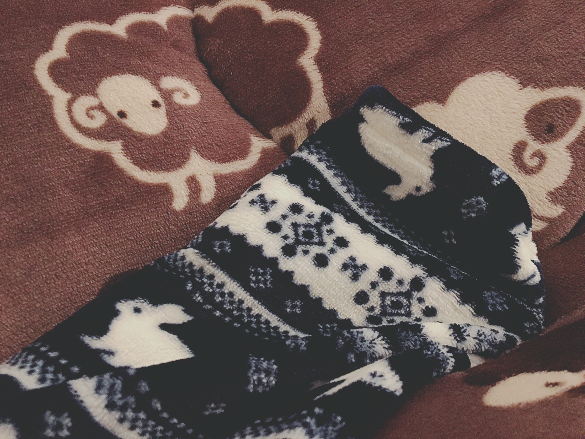

# ライブの一般発売と、もふもふ☁︎
# 演唱会的公开售票 & 毛茸茸☁︎

- Published: 2017-01-12T20:25:19+0900
- Original URL: http://lineblog.me/kano/archives/13109166.html
- Wayback snapshot: 20170322160246
- Source HTML: ../data/pages/20170322160246_CB5BYJWHNAOKKADFHOTDNLRKEWAT2Y76_lineblog.me_80_kano_archives_13109166.html.html

気付いたらお布団もパジャマも動物柄！

回过神来，被褥和睡衣都已经变成动物图案了！

[Image source](https://obs.line-scdn.net/0m0e2b2117e84d280e363e604c2d7b6b3e2b6e1828751b2e0f6b117d4e407147316a5269523e50784e492f744f532a141e2922432c731c6c0d31353b666d777b1472323c712c407f45626f3d75176f386b)

もふもふあったかい〜(*´-`)

毛茸茸的，好暖和～(*´-`)

ライブまであと一ヶ月。体力作りと健康管理に気をつけなくちゃっ

距离演唱会还有一个月。得好好锻炼体力、注意健康管理才行呀

というわけで以下、一般発売の情報です！

那么，以下是一般发售的信息！

プレミアムチケット発売終了後に、私の力不足でライブやるの知らなかった〜って言ってる方をちょいちょいお見かけしたので、よかったらTwitterなどでライブのことを拡散してください。なにとぞみんなのお力をお貸しくださいませm(\_ \_)m

Premium 票卖完之后，我时不时会看到有人说“都怪我自己宣传不力，根本不知道有演唱会～”。所以方便的话，麻烦大家帮忙在 Twitter 等地方扩散一下演唱会的信息。恳请各位助我一臂之力 m(\_ \_)m

『鹿乃ライブ 〜My Little Box〜』

《鹿乃Live ～My Little Box～》

【大阪公演】

【大阪场】

日程：2017年2月10日(金)

日程：2017年2月10日（周五）

開場18:30 / 開演19:00

开场 18:30 ／ 开演 19:00

会場：心斎橋 Music Club JANUS

会场：心斋桥 Music Club JANUS

券種：プレミアムスタンディング(イラストチケット/来場時プレゼント付き) 8,100円(税込) / スタンディング 5,940円(税込)

票种：Premium Standing（含插画票／到场赠品）8,100 日元（含税）／Standing 5,940 日元（含税）

※小学生以上有料。未就学児童は入場不可。

※小学生以上收费。学龄前儿童不得入场。

※入場時別途ドリンク代 600円

※入场时需另付饮料费 600 日元

【東京公演】

【东京场】

日程：2017年2月18日(土)　開場17:15 / 開演18:00

日程：2017年2月18日（周六）　开场 17:15 ／ 开演 18:00

会場：竹芝ニューピアホール

会场：竹芝 New Pier Hall

券種：プレミアム全席指定(イラストチケット/来場時プレゼント付き) 8,100円(税込)　/ 全席指定 5,940円(税込)

票种：Premium 全席指定（含插画票／到场赠品）8,100 日元（含税）／全席指定 5,940 日元（含税）

※小学生以上有料。未就学児童は入場不可。

※小学生以上收费。学龄前儿童不得入场。

☆チケット取り扱いプレイガイド

☆票务平台

（一般発売：1月14日（土）10時～）

（一般发售：1 月 14 日（周六）10 时～）

＜大阪公演＞

＜大阪场＞

チケットぴあ

Ticket Pia

[http://t.pia.jp/](http://t.pia.jp/)（Pコード320-855）

ローソンチケット

Lawson Ticket

[http://l-tike.com/](http://l-tike.com/)（Lコード56130）

イープラス

e+

[http://eplus.jp/](http://eplus.jp/)

＜東京公演＞

＜东京场＞

キョードー東京[http://www.kyodotokyo.com/kano](http://www.kyodotokyo.com/kano)

チケットぴあ

Ticket Pia

[http://w.pia.jp/t/kano-t/](http://w.pia.jp/t/kano-t/)（Pコード321-334）

ローソンチケット

Lawson Ticket

[http://l-tike.com/kano-mlb/](http://l-tike.com/kano-mlb/)（Lコード75967）

イープラス

e+

[http://eplus.jp/kano021](http://eplus.jp/kano0218/)

[http://eplus.jp/kano0218/](http://eplus.jp/kano0218/)

みんな遊びにきてね！待ってます！

大家要来找我玩哦！我等你们！

鹿乃
