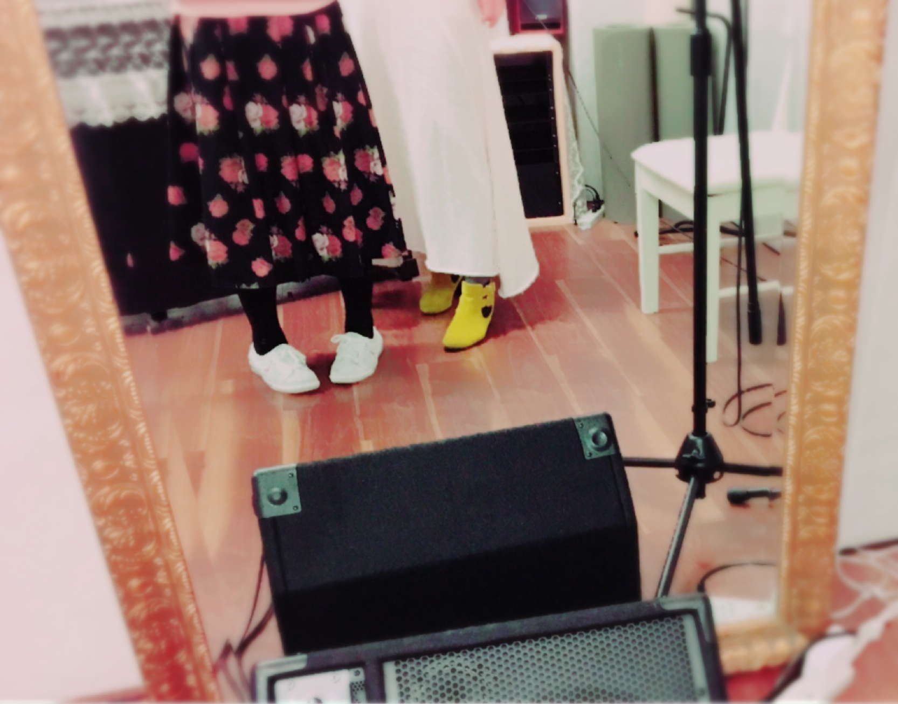

# チラッチラッ
# 偷偷瞄一眼

- Published: 2017-01-16T17:52:08+0900
- Original URL: http://lineblog.me/kano/archives/13110009.html
- Wayback snapshot: 20170117125444
- Source HTML: ../data/pages/20170117125444_LCVKUBTUJUTZ2MWFK7IWKEUXYBXKSJKN_lineblog.me_kano_archives_13110009.html.html

ボイトレの先生と鹿乃（の足）

发声练习老师和鹿乃（的脚）

dazzlinのお花柄のスカートがかわいくて最近とってもお気に入りです(*´◒`*)

dazzlin 的碎花裙好可爱，最近特别喜欢(*´◒`*)

[Image source](https://obs.line-scdn.net/0m0e20c0a7e84d280e363e604c2d7b6b3e640f3213553c7b2a7712445b5c66584516326a6e4e613f7555295248727f2f392922432c731b6801333532666d777b4071606a712c407c45626f3d7e4e606e68)

2月のライブに向けてがっつり色々おそわってます。先日からチケット一般発売はじまったので、ご都合よろしかったら是非きてね！

为了 2 月的演唱会，我正在拼命学习各种东西。前几天门票的一般发售已经开始了，方便的话请一定要来哦！

今回はみんなで一緒に楽しめるようにちょっとした何かできたらな〜っていうのも考えてるんだ。ふへへ

这次为了能和大家一起玩得开心，我还在盘算着能不能准备点小惊喜呢。嘿嘿

今日もめーちゃ寒くて、建物から外にでるたびに絶望してます。はやく春にならないかなあ〜って思ったけど、春は春で花粉が…なんてこったい_(:3 」∠)_

今天也超级冷，每次从建筑物里走出去都感到绝望。想着“春天快点来吧～”，可春天也有花粉……真是要命_(:3 」∠)_

鹿乃
