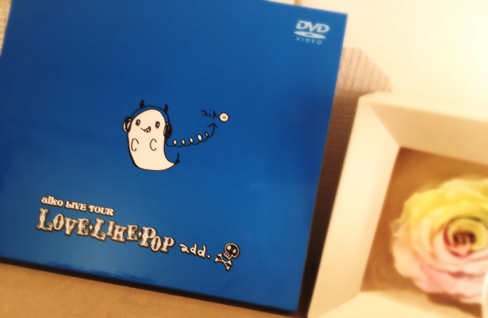

# Imagine
# 想象

- Published: 2017-01-19T12:20:46+0900
- Original URL: http://lineblog.me/kano/archives/13110547.html
- Wayback snapshot: 20170508164951
- Source HTML: ../data/pages/20170508164951_2ILJZ6IICAHQSWWJHCTRX5ED2QNJD7VV_lineblog.me_kano_archives_13110547.html.html

こんにちは(°▽°)

大家好(°▽°)

最近は早起きして色々してからま〜ったりブログを書くのが好きです。好きですと言いながらネタがないと書けないのですが笑

最近我喜欢先早起，把各种事情处理完之后再悠闲地写博客。
说是喜欢，可要是没有素材的话就写不出来呢（笑）

文章を書くのは得意じゃないのですが好きではあります＿φ(￣ー￣ )

写文章我虽然不擅长，但还是喜欢的＿φ(￣ー￣ )

[Image source](https://obs.line-scdn.net/0m0e23aef4e84d280e363e604c2d7b6b3e38066a3479024d3a703d6f7a616a6472027746454e3331565467426d737233232922432c73196a0c363b36666d777b13256760712c407e45626f3d251e62323d)

勉強のためにライブDVDを色々みてます。勉強と言いつつ完全に観ながら楽しんじゃってますが…笑

为了学习，我最近看了各种各样的演唱会 DVD。说是学习，其实一边看一边已经完全乐在其中了……（笑）

みんなに来てよかった。また来たいって思うライブにできたらいいな〜って、誰かの思い出になれたらいいなと思って頑張ります！

希望能办成让大家觉得“来了真好，还想再来”的演唱会，要是能成为谁的回忆就好了——我会为此加油的！

◆鹿乃2ndライブチケット一般発売中！

◆鹿乃 2nd 演唱会门票一般发售中！

> [!link] http://whv-amusic.com/kano/sp/news/index00510000.html
>
> [打开原始链接](http://whv-amusic.com/kano/sp/news/index00510000.html) · [查看网页存档](https://web.archive.org/web/20170508164951/http://whv-amusic.com/kano/sp/news/index00510000.html)

◆ハッシュタグ

◆话题标签

#鹿友 #鹿乃ライブ

録音うまくいかない！！！

录音总是不顺利！！！

ぐやじいいい

好不甘心啊啊啊

( T_T)＼(^-^ )

鹿乃
