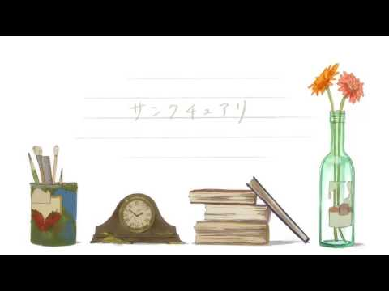

# sanctuary
# 圣域

- Published: 2017-03-18T19:22:04+0900
- Original URL: https://lineblog.me/kano/archives/13122580.html
- Wayback snapshot: 20190519011019
- Source HTML: ../data/pages/20190519011019_EQHZQJUS4Z27WRUP7WJGSZHV3DBP65HF_lineblog.me_kano_archives_2017-03.html.html

こんばんは、鹿乃ですᕦ(ò_óˇ)ᕤ

晚上好，我是鹿乃ᕦ(ò_óˇ)ᕤ

今日は動画を投稿しました。

今天投稿了一个视频。

同人時代から応援してくださっている方はびっくりしたと思います笑

从同人时期起就一直支持我的大家，应该吓了一跳吧（笑）

数年越しの投稿です。

这是时隔数年的投稿。

> [!link] 【MV】サンクチュアリ【鹿乃】 - niconico
>
> ｢ニコニコ動画｣は音楽・お笑い・アニメ・ゲームなどの動画再生中にコメントを付けて楽しむ動画コミュニティサイトです
>
> [打开原始链接](http://sp.nicovideo.jp/watch/sm30848141) · [查看网页存档](https://web.archive.org/web/20190519011019/http://sp.nicovideo.jp/watch/sm30848141)

<iframe width="480" height="270" src="https://www.youtube.com/embed/z7EkuWkEyPc?feature=oembed" title="嵌入视频" frameborder="0" allow="accelerometer; autoplay; clipboard-write; encrypted-media; gyroscope; picture-in-picture; web-share" allowfullscreen loading="lazy"></iframe>

<video controls preload="metadata" src="../media/052979d07051.mp4"></video>

> [!video] YouTube
> 
>
> [播放原视频](https://www.youtube.com/watch?v=z7EkuWkEyPc) · [查看网页存档](https://web.archive.org/web/20190519011019/https://www.youtube.com/watch?v=z7EkuWkEyPc)
>
> [封面来源](https://i.ytimg.com/vi/z7EkuWkEyPc/hqdefault.jpg)

楽曲は同人時代、2ndシングル、アルバム、ライブ中のSEなどでもお世話になっているすこっぷさん！

这首歌的曲子由すこっぷさん负责！从同人时代起，第二张单曲、专辑、演唱会里的音效等各方面，他都一直在关照着我。

今放送中の「亜人ちゃんは語りたい」のED楽曲も担当されているので気になったかたはぜひぜひ。

他现在还担任着正在播出的《亚人酱有话要说》片尾曲的作曲，感兴趣的朋友请一定去听听看。

動画は一緒にごはんを食べに行ったり、ライブを観に行ったり、鹿乃ライブに来ていただいたりと引っ込み思案＆人見知りの鹿乃がすーぱー珍しく制作以外でも果敢に絡みついていっている癒し系なへちまさん！

视频则是由へちまさん负责的！他是个治愈系的人，会一起去吃饭、一起去看演唱会，还会来看鹿乃的演出——内向又怕生的鹿乃，竟然超～级罕见地在制作之外也勇敢地跟他打成一片。

まんがタイムきららmaxさんで「ぱぺっとコール！」連載中＆第1巻発売中でございます。

他正在《Manga Time Kirara MAX》上连载《ぱぺっとコール！》，第 1 卷也在发售中。

mix、mastaringは動画投稿作品や同人制作、音まわりのことをほぼ全部引き受けてくださっていた、恩人って言ったら誰？と質問されたら名前が浮かんでくる●テラピコスさん。

混音和母带处理则几乎全部由●テラピコスさん包办，包括投稿视频、同人制作在内的所有声音相关的工作——要是有人问我“恩人是谁？”，脑海中浮现出来的就是他的名字。

●テラピコスさんがいなかったら、こんな風に今も活動できていなかったんだろうなあ。本当にありがとうございます。

如果没有●テラピコスさん，我现在大概也没办法像这样继续活动下去吧。真的非常感谢。

そんな三人のお力をお借りして、動画という形で改めて皆様の前にお披露目させていただくことになった「サンクチュアリ」という楽曲。

借这三位的力量、以视频的形式再次呈现在大家面前的，就是《圣域》这首曲子。

鹿乃ちゃんは語りたry

鹿乃酱也有话想（ry

危ない橋を渡るのはやめましょう。鹿乃はちなみに雪女ちゃんがタイプです。もう一度いいましょうか？あ、平気ですか。わかりました。

我们还是别走危险的桥了。顺便说一句，鹿乃喜欢的是雪女酱。要我再说一遍吗？啊，大家没事吧？好吧，我明白了。

サンクチュアリ、色々な解釈ができる作品となっていますのでそういう面でも楽しんでいただけたら嬉しいです。

《圣域》是一首可以有多种解读的作品，如果大家也能从这方面享受到乐趣，我会很开心的。

いつか、鹿乃なりの解釈をお伝えすることができたら面白いかもしれませんね。

如果哪天能把鹿乃自己的解读讲给大家听，或许会很有趣呢。

目先の楽しいことは周りや前にいっぱいあるけれど、そればかりみてたら目が悪くなっちゃうよ！心の視力低下に要注意！

眼前好玩的事情，身边和前方明明有一大堆，但如果只顾着看那些，眼睛可是会坏掉的哦！要小心“心灵视力”下降！

またね。

下次见。

鹿乃
