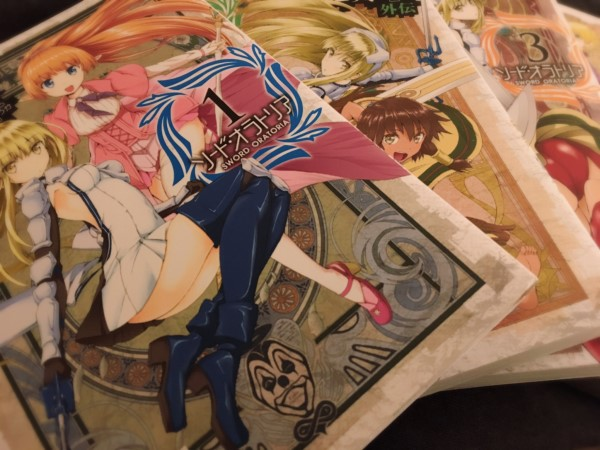
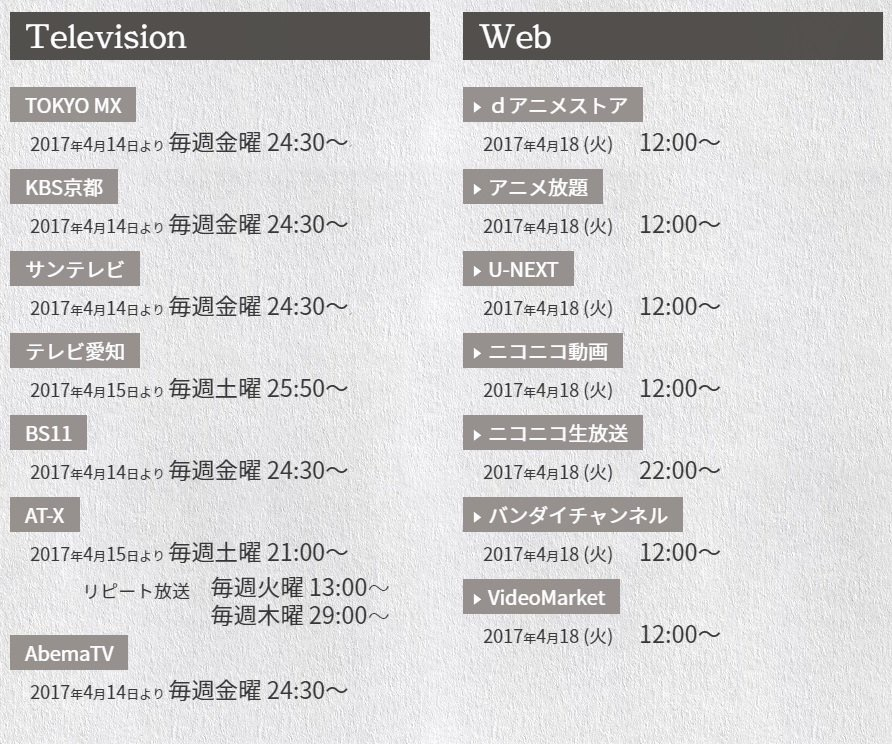

# ソード・オラトリアのEDを担当させていただくことになりました！
# 我将负责演唱《剑姬神圣谭》的片尾曲了！

- Published: 2017-03-19T19:27:48+0900
- Original URL: https://lineblog.me/kano/archives/13122781.html
- Wayback snapshot: 20210923022651
- Source HTML: ../data/pages/20210923022651_7TYU574VDYKNTVK5JKNUKYXKBOS2D47A_lineblog.me_kano_archives_2017-03.html.html

[Image source](https://obs.line-scdn.net/0hGI2Z6NlTGGYPIzbPV3RnMU1-Hgl2QAJuZVsPXHp1Ekh6Tw9mZ1kNUHV9WhZ-Rh9jSwQzd3BeDzR6GylJakA3UypLQDZSex00VSE-HComT14qE1kwOkBXCH8iRlIhFRoxNEQHBnl0Rw)

な、ブログを書いたつもりになっていた、だと！

哈？我还以为这篇博客已经写好了呢，居然没有！！

改めまして、4月放送開始のTVアニメ「ソード・オラトリア ダンジョンに出会いを求めるのは間違っているだろうか 外伝」のED主題歌を鹿乃が担当させていただくことになりましたとご報告させてください。

重新正式向大家汇报：4月开播的TV动画《剑姬神圣谭》（《在地下城寻求邂逅是否搞错了什么》外传）的片尾主题曲，将由我鹿乃负责演唱！

タイトルは「day by day」で、楽曲を田中秀和さん（ありがとうございますありがとうございます）作詞を鹿乃がさせていただきました。

歌名是《day by day》，乐曲由田中秀和老师创作（感激不尽、感激不尽），作词由我鹿乃来完成。

カップリングにはやしきんさんの最高にほにゃららな曲がゲフゲフ。

至于C/W曲，是やしきんさん那首软乎乎、可爱到不行的歌，嘿嘿。

発売日はOPの井口裕香さん「RE_ILLUSION」と同日の5月24日になりますᕦ(ò_óˇ)ᕤ

发售日是5月24日，和演唱OP的井口裕香小姐的《RE_ILLUSION》同一天哦ᕦ(ò_óˇ)ᕤ

アニメ本編、OPED、色々全部ひっくるめてみんなで一緒に楽しんでいけたらいいなと思っております。ので！！！なにとぞ、よろしくお願いいたします。

动画正片、OP、ED，所有的所有，我都想和大家一起开心地享受。所以！！！恳请各位多多关照！

ダンまちの放送当時、かくいう私も神秘の紐にうおおおと胸を熱くした一人でございます。

当年《地错》播出那会儿，说来惭愧，我自己也是为“神秘之绳”那一幕“呜噢噢噢”地热血沸腾的人之一。

このブログを読んでくださっている方の中にも胸を熱くした人はいると思います。

我想，正在读这篇博客的各位之中，也一定有人曾为之热血沸腾吧。

ソード・オラトリアでまたみんなでストーリーに、かわいい子にたくさん胸を熱くしましょう。

就让我们在《剑姬神圣谭》里，再次一起为剧情、为可爱的角色们热血沸腾吧！

( ﾟ∀ﾟ)o彡ﾟ( ﾟ∀ﾟ)o彡ﾟ( ﾟ∀ﾟ)o彡ﾟ

ご静粛に！！！！

肃静！！！！

そんなダンまち外伝のソード・オラトリアのアニメ化を記念して、ダンまち一挙放送が3月24日(金)19:00〜

为纪念《地错》外传《剑姬神圣谭》动画化，《地错》全话连播将于3月24日（周五）19:00开始〜

> [!link] 【ダンまち外伝アニメ化記念】「ダンジョンに出会いを求めるのは間違っているだろうか」全13話 一挙放送
> 
>
> [预览图来源](http://nicolive.cdn.nimg.jp/live/simg/img/a198/593645.2cc1ed.jpg)
>
> 全13話ニコニコ生放送では「ダンジョンに出会いを求めるのは間違っているだろうか」の一挙放送を行います。「ソード・オラトリア ダンまち外伝」ニコ生＆本編配信決定！《出演：大西沙織、木村珠莉、高橋未奈美》アニメ『ソード・オラトリア ダンまち外伝』放送直前ニコ生SP「ソード・オラトリア　ダンジョンに出会いを求めるのは間違っているだろうか外伝」1話上映会イントロダクション迷宮都市オラリオ──『ダンジョン』と通称される壮大な地下迷宮を保有する巨大都市。未知という名の興奮、輝かしい栄誉、
>
> [打开原始链接](http://sp.live2.nicovideo.jp/watch/lv291269829) · [查看网页存档](https://web.archive.org/web/20210923022651/http://sp.live2.nicovideo.jp/watch/lv291269829)

さらにさらに放送直前SP放送が3月26日(日)20:00からあります！

还有还有！开播前的特别节目将于3月26日（周日）20:00播出！

> [!link] 《出演：大西沙織、木村珠莉、高橋未奈美》アニメ『ソード・オラトリア ダンまち外伝』放送直前ニコ生SP
> 
>
> [预览图来源](http://nicolive.cdn.nimg.jp/live/simg/img/a374/1121387.477b67.jpg)
>
> ニコニコ生放送では、4月から始まるTVアニメ「ソード・オラトリア」の放送直前にアイズ役の大西沙織さん、レフィーヤ役の木村珠莉さん、ティオネ役の高橋未奈美さんが出演し、作品の魅力についてお伝えしていくスペシャル番組！さらに、『ソード・オラトリア ダンまち外伝』のスペシャルキャンペーンの実施や、「ダンまち」のソーシャルゲームの情報も盛りだくさん！！出演者大西沙織（アイズ役）、木村珠莉（レフィーヤ役）、高橋未奈美（ティオネ役）「ダンまち」一挙放送＆「ソード・オラトリア」配信決定！【
>
> [打开原始链接](http://sp.live2.nicovideo.jp/watch/lv291294375) · [查看网页存档](https://web.archive.org/web/20210923022651/http://sp.live2.nicovideo.jp/watch/lv291294375)

＼本編は4月14日の放送が最速です／

＼正片最早4月14日开播／

[Image source](https://obs.line-scdn.net/0hq7-rMkBNLhgQCwCxSvhRT1JWKHdpaDQQenM5ImVdJDZlZzkYeHE7LmpVbEF4UB9JLS0aLDNoOE9aMyEVSBVpCG5CcC0-R205KBgFYjUOeSA1O29HK2xhdmcDdSs7PCxPK2wxeGEDdQ)

> [!link] 「ソード・オラトリア　ダンジョンに出会いを求めるのは間違っているだろうか外伝」1話上映会
> 
>
> [预览图来源](http://nicolive.cdn.nimg.jp/live/simg/img/a374/1121736.477b67.jpg)
>
> 第1話「剣姫と妖精（けんきとようせい）」ニコニコ生放送では「ソード・オラトリア　ダンジョンに出会いを求めるのは間違っているだろうか外伝」の上映会を行います。「ダンまち」一挙放送＆「ソード・オラトリア」ニコ生特番決定！【ダンまち外伝アニメ化記念】「ダンジョンに出会いを求めるのは間違っているだろうか」全13話 一挙放送《出演：大西沙織、木村珠莉、高橋未奈美》アニメ『ソード・オラトリア ダンまち外伝』放送直前ニコ生SPイントロダクション【剣姫】アイズ・ヴァレンシュタイン。最強と名高
>
> [打开原始链接](http://sp.live2.nicovideo.jp/watch/lv291354355) · [查看网页存档](https://web.archive.org/web/20210923022651/http://sp.live2.nicovideo.jp/watch/lv291354355)

放送前から楽しめることたっくさんですね！ご紹介しきれてないイベントなどまだまだありますので気になった方は公式HPまたは公式Twitterをチェックしてみてください！

开播前就能享受的内容真的超多呢！还有一些活动没能全部介绍到，感兴趣的朋友请去官方网站或官方Twitter看看吧！

> [!link] TVアニメ「ダンまち」シリーズ公式サイト
> 
>
> [预览图来源](http://danmachi.com/danmachi2/images/og-image.jpg)
>
> GA文庫大賞初の大賞作「ダンジョンに出会いを求めるのは間違っているだろうか」　第3期 2020年7月より放送開始予定！
>
> [打开原始链接](http://danmachi.com/) · [查看网页存档](https://web.archive.org/web/20210923022651/http://danmachi.com/)

> [!link] 『ソード・オラトリア』アニメ公式(@danmachi_anime)さん | Twitter
>
> 『ソード・オラトリア』アニメ公式 (@danmachi_anime)さんの最新ツイート。TVアニメ『ソード・オラトリア』『ダンジョンに出会いを求めるのは間違っているだろうか』公式アカウント。両作品の最新情報呟きます！『ソード・オラトリア』は4月より放送開始！推奨ハッシュタグは #danmachi です！
>
> [打开原始链接](https://twitter.com/danmachi_anime) · [查看网页存档](https://web.archive.org/web/20210923022651/https://twitter.com/danmachi_anime)

ではではまた〜はっぴぃな三連休をお過ごしください✌︎('ω')✌︎

那么那么，下次见〜祝大家度过一个开开心心的三连休✌︎('ω')✌︎

鹿乃
