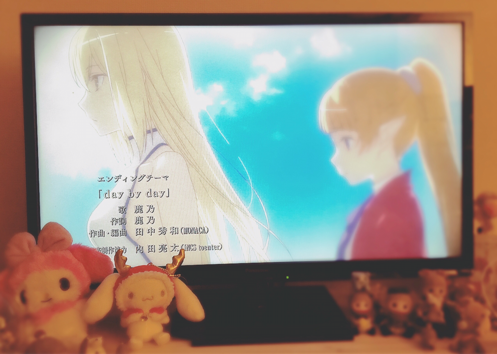
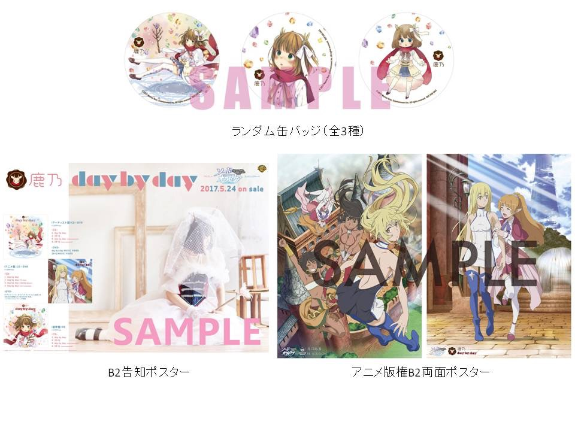

# day by day
# 日复一日

- Published: 2017-04-15T12:37:12+0900
- Original URL: http://lineblog.me/kano/archives/13128122.html
- Wayback snapshot: 20170419013957
- Source HTML: ../data/pages/20170419013957_345SJBX5HKRJE3F5CHF6HREX3DPMYKF6_lineblog.me_80_kano_archives_13128122.html.html

おはよう、窓あけて〜♪

早上好，打开窗子～♪

<iframe width="480" height="270" src="https://www.youtube.com/embed/A8jUgcSgcQg?feature=oembed" title="嵌入视频" frameborder="0" allow="accelerometer; autoplay; clipboard-write; encrypted-media; gyroscope; picture-in-picture; web-share" allowfullscreen loading="lazy"></iframe>

<video controls preload="metadata" src="../media/1c89458f6db3.mp4"></video>

> [!video] YouTube
> 
>
> [播放原视频](https://www.youtube.com/watch?v=A8jUgcSgcQg) · [查看网页存档](https://web.archive.org/web/20170419013957/https://www.youtube.com/watch?v=A8jUgcSgcQg)
>
> [封面来源](https://i.ytimg.com/vi/A8jUgcSgcQg/hqdefault.jpg)

おはようございます、鹿乃です🌸

早上好，我是鹿乃🌸

TVアニメ「ソード・オラトリア ダンジョンに出会いを求めるのは間違っているだろうか 外伝」の第1話を観ていて、感極まってなかなか眠れず寝坊をしました。

看了电视动画《剑姬神圣谭 在地下城寻求邂逅是否搞错了什么 外传》的第1话，激动得怎么也睡不着，结果睡过头了。

わー太陽まぶCよー(　˙-˙　)

哇——太阳好耀眼啊(　˙-˙　)

[Image source](https://obs.line-scdn.net/0h8iUiXIZyZ0ZoEEnQ9cEYESpNYSkRc31OAmhwfB1GbWgdfHBGAGpycBJOJRMsdkdCNBdRchlGbjI3RiFqKSB3W0hgWz8xXGdgVjUpPE0VMXVGIycQXXUoKBgQPHFEI2URU3V9c0sWPg)

「day by day」をTVから、youtubeから、ラジオからようやくみんなにお届けすることができました。

《day by day》终于可以从电视、YouTube、广播送到大家身边了。

いかがだったでしょうか？みんなの心のちょっとした琴線にタッチできてるといいなあﾂﾝﾂﾝ(｡ﾟｰﾟ)σ❤️

大家觉得怎么样呢？希望能轻轻拨动到大家心里的那根弦呀，戳戳(｡ﾟｰﾟ)σ❤️

それにしてもED映像の幸福感すごかったなあ…なんか、夢の中で懐かしい思い出を観ているような気持ちになりました。

话说回来，片尾动画洋溢的幸福感真的好厉害啊……感觉就像在梦里看着令人怀念的回忆一样。

day by day のサビの前向きなのに切ないメロディと相まって余計にグッときましたよグッ。

再配上《day by day》副歌那段既积极向上又带点忧伤的旋律，就更让人心头一紧了，真的。

田中さん、素敵な楽曲を本当にありがとうございます👏👏👏

田中先生，真的非常感谢您写出这么棒的曲子👏👏👏

制作スタッフさん、素敵な作品を本当にありがとうございます👏👏👏👏

制作团队的各位，真的非常感谢你们做出这么棒的作品👏👏👏👏

関わってくださったみなさん、本当に本当に本当にありがとうございます👏👏👏👏👏

所有参与进来的大家，真的真的真的非常感谢👏👏👏👏👏

感謝の気持ちで胸いっぱいです。

感激之情充满了胸膛。

また、アニメ放送後にcuteなMVもyoutubeで公開されました。水玉さん、TSOさん、えむめろさん、関わってくださった全てのみなさん、本当にありがとうございました！！

另外，动画播出后，可爱的MV也在YouTube上公开了。水玉さん、TSOさん、えむめろさん，还有所有参与进来的大家，真的非常感谢！！

ぜひ、たくさん聴いて観て楽しんでください。

请大家一定多多地听、多多地看，尽情享受哦。

[Image source](https://obs.line-scdn.net/0hti0nqM4tK0YNFwXQk8hUEU9KLSl0dDFOZ288fHhBIWh4ezxGZW0-cHdJaQh1RSt3NDQfI0oQDyomfRNCTngAZX5TMiElVwdDOAosPCgSfXUjJGsYNXJkKHpAcXclLikRNnIxc3gRfA)

特典の絵柄もMVとあわせて公開されています。詳しくは公式HPをご確認ください

特典的图样也和MV一起公开了。详情请查看官方网站

[Image source](https://parts.lineblog.me/img/emoji/line/1/00091.png)

[Image source](https://parts.lineblog.me/img/emoji/line/1/00111.png)

> [!link] 「day by day」特典解禁 ※4/15更新 -鹿乃 Warner Bros. Home Entertainment Official Website-
>
> [打开原始链接](http://whv-amusic.com/kano/sp/news/index00580000.html) · [查看网页存档](https://web.archive.org/web/20170419013957/http://whv-amusic.com/kano/sp/news/index00580000.html)

今から第2話がすでに楽しみだあ。引き続き、アニメともどもよろしくお願いします！

从现在就迫不及待想看第2话了。接下来，动画也好，我也好，都请大家多多关照！

リリイベもお待ちしてます〜ぜひ参加券を対象店舗さんでゲットして遊びにきてくださいね🤗❣️

发售纪念活动也等着大家来～请务必在对象店铺拿到参加券，来一起玩哦🤗❣️

鹿乃
