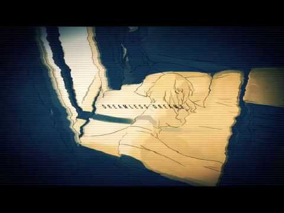

# 動画を投稿しました＆
# 投稿了一个视频＆

- Published: 2017-05-16T18:30:40+0900
- Original URL: https://lineblog.me/kano/archives/13134118.html
- Wayback snapshot: 20190518011047
- Source HTML: ../data/pages/20190518011047_YR4OSTNEHAQ2ODE4UBAODOBMA2FHSIVH_lineblog.me_kano_archives_2017-05.html_p_2.html

こんばんは

晚上好

[Image source](https://parts.lineblog.me/img/emoji/line/1/00093.png)

動画を投稿しました。

发布了一个视频。

> [!link] ドリームレス・ドリームス　歌ってみた【鹿乃】 - niconico
>
> ｢ニコニコ動画｣は音楽・お笑い・アニメ・ゲームなどの動画再生中にコメントを付けて楽しむ動画コミュニティサイトです
>
> [打开原始链接](http://sp.nicovideo.jp/watch/sm31218683?nicorepotwitter_upload_video) · [查看网页存档](https://web.archive.org/web/20190518011047/http://sp.nicovideo.jp/watch/sm31218683?nicorepotwitter_upload_video)

<iframe width="480" height="270" src="https://www.youtube.com/embed/VZfDyna9NJc?feature=oembed" title="嵌入视频" frameborder="0" allow="accelerometer; autoplay; clipboard-write; encrypted-media; gyroscope; picture-in-picture; web-share" allowfullscreen loading="lazy"></iframe>

<video controls preload="metadata" src="../media/0beee7779eb9.mp4"></video>

> [!video] YouTube
> 
>
> [播放原视频](https://www.youtube.com/watch?v=VZfDyna9NJc) · [查看网页存档](https://web.archive.org/web/20190518011047/https://www.youtube.com/watch?v=VZfDyna9NJc)
>
> [封面来源](https://i.ytimg.com/vi/VZfDyna9NJc/hqdefault.jpg)

独特の文化なので受け付けない人は受け付けないものなのですが、何年経っても音源完成したときのキャッキャウフフとか、投稿するときの不安とか、感想に一喜一憂してみたりとか、作曲者さんや動画制作者さんと一言二言かわせて嬉しいなって思ったりとか、全部ひっくるめて動画投稿は初心にかえれる瞬間で好きだなって思います。思いました。昨日！改めて！

这算是种独特的文化，接受不了的人就是接受不了。可无论过去多少年，音源完成时的那份欢呼雀跃、投稿时的不安、因感想而一喜一忧，还有能和作曲者、视频制作者聊上几句而感到开心——把这些全都算上，我觉得投稿视频是能让我找回初心的瞬间，我很喜欢。是昨天！又一次真切地这么觉得！

今さっきまでもね、録音してたんです。

其实直到刚才，我都在录音哦。

たぶんすぐ聴いてもらえそうかな？たぶん。苦戦してるところが終わればきっとすぐ。聴いたら苦戦してたのはここだなーってわかると思います笑

大概很快就能让大家听到了吧？大概。等苦战的地方搞定后，肯定马上就好。大家一听就会明白“原来苦战的是这里啊”的，笑

それもひっくるめてお楽しみに。

连同这一切，敬请期待。

そうそう！明日、ちょっとしたおねだりをみんなにしちゃいます。夕方くらいかな？ツイッターみていてもらえると嬉しいなあ。

对了对了！明天我要向大家提一个小小的请求。大概是傍晚的时候吧？大家能看看Twitter的话我会很开心的。

鹿乃
