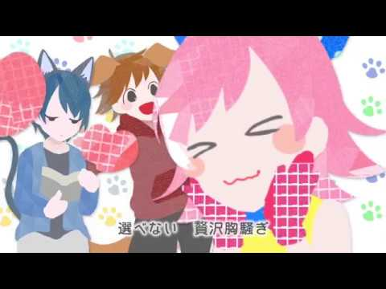
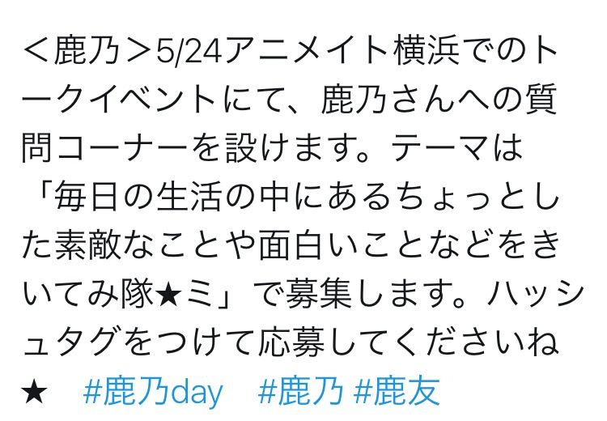

# にっ！
# 嘻！

- Published: 2017-05-20T11:56:48+0900
- Original URL: https://lineblog.me/kano/archives/13134776.html
- Wayback snapshot: 20190518011047
- Source HTML: ../data/pages/20190518011047_YR4OSTNEHAQ2ODE4UBAODOBMA2FHSIVH_lineblog.me_kano_archives_2017-05.html_p_2.html

こんにちは、鹿乃です。いよいよ来週、5/24（水）に鹿乃4thシングル「day by day」が発売されます。

大家好，我是鹿乃。终于，下周的 5/24（周三）鹿乃的第 4 张单曲《day by day》就要发售了。

先日、カップリング曲も投稿されました。

前几天，C/W 曲也已经公开了。

<iframe width="480" height="270" src="https://www.youtube.com/embed/vDaBppdt5rw?feature=oembed" title="嵌入视频" frameborder="0" allow="accelerometer; autoplay; clipboard-write; encrypted-media; gyroscope; picture-in-picture; web-share" allowfullscreen loading="lazy"></iframe>

<video controls preload="metadata" src="../media/7c59423a7e33.mp4"></video>

> [!video] YouTube
> 
>
> [播放原视频](https://www.youtube.com/watch?v=vDaBppdt5rw) · [查看网页存档](https://web.archive.org/web/20190518011047/https://www.youtube.com/watch?v=vDaBppdt5rw)
>
> [封面来源](https://i.ytimg.com/vi/vDaBppdt5rw/hqdefault.jpg)

何回聴いても自然に笑顔がでてくる元気の押し売り楽曲！（良い意味）なので、楽曲のもつパワーに負けないよう元気いっぱい＆ほんのりお姉さんぽく歌ってみました。

这是一首无论听多少次都会让人不由自主露出笑容的“元气强行推销”歌曲！（褒义）为了不输给歌曲本身的力量，我尝试用满满的元气＋微微大姐姐的感觉来演唱。

ぜひまだ聴いていない方は、シングルでるまで我慢じゃ〜の方以外は聴いてみてくださいね。

还没听过的人请务必听听看——不过打算“忍住，等单曲发售再听”的朋友除外哦。

<iframe width="480" height="270" src="https://www.youtube.com/embed/A8jUgcSgcQg?feature=oembed" title="嵌入视频" frameborder="0" allow="accelerometer; autoplay; clipboard-write; encrypted-media; gyroscope; picture-in-picture; web-share" allowfullscreen loading="lazy"></iframe>

<video controls preload="metadata" src="../media/1c89458f6db3.mp4"></video>

> [!video] YouTube
> 
>
> [播放原视频](https://www.youtube.com/watch?v=A8jUgcSgcQg) · [查看网页存档](https://web.archive.org/web/20190518011047/https://www.youtube.com/watch?v=A8jUgcSgcQg)
>
> [封面来源](https://i.ytimg.com/vi/A8jUgcSgcQg/hqdefault.jpg)

また、Twitterでも告知させていただきましたが5/24アニメイト横浜さんで開催される鹿乃初のトークイベントにて↓こんな感じ↓の募集をさせていただいています。

另外，我之前也在 Twitter 上告知过：在 5/24 于 Animate 横滨店举办的鹿乃首次脱口秀活动上，正在进行↓这样的↓征集。

[Image source](https://obs.line-scdn.net/0hTKgyyCHeC2RaACQc_5V0MxtdDQsjYxFsMHgcXi9WAUovbBxkMnoeUiBeSRFwWRxpEQ8dVw9HCDcXZ0x3bhM-fgF5FFEqRAsyJGE9Hn8FXVB0NUozY2VECioDXVVxdU01YjUWVSwD)

ぜひぜひ、ご応募ください〜(°▽°)🌸

请务必务必踊跃报名〜(°▽°)🌸

トークイベントはみんなで一緒に楽しめるあれやこれやを用意しているのですが、今から反応が楽しみだなあ。

我在脱口秀活动上准备了不少能让大家一起开心的环节，现在就开始期待大家的反应了呀。

まだ若干数、アニメイト横浜さんに参加券残っているので行きたい！という方は是非ゲットしてください！

Animate 横滨店的参加券还剩一些，想去！的朋友请务必入手！

また、サイン会に関しては東京と名古屋のイベント券は終了してしまっていますが（ありがたやあ）関西の参加券は残っているのでぜひぜひぜひ(°▽°)

另外，签售会方面，东京和名古屋的活动券已经售罄了（真是感恩啊），关西还剩有参加券，所以请务必务必务必(°▽°)

◆アニメイト三宮さん

◆Animate 三宫店

三宮店・姫路店

三宫店・姬路店

◆大阪日本橋店 5階イベントホール

◆大阪日本桥店 5 楼活动大厅

天王寺店・京橋店・大阪日本橋店

天王寺店・京桥店・大阪日本桥店

◆アニメイト京都

◆Animate 京都

京都店・梅田店

京都店・梅田店

ブックレット（歌詞カード）に直接サインのサイン会はメジャーデビュー後はじめてなので責任の重大さに震えます。

在歌词本（歌词卡）上直接签名的签售会，是我主流出道以来的第一次，责任之重大让我浑身发抖。

書いてるとき笑わせちゃダメよ！！！みんなのブックレットがキズモノになってしまう！！！ふりじゃないからね！！！

我签名的时候你们可别逗我笑！！！大家的歌词本会变成残次品的！！！我说的可不是玩笑话！！！

さてさて、告知たくさんになりましたがここからは告知とはまた違ったお話を。

好了好了，发了这么多通告，接下来想聊点跟通告不太一样的话题。

勘のいい方はタイトルでなにを書くか気付いてたのかな？笑

反应快的朋友是不是看标题就猜到我要写什么了？笑

<iframe width="480" height="270" src="https://www.youtube.com/embed/GNkPJvVEm0s?feature=oembed" title="嵌入视频" frameborder="0" allow="accelerometer; autoplay; clipboard-write; encrypted-media; gyroscope; picture-in-picture; web-share" allowfullscreen loading="lazy"></iframe>

<video controls preload="metadata" src="../media/5deac0f60979.mp4"></video>

> [!video] YouTube
> 
>
> [播放原视频](https://www.youtube.com/watch?v=GNkPJvVEm0s) · [查看网页存档](https://web.archive.org/web/20190518011047/https://www.youtube.com/watch?v=GNkPJvVEm0s)
>
> [封面来源](https://i.ytimg.com/vi/GNkPJvVEm0s/hqdefault.jpg)

今日は鹿乃メジャーデビュー2年目です。はやい…！！

今天是鹿乃主流出道两周年。好快……！！

まったく前が見えないまま、前を向いて時々下を向いてうずくまってのこのこ歩いて今日を迎えることが出来ました。

在完全看不清前方的情况下，我一边望着前方、偶尔低下头蹲一蹲，一边慢吞吞地挪着步子，就这样迎来了今天。

リリース直前のふわふわとドタバタを感じながら、ありがたいことに私は今日も歌を歌っています。

一边感受着发售前夕那种飘飘然又手忙脚乱的气氛，一边心怀感激地唱着歌——今天我也依然在唱。

応援してくれるファンのみなさま、支えてくださるスタッフのみなさま、自分に関わってくださった全てのみなさまとの出会いに感謝を！

感谢支持我的各位粉丝，感谢帮助我的各位工作人员，也感谢每一位与我相遇的人——谢谢你们出现在我的世界里！

この出会いが間違いじゃなかったと胸を張れるようにこれからも頑張っていきます。

为了将来能挺起胸膛说“这份相遇没有错”，今后我也会继续加油。

末長くよろしくお願いしますっっ

还请长长久久地多多关照呀

鹿乃
