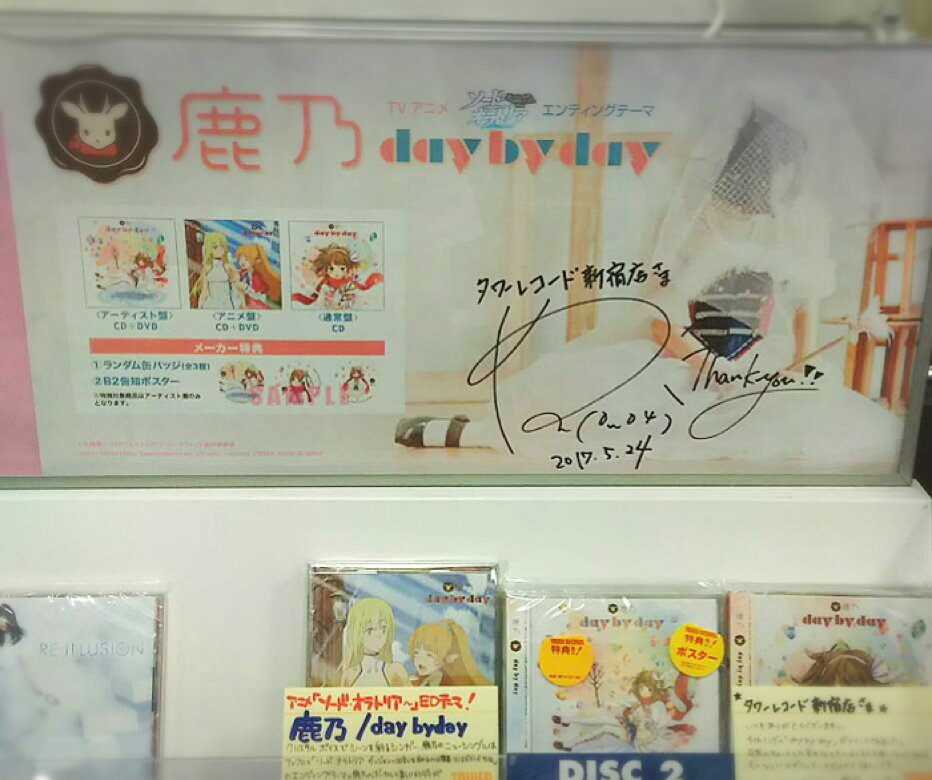
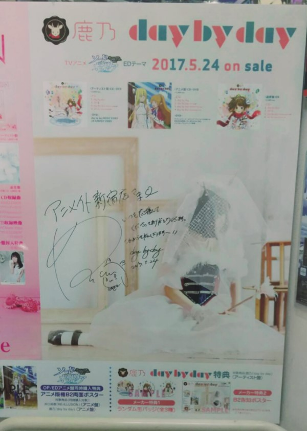
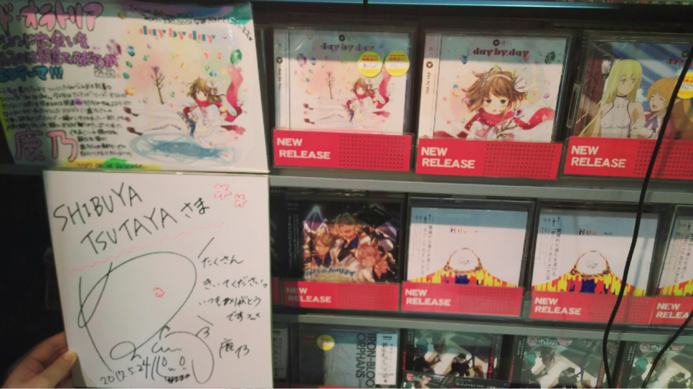
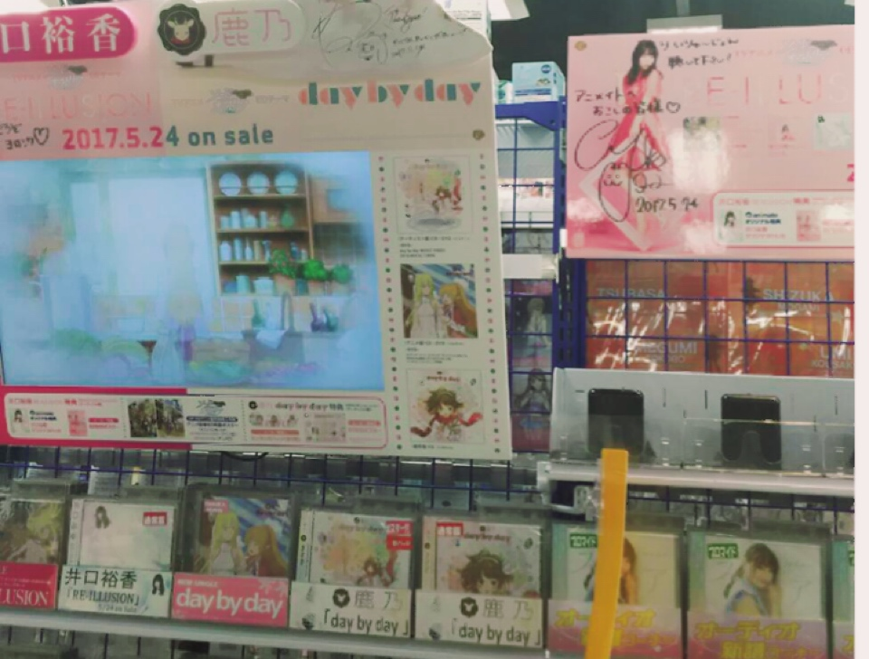
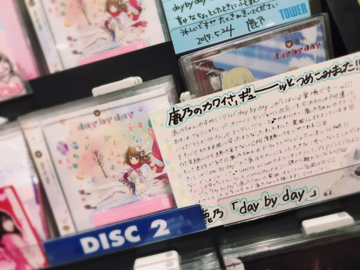

# 遂にリリース日(o^^o)②
# 终于到发售日了(o^^o)②

- Published: 2017-05-24T18:22:56+0900
- Original URL: https://lineblog.me/kano/archives/13135511.html
- Wayback snapshot: 20170907045552
- Source HTML: ../data/pages/20170907045552_4PZCMKP7AJPQJL4QXYMKSKU2UCV32YA4_lineblog.me_kano_p_2.html

こんにちは、鹿乃です！

大家好，我是鹿乃！

今日のぶんの店舗さまへのご挨拶回りが終了しました。あとは覚悟を決めてレッツトークショー

今天该拜访的店铺已经全部问候完了。剩下的就是下定决心，出发去开 Talk Show 啦

[Image source](https://parts.lineblog.me/img/emoji/line/1/00091.png)

[Image source](https://parts.lineblog.me/img/emoji/line/1/00111.png)

[Image source](https://obs.line-scdn.net/0heMjpOivOOmJXCRUgEgJFNRVUPA0uaiBqPXEtWCJfMEwiZS1iP3MvVC1XeDYlbgVTIDY3XnRoDyopfydHYxAcBjpeBlNzPQc2EjomGHIMbFZ9OXkwYm51DCBcY1p-MTg1bGh1AyUMNg)

タワーレコード新宿店さま！

Tower Records 新宿店！

いつもありがとうございます。タワーレコードさんのエプロンがすごく憧れます。昔からいいな〜〜と指をくわえつつ…ばんびちゃんのタワーレコードさん店員さんver.妄想はかどります。

谢谢你们一直以来的关照。Tower Records 的围裙让我特别向往。从小就一边眼巴巴地想着“真好啊～”……关于 ばんびちゃん 化身 Tower Records 店员的妄想根本停不下来。

[Image source](https://obs.line-scdn.net/0hIcL8YnVJFkxxQTkONU1pGzMcECMIIgxEGzkBdgQXHGIELQFMGTsDegsfVCkncAF5DEIMTBcpO3heOQZkSF5RYg5JPT9dClZjGXUkNlREQHhbcVUTTyJZIgYVQHVadhQbSiBZLFVEGw)

アニメイト新宿店さま！

Animate 新宿店！

おおきい〜〜〜〜〜〜ばんびちゃんのポスターでも動揺しますが実写だと倍の動揺がきますね(p_-)ドドドドッッ

好大呀〜〜〜〜〜〜 光是 ばんびちゃん 的海报就让我心跳加速了，看到真人版的话，冲击可是要翻倍呢(p_-)咚咚咚咚咚

ぜひ観てみてください。

请务必去看看。

[Image source](https://obs.line-scdn.net/0hXtXS7u6EB1tlKigZIpt4DCR3ATQcSR1TD1IQYRB8DXUQRhBbDVASbR90RSgPGR90DCsRfkNqIh1MTyJPASxMazZUHhcoREhwBS8sIUAvUW9PGkcOW01INRJ6XWhMX0EKXkxOPRUt)

SHIBUYA TSUTAYAさま！

SHIBUYA TSUTAYA 涩谷店！

リリースイベントで土曜日にお世話になります。緑色レベルの肌色のときしかお会いしていなかった店舗のスタッフさんと、はじめてくらいの勢いで普通の顔色でお会いできました笑

周六的发行活动上要麻烦各位了。此前每次见到这家店的店员，我的脸色都是“绿色级别”的，这次总算几乎是头一回以平常的脸色见到了他们，笑

[Image source](https://obs.line-scdn.net/0hOCNySrkVEGxzAD8uM7BvOzFdFgMKYwpkGXgHVgZWGkIGbAdsG3oFWgleUj4-Ylc_HG8bcRN3OjoIVgJ9SR8lay1CDzsrajJoBz0MFlYFRlhZMFAyR25fAgRVR1tfORI7SGFfDFNVSA)

アニメイト渋谷店さま！

Animate 涩谷店！

いつもありがとうございます(o^^o)アニメイト渋谷店さまに行く前のクレープの誘惑がすごくて震えながら通過してきました。終わりに買ってあげるよと言っていたのになかったようにスルーしたU田ディレクターさま、いつでもいいのでお待ちしてます。

谢谢你们一直以来的关照(o^^o)去 Animate 涩谷店之前，可丽饼的诱惑实在太强，我是浑身发抖着路过那家店的。U 田导演明明说过“结束之后买给你”，结果却像没这回事一样直接略过了——我随时都等着哦。

[Image source](https://obs.line-scdn.net/0hLpctZ2HfE19eDTwdA2dsCB9QFTAnbglXNHUEZStbGXErYQRfNncGaSRTUT8XRSxrJhg6RSJ2DSwaTSZ_Pm8mZgdNKA0hOw1yNxAZJXsIRWt0PVINam1cMS4MRWZ3eFUOZWtaP3hY)

タワーレコード渋谷店さま！

Tower Records 涩谷店！

いつも愛あるポップありがとうございます。本当に毎回毎回ぐっときます。お嫁に迎えにいきたいほどの丁寧さ。ぜひみんな観てみてくださいね(´；ω；\`)

谢谢你们充满爱意的 POP 宣传牌，真的每次每次都被深深打动。用心细致到让人想把它娶回家当新娘。大家也一定要去看看哦(´；ω；\`)

これからアニメイト横浜さんでトークイベントです！！いらっしゃるみなさん、よろしくお願いします！！！鹿乃からプレゼントがあるかもですよふっふっふ

接下来就是在 Animate 横滨店的脱口秀活动了！！要来的各位，请多关照！！！说不定会有鹿乃准备的礼物哦，嘿嘿嘿

鹿乃
