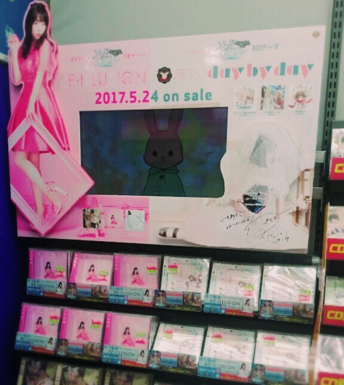
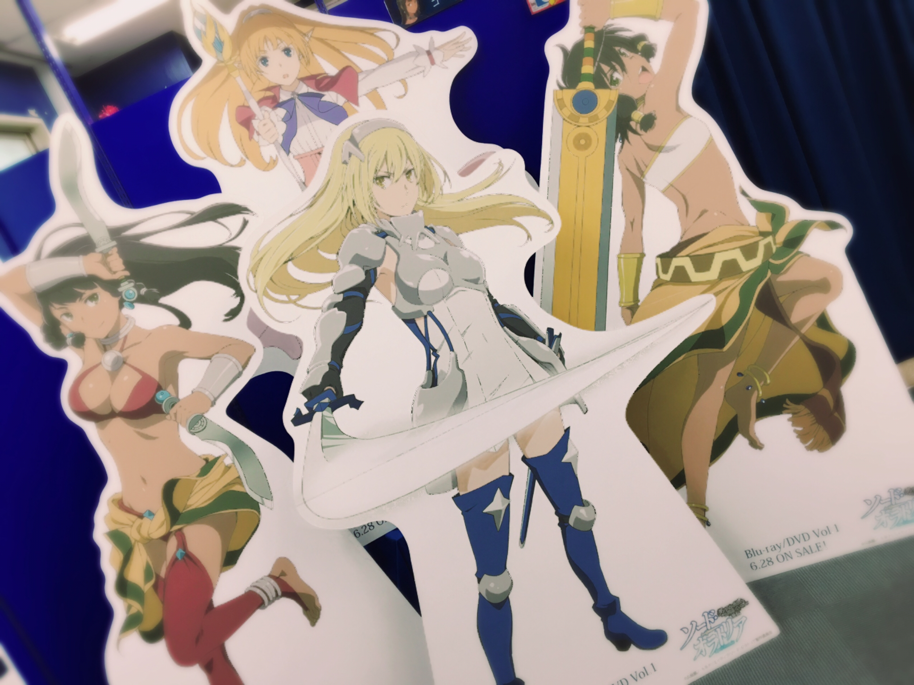
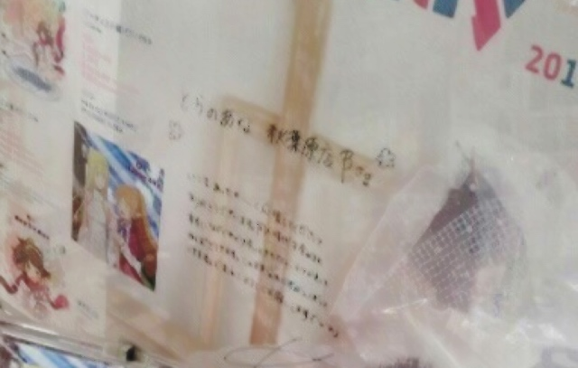
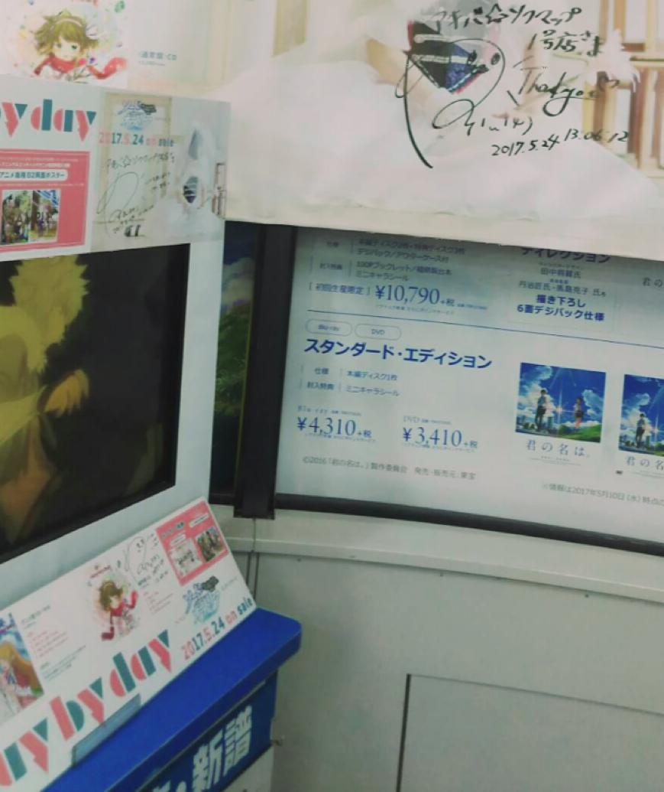
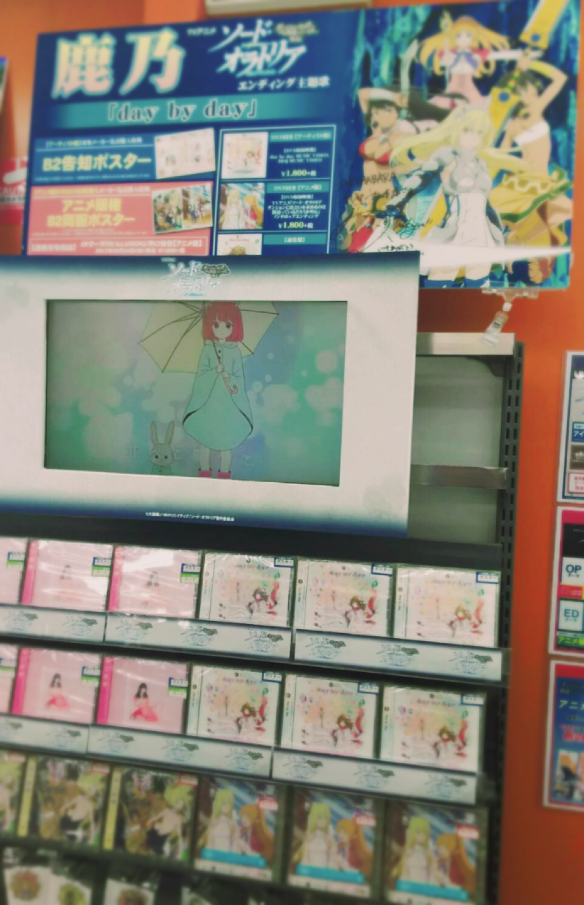
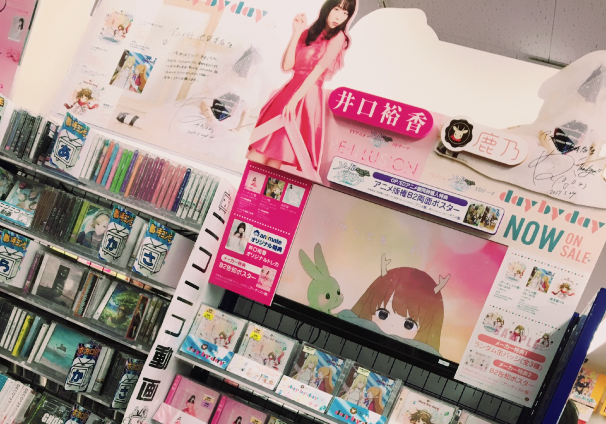

# 遂にリリース日(o^^o)①
# 终于到发售日了(o^^o)①

- Published: 2017-05-24T16:01:13+0900
- Original URL: https://lineblog.me/kano/archives/13135486.html
- Wayback snapshot: 20190517083456
- Source HTML: ../data/pages/20190517083456_IR73JBSLABX4TFJBTJFFXA33LBY6FKXO_lineblog.me_kano_archives_2017-05.html.html

こんにちは、鹿乃です。4thシングル「day by day」が本日リリースされましたっ

大家好，我是鹿乃。第 4 张单曲《day by day》今天正式发售啦

今日はお店まわりをさせていただいています。

今天在挨家拜访各家店铺。

[Image source](https://obs.line-scdn.net/0h6g6lmrg6aUgLFUYKLGkWH0lIbydydnNAYW1-cn5DY2Z-eX5IY298fnFLKwZtc14cTidma3dpXypvYV1bPgcmR1VAYHkvXVt8UTIgMi4QP3whJCgXM3MmJnsVNXgnLWsfMHQmKi4VZA)

アニメイト秋葉原店さま！

Animate 秋叶原店！

[Image source](https://obs.line-scdn.net/0hpaRY7WtTL05vIAAMTjpQGS19KSEWQzVGBVg4dBp2JWAaTDhOB1o6eBV-bRoeUy5dJjgnKUp4GgsndWFuMkYQaQJ0NjoEeS9kECc9NEoleXpFEWEaW0BgIBhycnxDEC0ZVEFgLEgiJA)

CDコーナーとは別にソード・オラトリアonlyな階が！！！必見です。かなりテンションあがりました(\*ﾟ∀ﾟ\*)

在 CD 区之外，居然有一整层楼只属于《剑姬神圣谭》！！！绝对值得一看。我兴奋得不得了(\*ﾟ∀ﾟ\*)

[Image source](https://obs.line-scdn.net/0hPlDsBy8AD0N5CiABXz5wFDtXCSwAaRVLE3IYeQxcBW0MZhhDEXAadQNUTSwnbE9JMj4ffyRDFwQNPzNqMDozIS5TWAcPOz8XHRw2OVwPWXdTO0EVQm5ALQkLVXtcOw0UQmtAIV8OUw)

とらのあな秋葉原店Bさま！

虎之穴秋叶原店 B！

CDかなりキッラキラに飾っていただいてテンション上がったので、あえてみせないパターンです笑

他们把 CD 装饰得闪闪发亮，我激动到不行，所以这次故意不给你们看，笑

ぜひみてキラキラ味わってください(o^^o)

请一定要去店里亲眼看看，好好感受那份闪闪发光哦(o^^o)

[Image source](https://obs.line-scdn.net/0hqqMz81GmLl5wAwEcUGdRCTJeKDEJYDRWGns5ZAVVJHAFbzleGHk7aApdbG8laRZ8SgMRWjZLEAUWVmoIFiA_OxVxBzYPcWpAMhAyJFUGeGpaMmAPT2NhMAdQd2tbNiwJS2JhPFAAcg)

アキバ☆ソフマップ1号店さま！

秋叶原☆Sofmap 1 号店！

写真で伝わりますかね、この高さ！！アキバ☆ソフマップ1号店さま名物脚立のぼりサイン（；゜０゜）毎回、よぼよぼしながら書かせていただいてます笑

照片里能看出这个高度吗！！这可是秋叶原☆Sofmap 1 号店有名的“爬梯子签名”（；゜０゜）每次我都得颤颤巍巍地爬上去签，笑

ぜひ観にいって高さを体感してください。

请一定去看看，亲身感受一下那个高度。

[Image source](https://obs.line-scdn.net/0hMwMK6fP7ElhwMj0aU0htDzJvFDcJUQhQGkoFYgVkGHYFXgVYGEgHbgpsUDA7YVZPCBQARBRrKxgEQzdnLjA8OiFxPw0lVxNONggFIlU3RGxaA1wHSlJdNgdhS2FaAhAPS1NdOlEyGQ)

AKIHABARAゲーマーズ本店さま！

AKIHABARA GAMERS 总店！

どどどーーーんと展開していただいてます。うひょおおとテンションあがりました(\*ﾟ∀ﾟ\*)

给我陈列得满满当当一大排，我“呜吼哦哦——”地兴奋起来了(\*ﾟ∀ﾟ\*)

OPの井口裕香さんのピンクジャケットがたくさんがお隣に並んでいるので本当にさらにさらに圧巻で目を引いちゃいます。

旁边还并排摆着许多演唱 OP 的井口裕香小姐的粉色封面专辑，所以整片展陈真的更加壮观，格外吸睛。

[Image source](https://obs.line-scdn.net/0hDMnVJR45G2JTLzQgcI5kNRFyHQ0qTAFqOVcMWCZ5EUwmQwxiO1UOVClxWSkMfh5tKCkpBxJYNwclZlk8ERdRWnN1AAkWVzlSNCIhGHYqTVZ5HlQ1aUBUDCMvQFV9Fhk1aE5UAHJ7Qg)

アニメイト池袋本店さま！

Animate 池袋总店！

毎回、本当にありがとうございます

每次真的都非常感谢你们

[Image source](https://parts.lineblog.me/img/emoji/line/1/00093.png)

[Image source](https://parts.lineblog.me/img/emoji/line/1/00111.png)

よーく見ると横にながーく展開していただいているのです。ありがたやあ(´；ω；\`)

仔细看的话，会发现展柜被横向拉得长长地铺了一整排。真是感激不尽啊(´；ω；\`)

修学旅行中の方と外国の方が多かったイメージがあり、アニメって本当に広い世代や国に広がってるんだなと感動しました。

印象中店里有很多正在修学旅行的学生和外国游客，看到动画真的传到了这么广的世代与国家，我深受感动。

さてさて、引き続きお店への挨拶は続きます。夜からはトークイベントだよーー！よろしくねっ

好啦好啦，拜访店铺的行程还在继续。晚上就是脱口秀活动了哟——！请多关照呀

鹿乃
