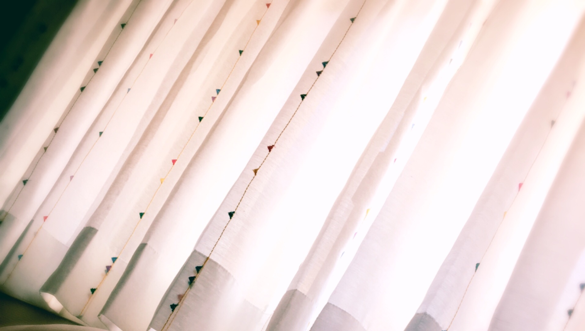

# こたえ
# 回答

- Published: 2017-07-11T12:00:00+0900
- Original URL: https://lineblog.me/kano/archives/13143678.html
- Wayback snapshot: 20190519101735
- Source HTML: ../data/pages/20190519101735_6ANFCR3JGNIHAGZKRWG6QVYLJUYAJFRN_lineblog.me_kano_archives_2017-07.html.html

こんにちは。前回のブログへのコメントありがとうございます(｀・ω・´)

大家好。谢谢大家对上一篇博客的评论(｀・ω・´)

無事にカーテンをつけることもできました。

窗帘也顺利装好啦。

[Image source](https://obs.line-scdn.net/0htZQbGsAiK3VsGwR2d4pUIi5GLRoVeDF9BmM8TxlNIVsZdzx1BGE-QxZFaSwpKxtrFDUadiJgdiYjTSpnVDsyUh1MLBsTWG8lLAUSD0kefU1HKWwkVH9kGxtOfUNFLCkiVy1lERxIcg)

ありがとうございます(\*´ー｀\*)

谢谢你们(\*´ー｀\*)

✂︎ ---------------------------------------

■血液型占いを信じるか

■你相信血型占卜吗？

占い全般は時と場合により！笑

占卜这种东西嘛，得看时机和场合！笑

■革ベルトについてる何か

■系在皮腰带上的那个东西

だ、誰か！ベルトに詳しい誰かー！

谁、谁来！有没有懂皮带的人——！

■ポケモンの世界が現実になったら？

■如果宝可梦的世界变成现实？

ぎゅってしたい。

想把它们紧紧抱住。

■血液型で相性はきまるか

■两个人合不合是由血型决定的吗？

いいことも悪いことも些細な偶然って重なるので、血液型というより確率の問題なのかな〜て思ってます(｀・ω・´)

因为不管是好事还是坏事，都是一些细小的偶然重叠在一起，所以与其说是血型，不如说是概率的问题吧〜我是这么想的(｀・ω・´)

■猛烈になにか食べたくなる原因は？

■突然特别想吃某样东西，原因是什么？

なんだろう。においとかかですかねえ？最近はカリカリ梅とシソのおいなりさんにハマってよく食べたくなります。あまじょっぱいの無限おいしすぎ有罪ループの刑おそるべし！！！笑

是什么呢。大概是气味之类的吧？最近迷上了脆梅和紫苏做的稻荷寿司，经常特别想吃。那种甜咸交织、好吃到有罪的无限循环之刑，太可怕了！！！笑

■歌はなんのためにあるか

■歌曲是为了什么而存在的？

人それぞれ、その時々かもですが、私にとっては「繋がりを感じるためのもの」なのかなあと。共感したいし、共感されたいし、共感されなくてもいいからとにかく言葉にしたいというかなんというか。寂しいから歌ったり歌を聴くのかな。あまり格好いい感情じゃないですね笑

也许因人而异，也因时而异吧。不过对我来说，歌曲或许是“用来感受人与人之间联结的东西”。想与人共鸣，也想被共鸣；就算不被理解也没关系，总之就是想把它化作语言——大概是这种感觉吧。也许正是因为寂寞，才会去唱歌、去听歌吧。这算不上什么帅气的感情呢（笑）

■買い物で迷う？

■买东西时会犹豫吗？

1500円以上からはかなり迷いに迷って買います…笑 CDと本とぬいぐるみとゲームはすぐに買っちゃうかもです笑

超过1500日元的东西，我会犹豫了又犹豫才买……笑。不过CD、书、毛绒玩具和游戏，可能会马上买下来（笑）

■作曲に挑戦したことは？

■挑战过作曲吗？

今またまさに。

现在正好在做。

■はやく走るには？

■怎样跑才能更快？

陸上選手の方はみなさん走っている姿がとてもきれいなのでフォームですかね。

田径选手们跑起来的姿势都很好看，所以大概是跑步姿势的问题吧。

■歌をはじめたきっかけは？

■开始唱歌的契机是什么？

演奏してみた動画などをみて動画投稿に興味をもったからです。

因为看了“试着演奏”之类的视频，对投稿视频产生了兴趣。

■洗濯バサミがたくさんついた物の製品名は？

■那种夹着很多晾衣夹的东西，产品名叫什么？

パラソルハンガーって言ってましたが正式はどうなんだろう汗

我一直管它叫“伞形晾衣架”，不过正式名称到底是什么呢（汗）

■炒飯最後まできれいに食べるの難しい問題

■把炒饭干干净净吃到最后一粒的这个难题

食べきりたいという強いハートです(｀・ω・´)

靠的是一颗“一定要全部吃完”的坚强的心(｀・ω・´)

■ごはんの前にお菓子食べたいの治したい！

■想改掉“饭前想吃零食”的毛病！

意志の強いハートをもつのです(｀・ω・´)なお私は負けます。KO。

要拥有一颗意志坚强的心(｀・ω・´)。不过，我是会输的。被KO。

■素麺の飽きない食べ方

■百吃不腻的素面吃法

サラダをトッピング、ラーメン風にしてみるなどおすすめです。

推荐试试把沙拉加在上面当配料，或者做成拉面风味之类的吃法。

■七夕に願いごとかきました？

■七夕，你写愿望了吗？

ツイッター短冊に書きました！笑

写在推特的许愿签上了！笑

■ノンシリコンとシリコン、どっちが頭にいい？

■无硅油和含硅油，哪个对头发更好？

イメージ的にはノンシリコンなのかなと？どうなんだろう〜〜考えたこともありませんでした。気になる！

凭印象的话，是不是无硅油比较好呢？到底怎么样呢～～我还从没想过这个问题。好在意！

■夏に外にでたくなる方法

■想让自己愿意在夏天出门的方法

恋をするのです(｀・ω・´)キリッ

去谈个恋爱吧(｀・ω・´)认真！

■最近よく聴く曲、歌手は？

■最近经常听的歌和歌手是？

目覚ましに設定されている「月曜9時のおままごと」を毎朝狂ったように何度も…笑

每天早上都会像疯了一样，把设成闹钟的《周一9点的过家家》反反复复听好多遍……笑

■宇宙に端はある？

■宇宙有尽头吗？

ないほうがいいな〜〜でもあるならどんな風か気になるな〜〜とどちらでも宇宙にはロマンがありますね！

希望没有尽头呢～～不过如果真有的话，又很在意它会是什么样子～～不管哪种，宇宙都充满浪漫呢！

■鹿角って地名知ってる？

■你知道“鹿角”这个地名吗？

実は名前だけ知ってました！鹿って漢字が目についちゃう病気です笑

其实我只知道这个名字！我得了看到“鹿”这个汉字就会不由自主注意到的病（笑）

以上、突発的な七夕企画でした(=´∀｀)🌠

以上，就是这次临时起意的七夕特别企划(=´∀｀)🌠

コメントありがとうございました。

谢谢大家的评论。

また来年〜〜

明年再见～～

鹿乃
