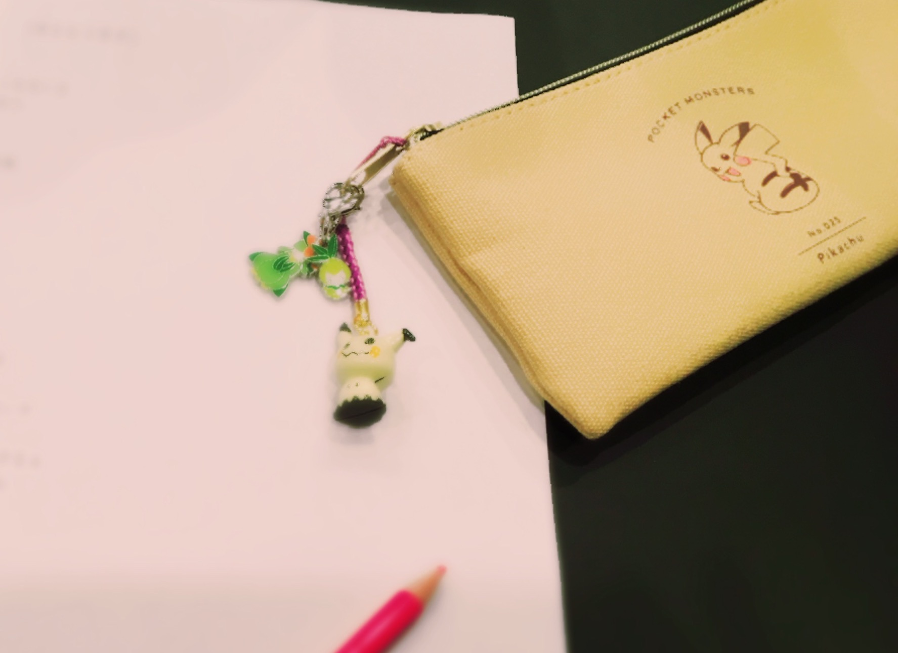
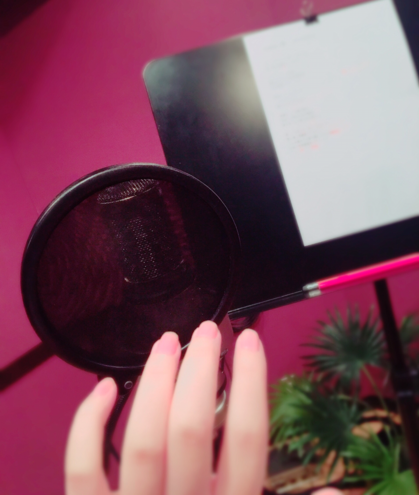

# ◯◯の秋
# ◯◯的秋天

- Published: 2017-09-05T12:00:59+0900
- Original URL: https://lineblog.me/kano/archives/13152253.html
- Wayback snapshot: 20190520222352
- Source HTML: ../data/pages/20190520222352_B6JKP7TTDKJQCVRPGSQNK5HA2N6N2R6R_lineblog.me_kano_archives_2017-09.html_p_2.html

[Image source](https://obs.line-scdn.net/0hAxIJ_X5WHld0MzGdmENhADZuGDgNUARfHksJbQFlFHkBXwlXHEkLYQ5tXDQGcC0EKBc5MhdaGhwRUQp2TBwyQy1nPAZYBB57IyIZLVE3QWJdBF8FQFRROQNjQmRfBBwATwEBMFgzRg)

レコーディングの秋(°▽°)❤︎

录音的秋天(°▽°)❤︎

[Image source](https://obs.line-scdn.net/0hdwVo-b_ZO1hrFhSShy5EDylLPTcSdSFQAW4sYh5AMXYeeixYA2wubhFIeQMmQn1yAnkkQCtFMTY4ZgBdFjJ8fxEQETQ6WTtRMwIoIk4SZG1CIXoJUHJ0NhxGZ2pELzkPUCQkP0cSMg)

がおがお(「・ω・)「ｶﾞｵｰ

嗷呜嗷呜（「・ω・)「吼——

あとは最近よく映画を観たりしています。

另外，我最近也经常看看电影什么的。

映画の秋！

电影的秋天！

鹿乃のおすすめは「インターステラー」

鹿乃推荐的是《星际穿越》

ハンカチを用意してみてね(；ω；)

记得备好手帕再看哦(；ω；)

zzz…

鹿乃
