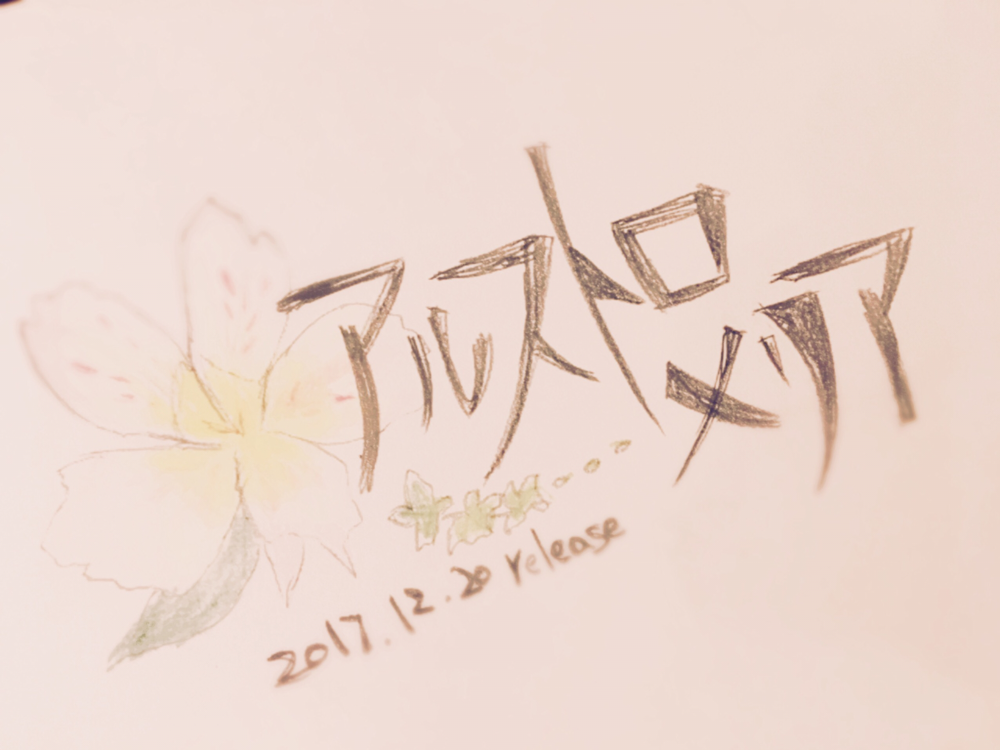
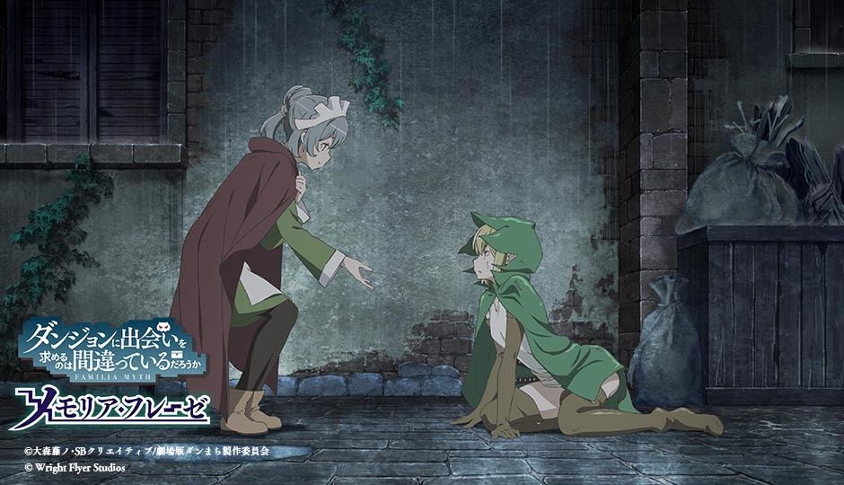

# 2ndアルバム「アルストロメリア」リリース決定！
# 第二张专辑《六出花》发售决定！

- Published: 2017-09-29T18:43:31+0900
- Original URL: https://lineblog.me/kano/archives/13155711.html
- Wayback snapshot: 20190518181657
- Source HTML: ../data/pages/20190518181657_4OOVOUXAQ4R2ANBWP6LKX6RKGPFERXTG_lineblog.me_kano_archives_2017-09.html.html

[Image source](https://obs.line-scdn.net/0h5Pnlgd2Van9TFUXWUtoVKBFIbBAqdnB3OW19RSZDYFEmeX1_O29_SSlLKCQtUWZ-G3MnciJySDh8dUVbFRNaHixicxh3XXVpGjhMBXYRNUh5IykgaHYlESRAMkt5JmgoaXJ1G3QcPQ)

こんばんは、鹿乃です٩( ᐛ )و

晚上好，我是鹿乃٩( ᐛ )و

2ndアルバムのリリースが発表されました。

第二张专辑的发售消息公布啦。

アルバムタイトルは

专辑的名字是

アルストロメリア

《六出花》

2017.12.20       発売

2017.12.20       发售

花びらに足跡のような模様がついているのが特徴的なお花の名前からとりました🐾

专辑名取自一种花的名字，那种花的花瓣上带有类似足迹的纹路🐾

1stアルバム「nowhere」から約一年半ぶりのリリースとなります。私と、私のそばにいてくれるみんなのこれまでと、これからの足跡はどうペタペタされているのか？いくのかな？

这是距第一张专辑《nowhere》约一年半后的新专辑。我和一直陪伴在我身边的大家，迄今为止的足迹会被怎样一步步印下呢？今后的足迹又会走向何方呢？

これまでの軌跡を信じて制作がんばりますᕦ(ò_óˇ)ᕤ

我会相信一路走来的轨迹，努力完成这张专辑的ᕦ(ò_óˇ)ᕤ

[Image source](https://parts.lineblog.me/img/emoji/line/1/00670.png)
アルバム詳細情報

专辑详细信息

> [!link] 2017年12月20日(水）2ndアルバム「アルストロメリア」発売決定 -鹿乃 Warner Bros. Home Entertainment Official Website-
>
> [打开原始链接](http://whv-amusic.com/kano/sp/news/index00640000.html) · [查看网页存档](https://web.archive.org/web/20190518181657/http://whv-amusic.com/kano/sp/news/index00640000.html)

[Image source](https://parts.lineblog.me/img/emoji/line/1/00670.png)
店舗さまごとの特典情報

各店铺的特典信息

> [!link] 2ndアルバム「アルストロメリア」法人特典 -鹿乃 Warner Bros. Home Entertainment Official Website-
>
> [打开原始链接](http://whv-amusic.com/kano/sp/news/index00650000.html) · [查看网页存档](https://web.archive.org/web/20190518181657/http://whv-amusic.com/kano/sp/news/index00650000.html)

今日、大型アップデートされた「ダンジョンに出会いを求めるのは間違っているだろうか〜メモリア・フレーゼ〜」の新主題歌「Ivy」もアルバムに収録されます。

今天迎来大型更新的《在地下城寻求邂逅是否搞错了什么～记忆憧憬～》的新主题曲《Ivy》也会收录进专辑里。

[Image source](https://parts.lineblog.me/img/emoji/line/1/00670.png)
ダンメモ公式サイト

记忆憧憬官方网站

> [!link] ダンまち〜メモリア・フレーゼ〜（ダンメモ）
> 
>
> [预览图来源](http://danmemo.com/img/ogimage.jpg)
>
> シリーズ累計800万部を突破したダンまちのゲーム最新作『ダンジョンに出会いを求めるのは間違っているだろうか～メモリア・フレーゼ～』。原作のストーリーに加えてここだけで楽しめる大森藤ノ先生完全監修のオリジナルストーリーを、豪華声優陣のフルボイスで彩る本格RPG！遂にリリース！
>
> [打开原始链接](http://danmemo.com/) · [查看网页存档](https://web.archive.org/web/20190518181657/http://danmemo.com/)

[Image source](https://parts.lineblog.me/img/emoji/line/1/00670.png)
ダンメモのyoutube チャンネル

记忆憧憬的YouTube频道

> [!link] ダンメモ【公式】
> 
>
> [预览图来源](https://yt3.ggpht.com/-T0r4ioaZXOI/AAAAAAAAAAI/AAAAAAAAAAA/4HS6J3UmlHE/s900-c-k-no-mo-rj-c0xffffff/photo.jpg)
>
> スマホゲームアプリ「ダンまち～メモリア・フレーゼ～」（通称：ダンメモ）の公式チャンネルが遂に開設！！ ダンメモや原作のダンまちシリーズに関連する様々な番組や動画を配信していきます。 是非チャンネル登録をして、最新情報やここだけの番組を御覧ください！ ◆ダンまち情報局オラジオＺ◆ レフィーヤ役の木村珠莉さんと、ティ...
>
> [打开原始链接](https://m.youtube.com/channel/UCK7W088EfNcdOy2Ks9UfsFg) · [查看网页存档](https://web.archive.org/web/20190518181657/https://m.youtube.com/channel/UCK7W088EfNcdOy2Ks9UfsFg)

タイトル画面で楽曲流れるのすごくドキドキします。TVとは違ったドキドキ感…！！

自己的歌会在标题画面响起，真的超级紧张。是和电视上不一样的那种心跳加速感…！！

アルバムもゲームもよろしくお願いしますっ

专辑和游戏，都请大家多多关照啦！

鹿乃
