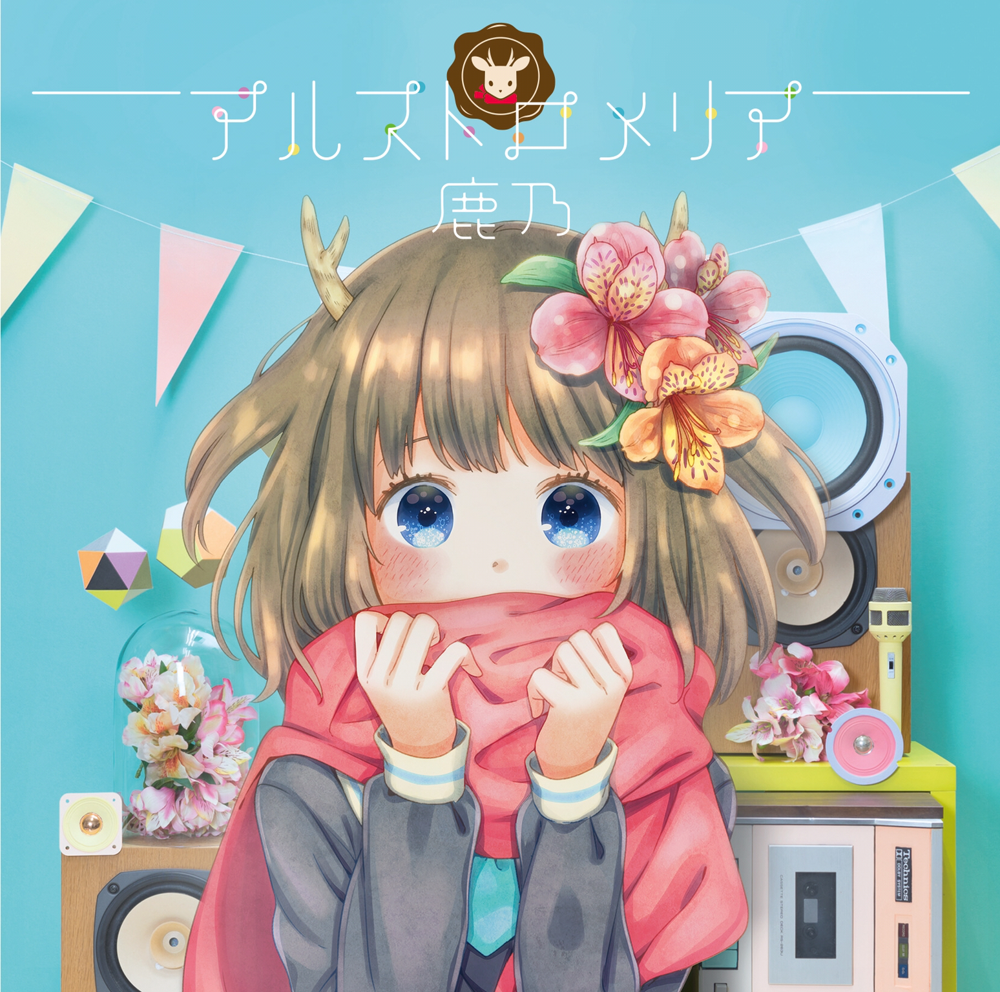
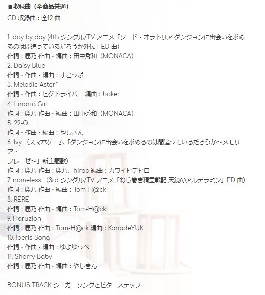
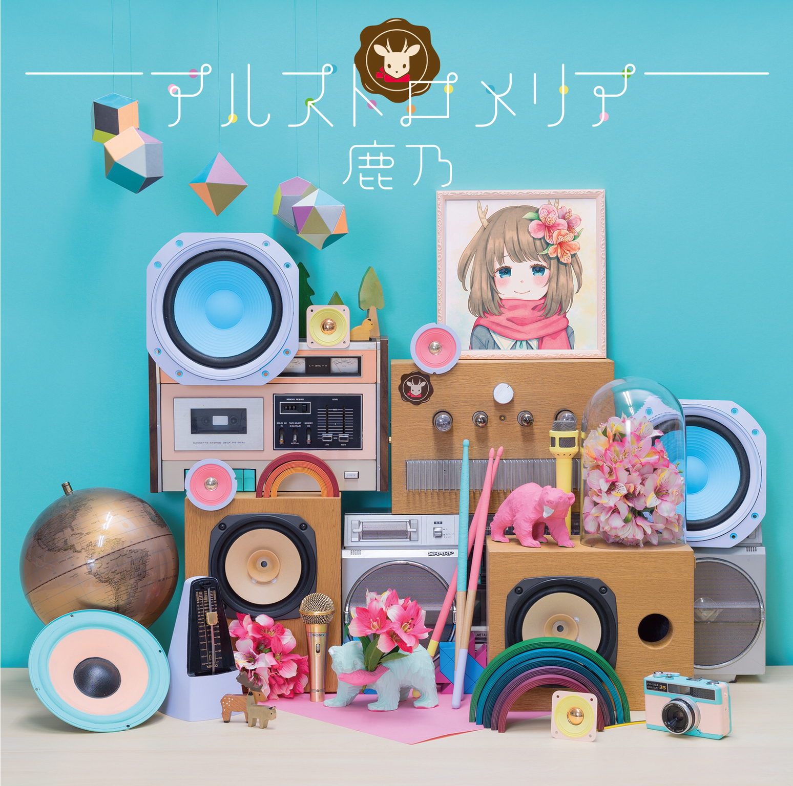

# ✴︎アルバム＆3rdライブ✴︎
# ✴︎专辑＆3rd Live✴︎

- Published: 2017-11-01T18:53:12+0900
- Original URL: https://lineblog.me/kano/archives/13160105.html
- Wayback snapshot: 20190518114331
- Source HTML: ../data/pages/20190518114331_IZOFDG2D4R2LQAUKZ2FZJWQNTCYGYATO_lineblog.me_kano_archives_2017-11.html.html

[Image source](https://obs.line-scdn.net/0hWBt0w0YPCG1JSSfzEO13OgsUDgIwKhJlIzEfVzwfAkM8JR9tITMdWzMXSi0DDzpmD1AFdSgMVSoSAUhfLy4UUDwSJl06ET8yDWwCF2xNV1VgeUw-dytHAz4eVVhmeQo6cy1DDT8dVA)

2ndアルバム「アルストロメリア/鹿乃」の追加情報が解禁されました！

第二张专辑《六出花／鹿乃》的追加情报解禁啦！

[Image source](https://obs.line-scdn.net/0hxQuDXVSyJ35IPQjgEhVYKQpgIRExXj12IkUwRD1rLVA9UTB-IEcySDJjZUsgXz5UBAAyQCVley8wbD5cJBo4GG9EEg45cWFrIystBG05eEZhDWIpfV1oEDg8ek9sCyUpcllsHjk6Lg)

この人が作る曲が大好きなの〜〜！！！て、方々に2ndアルバムでも楽曲提供していただくことができました。

“这个人写的曲子我超喜欢～～！！！”——这次第二张专辑，也成功拜托到了这位来提供歌曲。

どんな曲か曲名から色々想像してお楽しみにしてください(｀・ω・´)

歌是什么样子的，大家先看着曲名尽情想象，敬请期待哦(｀・ω・´)

[Image source](https://obs.line-scdn.net/0h3zbdsDsJbFVfHUPLBrkTAh1AajomfnZdNWV7bypLZnsqcXtVN2d5YyVDLgQUKnMHaj9ISDxJam17f35UE3hdVT4aMQZ2VUpLaiciL3oZM212LSgGYX8jOy8eMGBzJW4CZXknNSlJMA)

また、リリースイベント情報も発表されました！

另外，发售活动的情报也公布啦！

＜鹿乃＞
本日発表しました
2ndアルバム「アルストロメリア」
発売記念イベント

＜鹿乃＞
今天公布了
第二张专辑《六出花》
发售纪念活动

詳細を画像にて送ります。
しっかり保存していただき…皆様のご参加、お待ちしております！！！[#鹿乃](https://twitter.com/hashtag/%E9%B9%BF%E4%B9%83?src=hash&ref_src=twsrc%5Etfw) [pic.twitter.com/CZX1ny96rc](https://t.co/CZX1ny96rc)
— ＜ワーナー ブラザース＞アニメチーム (@wb_anime) [October 27, 2017](https://twitter.com/wb_anime/status/923870439750828032?ref_src=twsrc%5Etfw)

详细内容会以图片的形式发送。请大家务必好好保存……期待大家的参加！！！[#鹿乃](https://twitter.com/hashtag/%E9%B9%BF%E4%B9%83?src=hash&ref_src=twsrc%5Etfw) [pic.twitter.com/CZX1ny96rc](https://t.co/CZX1ny96rc)
— 华纳兄弟动画组 (@wb_anime) [October 27, 2017](https://twitter.com/wb_anime/status/923870439750828032?ref_src=twsrc%5Etfw)

握手🤝トーク🎤お渡し💌サイン✏️

握手🤝对谈🎤亲手递交💌签名✏️

各種様々なイベントが盛りだくさん！

各种各类的活动超级丰富！

ご都合よろしければぜひ遊びにきてくださいねっ

如果时间方便的话，请一定来玩哦！

さ   ら   に

而且！

＜鹿乃＞
本日解禁④!!!
12月20日発売 2ndアルバム「アルストロメリア」
このアルバムを携え、ライブツアー開催決定!!!

＜鹿乃＞
今天解禁第④弹!!!
12月20日发售 第二张专辑《六出花》
将带着这张专辑举办巡回Live，现已决定!!!

年末年始は鹿乃づくし！[#鹿乃](https://twitter.com/hashtag/%E9%B9%BF%E4%B9%83?src=hash&ref_src=twsrc%5Etfw) [pic.twitter.com/DcktPjXQ7V](https://t.co/DcktPjXQ7V)
— ＜ワーナー ブラザース＞アニメチーム (@wb_anime) [November 1, 2017](https://twitter.com/wb_anime/status/925529075896156160?ref_src=twsrc%5Etfw)

年末年初全是鹿乃！[#鹿乃](https://twitter.com/hashtag/%E9%B9%BF%E4%B9%83?src=hash&ref_src=twsrc%5Etfw) [pic.twitter.com/DcktPjXQ7V](https://t.co/DcktPjXQ7V)
— 华纳兄弟动画组 (@wb_anime) [November 1, 2017](https://twitter.com/wb_anime/status/925529075896156160?ref_src=twsrc%5Etfw)

3rdライブ開催決定しました(｀・ω・´)✴︎

第3次Live确定举办啦(｀・ω・´)✴︎

>>訂正<<

>>更正<<

先着はLINE公式ブログ会員→

先到先得的是LINE官方博客会员→

鹿乃のLINE公式アカウントを友達登録！

请把鹿乃的LINE官方账号加为好友！

が正しいです。後日HP側も修正されると思います。混乱させてしまいごめんなさい！！

这才是正确的。官网那边之后应该也会更正。把大家搞糊涂了，真的非常抱歉！！

年末年始、本当に本当にどれだけイベント盛りだくさんにするつもりだ〜〜というくらいイベントが盛りだくさんですね。どれか一つでも都合がつきそうなもの、興味がありそうなものがありましたらこの機会にぜひ遊びにきてください！

年末年初的活动真的多到让人想问“到底打算办多少场活动啊～～”的程度呢。哪怕只有一场时间合适、或让你感兴趣的活动，也请趁这个机会一定要来玩！

#鹿友

ハッシュタグをツイッターで使用していただくと、お友達ができたり情報を調べやすくなったりすると思います(｀・ω・´)

在推特上使用这个标签的话，应该能交到朋友，查信息也会更方便哦(｀・ω・´)

鹿乃をきっかけに、鹿乃のことだけじゃなくて気の合うお友達や趣味や夢やとにかく楽しい何かを見つけてもらえたら本望です。

如果大家能以鹿乃为契机——不只是关于鹿乃的事，还能找到合拍的朋友、爱好、梦想，总之能发现什么快乐的东西，我就心满意足了。

ようやく、一昨日アルバム制作の山場を乗り越えてホッと一息つきました。最近、宣伝ばかりでごめんなさいでした！呟くことが録音、録音、寒い、歌詞ィ、録音！しかなくて笑

前天终于跨过了专辑制作最关键的关口，松了一口气。最近只顾着宣传，真是抱歉！因为能发的内容，除了“录音、录音、好冷、歌词啊、录音！”以外就没有别的了（笑）

今日から少しずつまたアルバムやライブのこと以外に呟いていけたらいいなと思っています。文鳥とポケモンのことがメインになりそう！！

希望从今天起，除了专辑和Live之外，还能慢慢发些别的东西。感觉主要内容会变成文鸟和宝可梦！！

なんのアカウントかわからなくなっちゃいますね笑

都快搞不清这是个什么账号了呢（笑）

では、今日はここらへんで！

那么，今天就到这里吧！

みんなの明日が幸せでありますように。

愿大家的明天都充满幸福。

鹿乃
