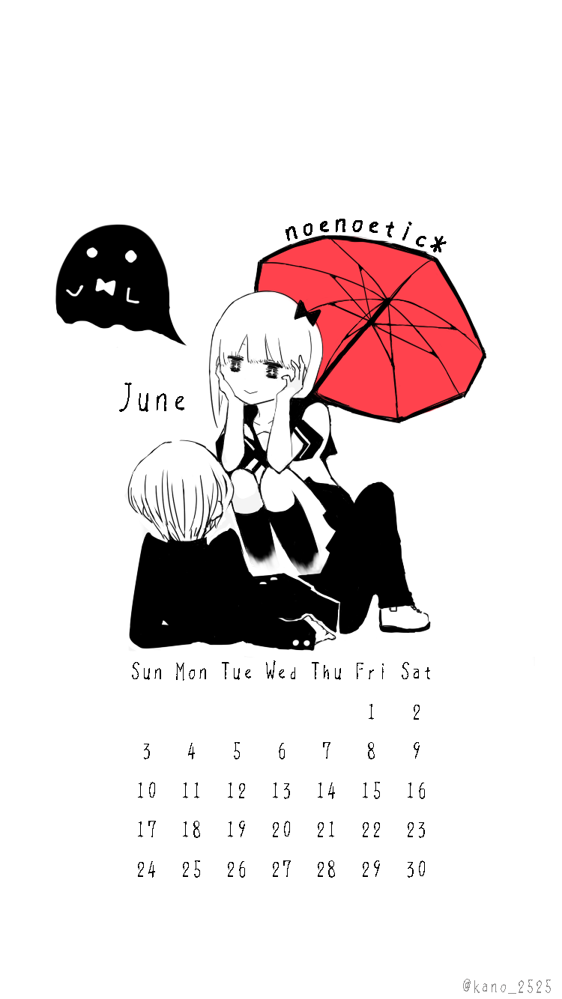
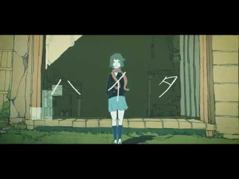
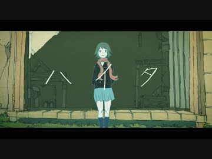
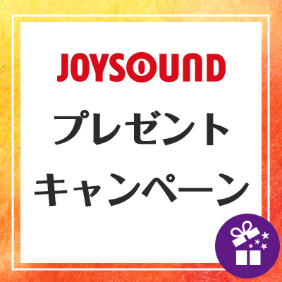

# (*´-`)つ プレゼント
# (*´-`)つ 礼物

- Published: 2018-06-18T17:10:00+0900
- Original URL: https://lineblog.me/kano/archives/13189337.html
- Wayback snapshot: 20180721073317
- Source HTML: ../data/pages/20180721073317_VZ75P3LZEPPTBSFT4HXUT7DP4VPI2VEQ_lineblog.me_kano.html

「好きすぎて死んじゃいそう」

“喜欢得快要死掉了”

[Image source](https://obs.line-scdn.net/0hBBDCLJf8HW15OjAszYRiOjtnGwIAWQdlE0IKVwxsF0MMVgptEUAIWwNkXysxVx1DQiMQeQ87FAUcWTlnEC4zUl16PA0GAjxAFl4WF1w-QFVXDV88RVxSAw5pQVVRDR86TFtRX11vSw)

イラストにも本格的に手をだしはじめてみました(*´-`)6月も半ば過ぎですがカレンダーにしてみたので使ってください。

我也开始正儿八经地尝试画插画了(*´-`)6月虽然已经过半，不过我把它们做成了日历，大家拿去用吧。

好きすぎると相手には重く、

喜欢得太过火，对对方来说就成了负担，

好きすぎるあまり相手を嫌いになりやすく、

喜欢过头了，反而容易变得讨厌对方，

不安定なカップルな感じ

一副不安定的情侣的感觉

対人関係のバランスって難しいですよね

人际关系的分寸，真的很难把握呢

人類みな平等って嘘だと思います

我觉得“人人平等”是骗人的

だからみんな必死に生きているんだもの

所以大家才会拼命地活着呀

少なくとも私はまだまだ

至少我自己，还远远

クールには生きられないや

活不成那种潇洒酷酷的样子啊

ちなみにどうでもいい情報ですが、

顺带一提，一个无关紧要的情报，

個人的に心の中で

我个人在心里，

黒いおばけちゃんは「バケる」

管黑色的小幽灵叫“バケる”

女の子は「バケ子」

女孩子叫“バケ子”

男の子は「男」て呼んでます。

男孩子则叫“男”。

<iframe width="480" height="270" src="https://www.youtube.com/embed/y-bPf-6OHws?feature=oembed" title="嵌入视频" frameborder="0" allow="accelerometer; autoplay; clipboard-write; encrypted-media; gyroscope; picture-in-picture; web-share" allowfullscreen loading="lazy"></iframe>

<video controls preload="metadata" src="../media/abe8cd8c894a.mp4"></video>

> [!video] YouTube
> 
>
> [播放原视频](https://www.youtube.com/watch?v=y-bPf-6OHws) · [查看网页存档](https://web.archive.org/web/20180721073317/https://www.youtube.com/watch?v=y-bPf-6OHws)
>
> [封面来源](https://i.ytimg.com/vi/y-bPf-6OHws/hqdefault.jpg)

> [!link] ハイタ　歌ってみた【鹿乃】
> 
>
> [预览图来源](http://tn.smilevideo.jp/smile?i=33381499.L)
>
> ハイタ　歌ってみた【鹿乃】 [歌ってみた] 「多数決は絶対なの」ルワンさまの御本家動画様（動画：Waboku さま制作のご本家動画をお借りしてい...
>
> [打开原始链接](http://www.nicovideo.jp/watch/sm33381499) · [查看网页存档](https://web.archive.org/web/20180721073317/http://www.nicovideo.jp/watch/sm33381499)

久しぶりに動画を投稿しました。曲よし、動画よし、最高〜〜！な、この曲にまだ出会えてなかった方々に私をキッカケに知ってもらえたら嬉しいです。

好久没投稿视频了。歌也好、画面也好，太棒了〜〜！这首歌，还没听过它的朋友们，如果能因为我而认识它，我会很开心的。

ああ〜〜もうやだ〜〜面倒くさ〜〜いと投げやりになってるのに、淡い期待や寂しさから全て捨てきれなくて弱い、そんなイメージをして脳内で演じながら歌いました。あくまで脳内。できるできない関係なく、毎回楽曲のもつ物語や物語にでてくるキャラクターの想像は大事にしています。

明明已经自暴自弃地想着“啊啊〜〜烦死了〜〜好麻烦〜〜”，却因为一丝淡淡的期待和寂寞，没办法把一切彻底舍弃——我抱着这样软弱的想象，在脑海里一边演绎一边唱了出来。纯粹是脑内演绎。不管唱得好不好，每次我都会认真去想象歌曲里蕴藏的故事，以及故事中登场的角色。

多感な学生時代、常にちょっぴり息苦しかったなあ。今もかな？ただ生きてくだけなら今よりいージーモードなのに、目標をもったり期待したり集団行動しないといけない場面で人目ばかり気にして凹んだり、欲深いばかりにヒーーーンなります。

多愁善感的学生时代，总觉得一直有一点点喘不过气。现在大概也还是吧？明明光是活下去的话，比现在要轻松容易得多，可一旦有了目标、有了期待，或者在不得不参与集体行动的场合，就会总在意别人的眼光而失落，又因为欲望太多而忍不住“呜——”地难受起来。

みんなもなったりするのかな？

大家是不是也会这样呢？

自分以外みんな無敵に幸せにみえちゃうや。

总觉得除了自己，其他人都看起来无敌幸福呢。

> [!link] アーティストトピックス - アーティストからの素敵なプレゼントも！？
> 
>
> [预览图来源](https://www.joysound.com/web/src/s/campaign/777/img/ogp.jpg)
>
> アーティストからの素敵なプレゼントも！？
>
> [打开原始链接](https://www.joysound.com/web/s/campaign/777/index) · [查看网页存档](https://web.archive.org/web/20180721073317/https://www.joysound.com/web/s/campaign/777/index)

また、こちらのイベントに参加させていただいています。ガチな私物をプレゼントします🎁

另外，我还参加了这边的活动，会送出货真价实的私人用品🎁

ぜひ参加してね♡♡♡

大家一定要来参加哦♡♡♡

鹿乃

追記:

追记：

こちらのブログ実は昨夜書いたもので、朝起きてTVをつけてびっくりしました。なので追記という形で失礼いたします。

其实这篇博客是昨晚写好的，今早起来一打开电视，吓了一跳。所以就以追记的形式补上几句，失礼了。

関西方面にお住まいの方大丈夫でしょうか？不安な気持ちかと思います。万が一にそなえつつ、なかなか難しいかもしれませんがほんの少しでも自分のためにホッとする時間を作ってもらえたらなと思います。ずっと不安だと気持ち悪くなってきたり疲れはてちゃったりするので。どうかみなさんご無事で。

住在关西一带的朋友们还好吗？我想大家一定很不安吧。虽说要做好万全的防备并不容易，但还是希望大家能为自己留出哪怕一点点安心的时间。一直处在不安里，人会难受起来，也会精疲力竭的。请大家都一定要平安无事。
